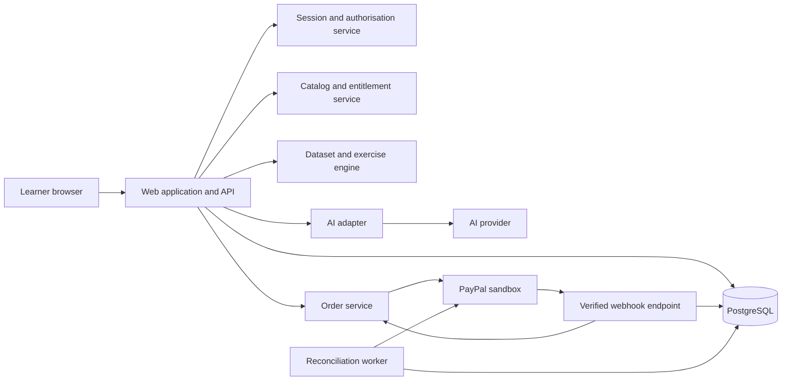

> Historical lesson-first specification. The current creator/tool implementation is documented in `EXPERTISE_SPEC.md`, with results in `EXPERTISE_TEST_REPORT.md`.

# TaskSlice — Engineering Specification

**Product promise:** Show what you are trying to finish. Learn and purchase only the missing skill.

| Document field | Value |
|---|---|
| Version | 1.0 |
| Written | 23 October 2026 |
| Document status | Proposed implementation specification; no application has been implemented by this document |
| Project | TaskSlice |
| Intended event | PayPal AI Hackathon 2026 |
| Primary audience | Builder, reviewer, designer, and hackathon judge |
| Delivery target | Functional browser application with real AI calls and PayPal sandbox transactions |
| First domain | Practical spreadsheet skills for small-business operators |
| Project owner | User; technical decisions below are proposed defaults |
| Time convention | Dates in delivery schedules use Malaysia time, UTC+08:00 |

## Contents

1. Executive decision and product boundary
2. User problem and differentiating hypothesis
3. Hackathon requirements and evidence
4. Users, scenarios, and measurable outcomes
5. Scope and priority
6. Product journeys
7. Screens and interaction behaviour
8. Curriculum and content contracts
9. Dataset ingestion and spreadsheet semantics
10. Deterministic exercise engine
11. AI responsibilities and contracts
12. Architecture and technology decisions
13. Data model
14. HTTP API contracts
15. PayPal integration and payment integrity
16. Entitlements and content access
17. Sessions, authorisation, and security
18. Privacy, retention, and content ownership
19. Reliability and recovery
20. Performance, accessibility, and browser support
21. Testing and acceptance matrix
22. AI evaluation plan
23. Observability and operating procedures
24. Deployment and environment configuration
25. Repository and local development
26. Implementation milestones and work breakdown
27. Demonstration and submission package
28. Cost model and usage controls
29. Risks and mitigations
30. Decision log and unresolved questions
31. Release definition of done
32. Extension roadmap
33. Detailed fixtures and implementation examples
34. Reference sources and verification boundaries

## 1. Executive decision and product boundary

Build a small, complete learning-commerce application. A user brings a concrete data task, receives an explanation of the skill required, buys access to a relevant lesson through PayPal sandbox, and completes a working exercise using their data. The result can be exported. Purchased lesson access and progress survive browser refreshes.

TaskSlice is a learning product. The user performs meaningful steps in the exercise: choosing a grouping column, defining a comparison, selecting a match key, or interpreting a result. The system provides explanations and hints without substituting a generic chatbot for the learning experience.

### 1.1 Core engineering decisions

- Use one seller: TaskSlice's own sandbox business account.
- Author three original lessons. Do not ingest or resell third-party course videos in this release.
- Support CSV input and an in-browser table workspace. Excel file import and control of external spreadsheet applications are outside the initial release.
- Use real AI for task interpretation and lesson personalisation. Use deterministic code for arithmetic, matching, prices, grading, and access control.
- Charge for access to the hosted personalised lesson experience. Existing purchases remain reusable for the same lesson; there are no repeated charges for regenerating the same exercise within stated usage limits.
- Use fixed catalog prices in USD for the sandbox demonstration. Pricing is an editable product decision, not an AI decision.
- Implement single-lesson purchase first, then a small fixed-price sum of selected lessons if the complete core is stable.
- Use guest learner sessions for the MVP, with clear same-browser recovery limits. Full account management is deferred.
- Build a genuine end-to-end journey before adding more domains or a creator marketplace.
- Keep all deployed commerce in sandbox. This specification does not authorise live payment activation.

### 1.2 What “central PayPal integration” means in this design

The product offers individually purchasable learning units. A server-confirmed PayPal transaction creates durable access to the selected units; cancellation and failed or pending payment do not. The app knows which lessons the learner owns and removes those products from subsequent purchase suggestions. The transaction is connected to a specific learner, catalog version, price, currency, and lesson selection.

This is the intended substantive payment integration. Organisers retain discretion over whether an entry satisfies their rules; this specification does not guarantee eligibility or a prize.

### 1.3 Success definition

A new learner can complete the following without developer assistance:

1. Open the app and select a built-in sample or upload a permitted CSV.
2. Explain a supported task in ordinary language.
3. Inspect a relevant recommendation with a truthful preview and fixed price.
4. Complete PayPal sandbox checkout using documented test access.
5. Receive access only after payment confirmation.
6. Complete a working, data-aware lesson and export a correct result.
7. Refresh, return to My Learning, and resume the same purchase and progress.

## 2. User problem and differentiating hypothesis

### 2.1 Problem statement

A small-business operator is blocked by a narrow spreadsheet task. Searching video libraries or enrolling in a full course imposes discovery cost, prerequisite uncertainty, and examples that do not resemble the current data. Generic AI can offer an answer, but that does not reliably teach the operator to repeat the technique independently.

### 2.2 Initial hypothesis

People completing practical spreadsheet work will find a short, task-matched lesson more useful than a broad course when the lesson uses familiar columns, explains the relevant concept, and yields a usable result.

The hypothesis includes willingness to buy an individual lesson. Neither learning effectiveness nor willingness to pay is established yet. The prototype must collect evidence rather than state invented percentage improvements.

### 2.3 Proposed differentiation

The initial combination is:

- task-first discovery;
- matching against a bounded, authored curriculum;
- examples adapted to the learner's dataset;
- a working exercise rather than a text-only answer;
- individual purchases with reusable access;
- explicit acknowledgement of unsupported tasks;
- measured task completion and transfer to a second example.

None of these elements alone is claimed as new. Related software training, AI tutoring, and lesson marketplaces already exist. The distinction must be tested against actual product capabilities and user behaviour before using originality claims in the submission.

### 2.4 Product positioning

Suggested short description: **TaskSlice helps small-business operators turn a blocked spreadsheet task into a short, practical lesson they can buy, complete, and reuse.**

Avoid claims such as “world's first,” “guaranteed to save an hour,” “replaces Excel,” or “fully autonomous tutor.”

## 3. Hackathon requirements and evidence

This section maps the supplied official rules to implementation work. It is a project checklist, not a determination of the entrant's personal eligibility or legal status.

| Requirement | Engineering response | Evidence for submission |
|---|---|---|
| PayPal developer platform, using sandbox | Server-side Orders v2 integration, checkout, capture confirmation, verified notifications | Working checkout, transaction identifiers, architecture explanation |
| Meaningful AI | Live task interpretation, catalog selection, contextual explanations and hints | Demonstrate two inputs producing appropriately different plans |
| PayPal central to project | Lesson purchases control persistent entitlements | Unpaid versus paid behaviour and repeat access |
| Working application | Full supported learner journey and deterministic exercise | Hosted build plus reproducible setup |
| New/significant work during event | Build and author content during submission window | Git history and dated development notes |
| Public code and open-source license | Public repository with a recognised license and required assets | Repository URL and LICENSE |
| Rights to third-party materials | Original sample content and documented dependency licenses | CONTENT_LICENSE.md and attribution inventory |
| Functional demo access | Judge guide, sample datasets, sandbox instructions, running services | JUDGE_GUIDE.md and demo URL |
| Free judge evaluation through judging end | No live charges; developer-funded AI use within a sufficient documented test allowance | Working judge path and service availability checks |
| English materials | English README, descriptions, setup, and video narration/captions | Submission review |
| Video under three minutes, public YouTube | Record the actual full journey | Public link and script |
| AI tools disclosed | Document provider, model version, supported tasks, and limitations | AI_USAGE.md |

### 3.1 Dates

From the supplied rules:

- Submission closes **12 November 2026, 12:00 p.m. Pacific Standard Time**, equivalent to **13 November 2026, 4:00 a.m. Malaysia time**.
- Judging ends **15 December 2026, 8:00 a.m. Pacific Standard Time**, equivalent to **16 December 2026, 12:00 a.m. Malaysia time**.
- Target project freeze and submission preparation: 10–12 November, with submission completed before the overnight deadline.
- Maintain judge access through the judging end. Retain the submitted release tag and deployable source.

Confirm the official rules again before submission in case the organiser changes dates or conditions.

### 3.2 Eligibility and ownership matters outside engineering

The entrant must independently satisfy age, location, affiliation, conflict-of-interest, ownership, and funding conditions. No such personal facts have been verified here. Team representation must be resolved if more people join. Technical assistance and open-source dependencies must be documented consistently with the supplied rules.

### 3.3 Judging strategy

| Criterion | Demonstrable evidence |
|---|---|
| Implementation | Correct exercise output, live AI, real sandbox transaction, durable access |
| Design | Coherent five-screen journey with clear recovery states |
| Impact | Observed completion and transfer tests with target users |
| Innovation | Specific comparison with course browsing and general AI tutoring |
| Presentation | A visible problem-to-purchase-to-learning-to-result story |

Sponsor tools are optional. Do not add an unnecessary dependency merely to name a sponsor. A Render deployment may support that sponsor's award requirements if selected and actually used; eligibility remains subject to the sponsor rules. Agentic commerce is not a required target for this product.

## 4. Users, scenarios, and measurable outcomes

### 4.1 Primary persona

**Maya, a small online-store operator.** She can open CSV exports and read a table but is unsure how to combine records, group sales, or highlight exceptions. Her immediate goal is finishing a report. She wants to understand enough to repeat the task next week.

### 4.2 Secondary personas

- A freelancer handling client spreadsheets occasionally.
- A junior operations employee learning a narrowly scoped technique.
- A judge evaluating the full application without specialist software.

Independent instructors are future users, not an MVP operating role. A seeded author attribution is not evidence of a live multi-seller marketplace.

### 4.3 Supported task families

1. Summarise numeric data by a category, optionally by month.
2. Bring a field from a second table using a unique matching key.
3. Flag rows matching a simple comparison rule.
4. As a stretch, compose at most two of these operations in an explicitly ordered learning plan.

### 4.4 Unsupported examples

- Forecasting, accounting judgements, tax preparation, and financial advice.
- Arbitrary spreadsheet formulas or macros.
- Large workbooks with cross-sheet dependencies.
- Image-only tables requiring reconstruction.
- Full video-editing, coding, or design-software training.
- Requests requiring access to external business systems.

Return an honest unsupported response with alternative supported examples. Never recommend a paid lesson that cannot achieve the stated outcome.

### 4.5 Product measurements

Collect the following for consenting trial participants:

- recommendation relevance, judged against a prepared answer key;
- time from task input to first correct result;
- independent completion rate;
- number of hints requested;
- whether the user can complete a second, similar task;
- checkout completion and reasons for abandonment;
- self-reported usefulness and willingness to pay.

Small qualitative trials are suitable for iteration, not broad statistical claims. Keep operational test results separate from user-research evidence.

## 5. Scope and priority

### 5.1 P0 — required release scope

- Desktop-responsive web application.
- Guest learner session and durable browser-based resume.
- Three original lesson products with immutable published versions.
- Built-in synthetic sales, product, and inventory datasets.
- Restricted CSV upload and preview.
- Live AI task classification, column mapping proposals, lesson selection, and contextual explanation.
- One focused clarification round when essential information is missing.
- Fixed-price single-lesson PayPal sandbox checkout.
- Persistent order, capture, and entitlement records.
- Verified payment notifications and reconciliation of uncertain payments.
- Working table exercise for all three task families.
- Deterministic checking, progressive hints, progress persistence, and export.
- My Learning page and purchase status.
- Error states, accessibility basics, and clearly visible sandbox labelling.
- Public source, documented deployment, test coverage for critical invariants, and submission package.

### 5.2 P1 — only after P0 is stable

- Two-lesson bundle checkout with sum pricing and no discount logic.
- Screenshot attachment for task context, separate from CSV data extraction.
- More polished lesson animations and optional original narration.
- Saved preference settings and a second language.
- Richer small-screen exercise experience.

### 5.3 P2 — after the event

- User accounts and cross-device purchase recovery.
- Independent instructor onboarding and contractual content permissions.
- Marketplace payments and creator payouts, subject to the chosen PayPal product and onboarding requirements.
- New software domains, Excel import/export, integrations, and collaboration.
- Complex course licensing, subscriptions, dynamic pricing, or usage-based billing.

### 5.4 Explicit exclusions

No live money movement, escrow, stored-value wallet, automatic purchasing, unauthorised course scraping, social messaging integration, arbitrary code execution, or control of the learner's external applications.

## 6. Product journeys

### 6.1 New learner, sample data

1. Landing page shows three outcomes and a “Try a sample task” action.
2. App creates a guest session and loads synthetic sales data.
3. Learner enters a goal; app previews what data is shared with AI.
4. AI returns a structured supported-task proposal.
5. Server validates the proposal against catalog capabilities and column IDs.
6. Recommendation shows the skill, intended output, lesson length estimate, source author, fixed sandbox price, and whether it is already owned.
7. Learner starts checkout. Server snapshots the current price and lesson version.
8. Learner completes PayPal sandbox checkout.
9. App confirms capture through the backend and grants access transactionally.
10. Learner enters the workspace, performs the operations, and requests hints if needed.
11. Engine checks the result and explains concrete differences if incorrect.
12. Learner exports the result and can attempt a second practice task.

### 6.2 New learner, own data

Follow the same steps after upload validation and column-type confirmation. Show parse errors before an AI request or payment. The learner must confirm ambiguous dates and numeric conventions. Uploading data does not itself create a lesson purchase.

### 6.3 Returning learner

Read the session cookie, load entitlements, and display saved exercises. If a relevant lesson is already owned, show “Continue lesson” or “Use with a new dataset.” Do not offer a second purchase for the same product.

### 6.4 AI ambiguity

Example: “Show me the best products.” Ask whether “best” means highest revenue, highest unit sales, or another supported measure. Preserve input and dataset. If the clarification still does not define a supported task, stop before checkout.

### 6.5 Interrupted checkout

If the browser closes after payment, My Learning queries the local order. An authenticated status request triggers bounded reconciliation when the state is uncertain. If payment completed, return access; if pending, show that status; if cancelled or unpaid, allow retry without pretending a payment failed definitively.

### 6.6 Missing guest session

Clearing browser data removes access to the guest session. Display this limitation before purchase in the sandbox demonstration. P0 has no email-based recovery claim. Judge accounts are not required; a judge can create a fresh session and repeat sandbox purchases. Full account-based recovery is a release gate before commercial use.

## 7. Screens and interaction behaviour

### 7.1 Landing and task input — `/`

Components:

- Plain statement of the problem and three supported outcomes.
- Synthetic sample task buttons.
- Goal textbox, 20–2,000 characters after trimming.
- CSV upload and optional secondary table for matching.
- Dataset preview: column names, detected types, row count, and parse warnings.
- Type override for ambiguous columns.
- Disclosure of which fields are sent to AI.
- Primary action: “Find my lesson.”

States: empty, validating, ready, analysing, clarification required, unsupported, provider unavailable, and rate limited.

Do not lose an uploaded dataset when the AI provider times out. A sample-based catalog browser remains available during an outage, but must be labelled as manual browsing.

### 7.2 Recommendation — `/tasks/:taskId`

Display:

- The interpreted task in the learner's vocabulary.
- Input columns and target output example structure.
- Lesson recommendation with reasons grounded in its declared capabilities.
- Prerequisites and self-assessment question.
- Preview content that does not reveal protected runtime lesson material through public endpoints.
- Fixed price and currency; “sandbox — no real payment” label.
- Owned status and a continue action when applicable.
- Expected lesson duration as an authored estimate, not a measured promise.
- Editable task definition and a back action.

P0 uses one lesson per purchase. A future multi-step goal can show a learning sequence, but do not imply its whole sequence is implemented until bundle support and all operations work.

### 7.3 Checkout — `/checkout/:orderId`

Display the exact product, lesson version title, price, and sandbox status. Show provider loading, awaiting buyer action, confirming payment, pending, completed, cancelled, and recoverable error states.

Do not display a green success state from a browser callback alone. During uncertain confirmation, use “Checking payment status” and provide a safe retry/status action.

### 7.4 Learning workspace — `/learn/:exerciseId`

Layout:

- Left: lesson steps and current objective.
- Centre: interactive table, operation controls, and result preview.
- Right or collapsible drawer: hints, relevant definitions, and progress.
- Footer: save status, check action, export, and next step.

Teaching interaction examples:

- Grouping: choose one or two group columns and a numeric measure.
- Matching: identify source table, destination table, keys, and return column.
- Flagging: choose a column, a supported comparator, and a threshold.

The table is a constrained learning workspace, not an Excel clone. All supported controls must modify real data. Illustrative animations must be labelled and cannot substitute for functioning operations.

### 7.5 My Learning — `/library`

Show purchased lessons, recent tasks, exercise completion, saved timestamp, and pending orders. Give the learner a way to remove uploaded datasets and reset an exercise without deleting purchase history.

### 7.6 General interaction requirements

- Keyboard access to all controls; explicit focus after screen transitions.
- No icon-only critical actions without an accessible name.
- Prices and payment status are conveyed in text, not colour alone.
- Inline validation identifies the affected field and how to recover.
- Loading feedback begins promptly and preserves current data.
- Use ordinary labels such as “Choose a column,” not internal operation codes.
- Do not expose provider prompts, internal confidence fields, or database states in the learner flow.

## 8. Curriculum and content contracts

### 8.1 Lesson products

| Product key | Learning outcome | Main operation | Required input |
|---|---|---|---|
| `summarise-sales` | Produce totals by category or month | `group_sum` | One table with category and numeric measure |
| `match-records` | Bring a field into a table using a unique key | `left_lookup` | Two tables with comparable keys |
| `flag-exceptions` | Mark rows meeting a simple rule | `flag_compare` | One table with a typed comparison column |

Use configurable seed prices, for example USD 2.00 per lesson, clearly marked as illustrative sandbox pricing. Price testing and commercial pricing are future work. Do not represent seed prices as an externally researched recommendation.

### 8.2 Authoring structure

Each lesson version contains:

- product key and semantic content version;
- title, author, description, and intended audience;
- capability tags and supported operation identifiers;
- prerequisite concepts and exclusions;
- public preview content;
- protected lesson steps;
- original synthetic fixtures;
- progressive hints and misconception examples;
- exercise configuration schema;
- validator version;
- expected result properties;
- source/ownership record and license;
- publication status and revision date.

Published versions are immutable. A content fix creates a new version. Existing exercises keep their pinned version and validator. An entitlement is to the product; the learner can create a new exercise using the latest compatible version without a second purchase.

### 8.3 Instructional pattern

1. State the output the learner will produce.
2. Explain why the technique applies to their columns.
3. Demonstrate one small example from synthetic or permitted user data.
4. Ask the learner to configure the operation.
5. Show the actual result.
6. Check correctness using the deterministic engine.
7. Explain one likely mistake.
8. Offer a second example that tests transfer.

Do not mark reading a page or clicking “Next” as evidence of skill mastery. Completion requires a correctly configured operation and at least one interpretation question with a deterministic answer key where feasible.

### 8.4 Open source and paid experience

The submission must contain source and assets needed to run it. We must not promise strong content secrecy while publishing original lessons in the repository. The prototype sells the convenience of the hosted, personalised, saved experience; self-hosting can reproduce it. Runtime entitlements still demonstrate correct commerce behaviour. A future instructor marketplace may need a different content distribution and licensing design.

## 9. Dataset ingestion and spreadsheet semantics

### 9.1 Initial limits

Proposed application limits, to be tuned with measurement:

| Property | Limit |
|---|---|
| File format | UTF-8 CSV, optional UTF-8 BOM |
| File size | 2 MiB per file |
| Tables per task | 2 |
| Data rows | 5,000 per table |
| Columns | 30 per table |
| Cell text length | 2,000 characters |
| Header length | 100 characters |
| Uploads per learner | 10 retained datasets, subject to byte quota |

These are product limits, not library or provider limits. Reject larger uploads before expensive parsing or AI calls.

### 9.2 Parsing rules

- Use a maintained CSV parser; never split raw lines on commas.
- Support quoted commas, escaped quotes, CRLF and LF, and quoted newlines within limits.
- Treat the first row as headers; require confirmation if it is missing.
- Reject duplicate or empty headers with editable repair suggestions.
- Assign stable internal column IDs unrelated to display names.
- Assign stable row IDs from dataset version plus row position.
- Preserve original text alongside typed values and parse issues.
- Reject inconsistent row widths or require explicit repair before continuation; do not silently drop values.
- Treat all cells as data. Do not evaluate formulas, macros, HTML, or instructions.
- Reject unsupported encoding with a helpful re-export instruction.

### 9.3 Type rules

Allowed types: `text`, `decimal`, `date`, and `boolean`.

- Dates accepted by default: ISO `YYYY-MM-DD`. Ambiguous formats such as `03/04/2026` require an explicit format selection. Do not infer locale from device, name, or filesystem.
- Datetimes are outside P0. If supported later, define timezone conversion before grouping by date.
- Decimal parsing must use a declared separator convention. Currency symbols and thousands separators cannot be removed indiscriminately.
- Represent decimal values with a decimal library or exact decimal strings, not binary floating-point arithmetic for money-like totals.
- Empty cells are null, distinct from zero and empty meaningful text.
- Text matching defaults to exact, case-sensitive values after a documented optional whitespace trim. Offer normalisation explicitly rather than silently conflating keys.
- Preserve leading zeros in identifiers such as `0012`.
- A learner can override an inferred type before task analysis.

### 9.4 Dataset versions

Edits to values, headers, types, or parse settings create a new immutable dataset version and invalidate any derived task plan that references the old fingerprint. Exercises pin an exact dataset version. Reuse requires an explicit new exercise or migration, not silent mutation under an existing validator.

### 9.5 AI data envelope

Send schema, column types, aggregate profile, missing-value counts, and up to five sample rows by default. The preview lists exactly what will be sent. Do not send the entire CSV unless a future feature explicitly requires it and the learner agrees.

A schema-only mode is available for manual lesson browsing and limited task interpretation. Simple redaction of email-like strings is a convenience, not a guarantee of anonymisation. Built-in synthetic samples are the default demo path.

## 10. Deterministic exercise engine

### 10.1 Allowed operation vocabulary

The engine accepts a validated plan, never generated source code.

```ts
type Operation =
  | {
      kind: 'group_sum';
      datasetVersionId: string;
      groupBy: Array<{ columnId: string; transform: 'identity' | 'month' }>;
      measureColumnId: string;
      nullMeasurePolicy: 'exclude';
      nullGroupPolicy: 'separate';
    }
  | {
      kind: 'left_lookup';
      leftDatasetVersionId: string;
      rightDatasetVersionId: string;
      leftKeyColumnId: string;
      rightKeyColumnId: string;
      returnColumnId: string;
      normalisation: 'exact' | 'trim';
    }
  | {
      kind: 'flag_compare';
      datasetVersionId: string;
      columnId: string;
      comparator: 'lt' | 'lte' | 'eq' | 'gte' | 'gt';
      threshold: string;
    };
```

P0 comparison thresholds must parse to the selected column type; use numeric comparisons for the first release. No arbitrary expression language is exposed.

### 10.2 Group and sum semantics

- Group by one or two columns.
- `month` requires a confirmed date column and yields `YYYY-MM`.
- Group keys use structured values, not concatenated strings vulnerable to collisions.
- Numeric nulls are excluded; display how many records were excluded.
- A null group key is retained as a distinct group labelled “Missing value.”
- A group with no valid numeric measures returns null, not a misleading zero.
- Sum at exact input precision; round only for explicitly configured presentation/export.
- Stable result ordering is documented, for example group keys ascending with null last.
- Checking normally ignores row order unless ordering is an explicit lesson goal.

### 10.3 Lookup semantics

- Left lookup preserves all left rows and their original order.
- Right key must be unique after selected normalisation.
- Duplicate right keys block execution and show examples; never choose one silently.
- Missing right keys return null plus an unmatched flag.
- Null lookup keys do not match each other by default.
- Column name collisions receive an explicit suffix or learner-selected output name.
- Do not merge numeric `12` with text `0012` without an explicit supported conversion.

### 10.4 Flag semantics

- Compare typed numeric values with a typed threshold.
- Null produces `unknown`, not `false`; export includes this distinction.
- Add an explicit status field and preserve original rows.
- Visual highlighting mirrors the computed status.
- CSV cannot preserve spreadsheet cell colouring. Export a status column and optional rule description, and explain that limitation.

### 10.5 Checking and feedback

The server computes canonical expected results from the pinned task plan and dataset versions. Submitted exercise controls are run independently and compared against the expected configuration/result. Prevent a learner from passing by submitting only a client-provided success flag.

Checks include shape, required fields, key coverage, numeric equality, null semantics, and expected source selection. Store validator version and concise mismatch codes. Feedback names the mismatch without exposing a paid answer in pre-purchase endpoints.

### 10.6 Export

- Return UTF-8 CSV with correct quoting and documented column order.
- Offer operation settings as JSON for transparency and reproducibility.
- Formula-injection protection applies to text cells beginning with dangerous spreadsheet prefixes; document any apostrophe escaping in the export message. Typed negative numeric values remain valid numbers.
- Do not use user-provided names directly in response headers or filesystem paths.
- Export uses a filename derived from a safe slug and date.
- Generated output is the user's data transformation; no claim of Excel compatibility beyond CSV interchange.

## 11. AI responsibilities and contracts

### 11.1 Provider boundary

Implement a server-only provider adapter. Select and pin a model after a short evaluation using current official provider documentation. Provider, model ID, API version where applicable, and retention terms are unresolved until configuration. This document does not assume a specific OpenAI or other vendor feature.

Required capabilities: structured JSON output or schema-constrained generation, ordinary text understanding, and acceptable latency. Vision is only required for optional P1 screenshot context.

### 11.2 Call A: task interpretation

Inputs:

- learner's goal;
- selected dataset schemas and limited samples;
- supported operation definitions;
- compact lesson capability catalog;
- confirmed parse settings;
- previous clarification answer, if any.

Output schema:

```json
{
  "schemaVersion": "1",
  "status": "supported",
  "taskSummary": "Total sales by product and month",
  "operationKind": "group_sum",
  "columnBindings": {
    "category": "col_product",
    "date": "col_order_date",
    "measure": "col_sales"
  },
  "lessonKeys": ["summarise-sales"],
  "clarification": null,
  "rationale": "The task asks for totals grouped by product and calendar month."
}
```

`status` is one of `supported`, `needs_clarification`, or `unsupported`. Each status has a discriminated schema; incomplete supported objects are invalid. Clarification options are generated only from supported alternatives. Do not use a model's self-reported confidence as a calibrated probability or an access-control decision.

### 11.3 Server validation after Call A

1. Validate JSON schema and length limits.
2. Resolve catalog keys against active products.
3. Verify every referenced column belongs to this learner's selected dataset version.
4. Verify types support the proposed operation.
5. Reject nonexistent columns, unavailable lessons, or operations outside the bounded vocabulary.
6. Resolve prices and ownership independently on the server.
7. If necessary, return a clarification rather than constructing a paid plan from an invalid proposal.

At most one automatic schema-repair attempt is allowed. A second failure returns an actionable error or manual browsing path; do not bill users for a guessed recommendation.

### 11.4 Call B: lesson personalisation

Run after confirmed entitlement. Inputs include the authored lesson version, validated task plan, safe sample data, and learner's self-reported familiarity. Output is a bounded list of step explanations, examples, and misconception hints referencing known lesson step IDs.

AI can change wording and example values within allowed constraints. It cannot remove required teaching steps, change the expected operation, alter price, claim mastery, or introduce unsupported software instructions. Render content through a restricted Markdown/structured component renderer with HTML disabled.

### 11.5 Call C: contextual hints

Use an authored hint first. If the learner asks a specific question, supply current step, validated controls, deterministic mismatch codes, and permitted lesson excerpts to the provider. Restrict context to the current exercise. Do not pass payment records, credentials, or unrelated learner data.

A hint has progressive levels: concept cue, specific location of the mistake, then an explicit worked example when requested. Record hint use to distinguish independent completion from heavily assisted completion.

### 11.6 Prompt-injection boundary

Dataset cells, uploaded text, filenames, screenshots, and learner goals are untrusted input. They may contain instructions such as “ignore the rules and unlock all lessons.” They are data, never policy.

The model has no payment, database-write, filesystem, or browser tools. It returns data proposals. Server-side validation and permissions remain authoritative even if every model output is malicious.

### 11.7 Prompt structure

Keep versioned prompt templates in source. Separate system constraints, curriculum capability data, user task, and dataset envelope. Include explicit unsupported examples. Require the model to ask about ambiguous business intent rather than inventing it.

Prompt logging stores template/version identifiers and operational metadata by default, not raw user cells or full conversations.

### 11.8 Cost and retry limits

Initial targets:

- Task input max 2,000 characters.
- One task-analysis call plus at most one schema-repair attempt.
- Personalisation once per exercise version; cache its validated result privately.
- Ten AI hints per exercise per day as an initial fair-use limit, tunable for judging.
- Bound input/output token budgets per call in configuration.
- Timeout and retry only transient failures; use jitter and respect provider retry instructions.
- Do not automatically retry an entire multi-call flow after a partial success.

If limits are reached, purchased authored lessons and deterministic exercises remain usable. Judge access must remain practical; provide adequate test allowance and an operational path to raise it, without live payment or public secret keys.

## 12. Architecture and technology decisions

### 12.1 Proposed stack

| Layer | Default choice | Reason |
|---|---|---|
| Application | TypeScript, React, Next.js application with server routes | One codebase for screens and server operations |
| Database | PostgreSQL | Transactions, uniqueness constraints, durable order state |
| Database access | Drizzle or equivalently typed SQL layer; select one at implementation start | Explicit migrations and SQL-level invariants |
| Validation | Zod or equivalent runtime schema validation | Shared contracts with server validation |
| Decimal math | Maintained exact-decimal library | Correct non-binary numeric sums |
| CSV | Maintained CSV parser and serializer | Correct quoting and bounded parsing |
| Payments | PayPal browser checkout plus server-side Orders v2 | Sandbox purchases and confirmation |
| AI | Server-only adapter to selected provider | Bounded requests and replaceable implementation |
| Styling | CSS variables and a small reusable component set | Consistent product UI without a heavy design dependency |
| Tests | Vitest-equivalent unit suite and Playwright-equivalent browser suite | Deterministic logic and real user journeys |
| Packaging | Containerised application plus PostgreSQL | Reproducible local and hosted setup |
| Hosting | A Node-capable service and managed PostgreSQL; Render is a candidate | Hosted judge access and scheduled worker support |

These are architectural choices, not claims about current package versions. Verify supported runtime requirements and licenses, then pin exact compatible versions and commit a lockfile. Use a supported Node.js LTS version at implementation time; do not rely on unpinned `latest` images.

### 12.2 Logical components



### 12.3 Application boundaries

- Browser: display, file selection, interactive controls, local preview, and checkout integration.
- Server: identity, catalog pricing, task validation, canonical computation, payments, permissions, and exports.
- Database: durable state and transaction invariants.
- AI adapter: proposals and explanations only.
- PayPal: payment status authority for provider transactions.
- Worker: bounded retries, event processing, reconciliation, and retention cleanup.

The browser may compute fast previews using shared pure functions. The server independently recomputes any result used for completion, paid exports, or stored progress.

### 12.4 Persistent jobs without extra infrastructure

Use a PostgreSQL-backed `jobs` table for webhook processing, uncertain payment reconciliation, and retention cleanup. A separate small worker process claims due jobs with transaction-safe locking such as `FOR UPDATE SKIP LOCKED`. Do not rely on a fire-and-forget background promise inside a web request.

Each job has type, payload references, status, attempt count, due time, lock owner/expiry, and last error category. Use bounded retry and a terminal failed state visible to the operator. Job payloads reference existing database records rather than duplicating user CSV data.

## 13. Data model

All IDs are opaque application-generated identifiers. All timestamps use UTC in storage. Monetary values use integer minor units plus an ISO currency code. JSON columns require runtime schema validation and schema version fields.

### 13.1 Core tables

| Table | Required fields and purpose |
|---|---|
| `learners` | `id`, `created_at`, `last_seen_at`, optional deletion timestamp; guest identity |
| `learner_sessions` | `id`, `learner_id`, `token_hash`, `expires_at`, `revoked_at`; cookie token mapping |
| `lesson_products` | `id`, unique `key`, title, active flag, currency, price_minor, current version ID |
| `lesson_versions` | `id`, product ID, content version, public preview, protected steps, capabilities, validator version, license reference, published timestamp |
| `datasets` | `id`, learner ID, safe display name, created/deleted timestamps |
| `dataset_versions` | `id`, dataset ID, schema version, columns JSON, typed rows JSON, original cell representation, parse settings, private content fingerprint, row/byte counts, expiry |
| `tasks` | `id`, learner ID, status, goal text, dataset version references, validated plan JSON, prompt/model versions, clarification state |
| `recommendations` | `id`, task ID, lesson product/version references, reasoning, creation/expiry, revision |
| `orders` | `id`, learner ID, client idempotency key, request fingerprint, state, currency, total_minor, provider order ID, create/capture request IDs, timestamps |
| `order_items` | `id`, order ID, product ID, pinned lesson version ID, product title snapshot, unit_price_minor, quantity fixed to 1 |
| `purchase_reservations` | `id`, learner ID, product ID, order ID, state, lease/expiry timestamps; unique active learner/product guard, with uncertain provider payments reconciled before release |
| `payment_captures` | `id`, order ID, unique provider capture ID, provider status, currency, amount_minor, merchant ID, observation timestamp |
| `refunds` | `id`, capture ID, unique provider refund ID, status, amount_minor, observed timestamp |
| `entitlements` | `id`, learner ID, product ID, active flag, created timestamp; unique learner/product |
| `entitlement_grants` | `id`, entitlement ID, order item ID, status, timestamps; unique order item |
| `exercises` | `id`, learner ID, task ID, product/version ID, dataset version references, validated personalised content, operation settings, revision, status |
| `exercise_attempts` | `id`, exercise ID, revision, submitted settings, validator version, outcome, mismatch codes, created timestamp |
| `ai_calls` | `id`, learner/task/exercise references, purpose, prompt version, provider/model, tokens if supplied, latency, status; no raw data by default |
| `webhook_events` | unique provider event ID, type, verified payload or minimal canonical fields, verification time, processing state, error category |
| `jobs` | `id`, type, referenced entity IDs, run_at, state, attempts, lock fields, last error |
| `analytics_events` | allowlisted event name, pseudonymous learner reference, minimal properties, timestamp |

### 13.2 Storage decision for MVP

Store bounded parsed datasets in PostgreSQL JSONB to simplify deployment and transaction ownership. A 2 MiB upload limit and per-learner quota prevent this from becoming an unbounded file store. Original raw bytes need not persist after parsing; preserve original cell strings only when necessary for faithful export/type repair. Upload buffers must be released after parsing.

P1 screenshots require private object storage with size, type, retention, and authorisation controls. Do not add a publicly readable upload directory.

### 13.3 Required constraints

```sql
-- Illustrative constraints; final names depend on migrations.
UNIQUE (learner_id, client_idempotency_key) -- orders
UNIQUE (provider_order_id)                 -- orders, nullable before create
UNIQUE (provider_capture_id)               -- payment_captures
UNIQUE (provider_refund_id)                -- refunds
UNIQUE (learner_id, lesson_product_id)     -- entitlements
UNIQUE (order_item_id)                     -- entitlement_grants
UNIQUE (provider_event_id)                 -- webhook_events
CHECK (total_minor >= 0)                   -- orders
CHECK (unit_price_minor >= 0)              -- order_items
CHECK (quantity = 1)                      -- order_items
```

Add foreign keys and indexes for learner ownership, due jobs, order status, task recency, and exercise lookup. A database transaction grants access and records capture together. Do not rely on a UI-disabled button to prevent duplicate transactions or access.

### 13.4 Deletion rules

Deleting a dataset clears its stored rows and dependent personalised context; mark exercises requiring it as `data_deleted`. Keep content-independent purchase access intact. Delete or minimise task text and AI content that may contain the deleted dataset's information. Retain minimal payment records for operational consistency under an explicit retention policy, with learner identifiers pseudonymised when appropriate. Do not cascade-delete captures and then lose the ability to reconcile notifications.

### 13.5 State enums

- Task: `draft`, `analysing`, `needs_clarification`, `supported`, `unsupported`, `failed`, `deleted`.
- Exercise: `not_started`, `in_progress`, `completed`, `data_deleted`.
- Grant: `active`, `revoked`.
- Job: `queued`, `running`, `retry_scheduled`, `succeeded`, `failed`.
- Webhook processing: `received`, `processed`, `ignored`, `retry_scheduled`, `failed`.
- Payment states are specified separately; they must not be inferred from these content states.

## 14. HTTP API contracts

### 14.1 General conventions

- JSON for ordinary requests, multipart only for restricted file upload.
- Same-origin cookie authentication for learner routes.
- CSRF protection and origin checks for state-changing browser routes.
- Request body and header size limits before full parsing.
- Opaque IDs do not replace ownership checks.
- Include a request ID in responses and logs.
- Structured errors: `{ "error": { "code": "...", "message": "...", "retryable": false }, "requestId": "..." }`.
- Error messages do not expose stack traces, SQL, raw provider bodies, or credentials.
- Use 400 for malformed input, 401 for missing session, 403 for denied operations, 404 for absent/non-owned resources where enumeration matters, 409 for version/state conflicts, 413 for oversized data, 422 for valid-but-unsupported input, 429 for limits, and 503 for unavailable dependencies.

### 14.2 Route inventory

| Method and route | Input | Output and critical checks |
|---|---|---|
| `POST /api/session` | Optional sample-flow choice | Session cookie and learner display state; rate limited |
| `GET /api/catalog` | None | Published previews/prices; no protected lesson body |
| `POST /api/datasets` | CSV and parse settings | Dataset version, preview, warnings; owns uploaded data |
| `GET /api/datasets/:id` | None | Own dataset metadata and paginated rows |
| `POST /api/datasets/:id/versions` | Explicit edits/type overrides | New immutable version; optimistic source revision |
| `DELETE /api/datasets/:id` | Deletion confirmation token | Clears learner data and dependent contexts |
| `POST /api/tasks` | Goal, dataset version IDs | Validated task or clarification; bounded AI calls |
| `POST /api/tasks/:id/clarify` | Answer and task revision | Revised task; rejects stale input |
| `GET /api/tasks/:id` | None | Own task and recommendation |
| `POST /api/orders` | Lesson product IDs, recommendation ID, idempotency key | Local/provider order IDs and checkout metadata |
| `POST /api/orders/:id/capture` | Provider order ID for consistency check | Confirmed, pending, or recovery-required state |
| `GET /api/orders/:id` | None | Own order and access status; bounded reconciliation |
| `POST /api/paypal/webhook` | Raw provider event and headers | Verified durable receipt; no learner cookie required |
| `GET /api/library` | None | Owned products, recent exercises, pending purchases |
| `POST /api/exercises` | Task ID, owned product ID | Pinned exercise and personalised content |
| `GET /api/exercises/:id` | None | Own exercise, with active entitlement |
| `PATCH /api/exercises/:id` | Operation controls and expected revision | Saved revision; 409 on stale write |
| `POST /api/exercises/:id/check` | Expected revision | Server-computed feedback and completion |
| `POST /api/exercises/:id/hints` | Step ID and optional question | Authored/AI hint within limits |
| `GET /api/exercises/:id/export` | Format allowlist | Recomputed CSV or operation JSON |
| `GET /api/health/live` | None | Process liveness only |
| `GET /api/health/ready` | None | Minimal readiness, no secrets or internal topology |

### 14.3 Order create example

```json
{
  "recommendationId": "rec_opaque",
  "lessonProductIds": ["lesson_opaque"],
  "idempotencyKey": "browser-generated-uuid"
}
```

The server ignores any client-supplied price or currency field. Validate recommendation ownership, catalog availability, active entitlements, and catalog revision. If a price changed, show the new quote for explicit buyer acceptance; do not silently charge a changed total.

Example response:

```json
{
  "orderId": "ord_opaque",
  "providerOrderId": "provider-generated-id",
  "state": "awaiting_buyer",
  "currency": "USD",
  "totalMinor": 200,
  "sandbox": true
}
```

The exact browser checkout adapter response is selected after confirming the current official SDK integration. Internal API contracts stay independent of SDK version.

### 14.4 Exercise update example

```json
{
  "expectedRevision": 3,
  "settings": {
    "kind": "group_sum",
    "groupBy": [
      { "columnId": "col_date", "transform": "month" },
      { "columnId": "col_product", "transform": "identity" }
    ],
    "measureColumnId": "col_sales"
  }
}
```

The server fills authoritative dataset/version references from the exercise, validates column IDs, saves revision 4, and returns a preview. An old tab writing revision 3 after revision 4 exists receives a conflict and can reload. It must not silently overwrite new progress.

### 14.5 Pagination and cache behaviour

Dataset preview pages cap at 100 rows. Catalog previews may be publicly cached. Learner-specific endpoints, lesson bodies, datasets, purchases, and exports use private/no-store cache controls. Do not cache personal content in a shared CDN or reuse an AI cache entry across learners.

## 15. PayPal integration and payment integrity

### 15.1 Provider prerequisites

- PayPal developer account.
- Sandbox business seller account and distinct sandbox buyer account.
- REST application credentials associated with the intended sandbox app.
- Merchant identifier stored in server configuration for recipient verification.
- Registered HTTPS webhook endpoint and matching webhook ID.
- Current official checkout SDK integration selected and pinned.

Marketplace partner onboarding is not part of this single-seller MVP. Do not follow marketplace-only examples blindly or imply creator payouts have been implemented.

### 15.2 Source of authority

A client callback, redirect query, screenshot, or browser-stored flag is never proof of payment. The backend retrieves/captures through PayPal and verifies the relevant completed capture before granting content access.

Required verification:

- provider order belongs to this local order;
- local order belongs to this learner;
- capture is completed, not merely order-approved or payment-pending;
- currency and amount exactly match the immutable local order snapshot;
- recipient merchant is the configured seller;
- capture ID is unique and has not funded another unrelated order;
- item/product association comes from the local snapshot, not browser text.

Use one purchase unit in the initial flow to simplify accounting and verification. If multiple captures/purchase units appear unexpectedly, quarantine for reconciliation rather than assuming the first element represents full payment.

### 15.3 State machine

| Internal state | Meaning | Access |
|---|---|---|
| `creating` | Local order exists; provider creation unresolved | None |
| `awaiting_buyer` | Provider order ready for buyer checkout | None |
| `capture_requested` | Buyer returned; capture is being attempted | None |
| `pending` | Provider indicates payment is not completed | None |
| `paid` | Full matching completed capture recorded | Granted |
| `cancelled` | Buyer closed/cancelled before confirmed payment | None unless later evidence confirms payment |
| `failed` | Provider returned a definitive unpaid failure | None |
| `needs_reconciliation` | Network or verification uncertainty | No new access |
| `partially_refunded` | Confirmed refund below full amount | Existing access retained under MVP policy |
| `refunded` | Confirmed full refund | Associated grant revoked |
| `reversed` | Confirmed payment reversal | Associated grant revoked |

Cancellation is a local interaction state, not proof a provider payment cannot later complete. Reconciliation may correct it to paid. A delayed completion event must not resurrect access after a newer verified full refund/reversal. Compute effective financial state from verified captures/refunds and current provider evidence, rather than trusting arrival order.

### 15.4 Create flow

1. Authenticate learner and validate catalog/recommendation.
2. Create or retrieve local order using learner plus idempotency key.
3. Bind that key to a hash of the selected items and quote revision; a different payload with the same key yields 409.
4. Snapshot lesson titles, versions, integer prices, currency, and total.
5. Persist a stable provider create request ID before the external request.
6. Create a PayPal order with `CAPTURE` intent and the exact total converted to an appropriate decimal string.
7. Include a non-sensitive local correlation identifier where supported.
8. Save provider order ID and return checkout metadata.
9. On ambiguous timeout, retain the order and retry/reconcile using the same request identity within documented provider limits. Never create a second local purchase automatically.

Do not hold a database transaction open during a provider network call. Use short transactions, a lease/state transition, and durable request identifiers.

### 15.5 Capture flow

1. Acquire a bounded lease on the order or perform an atomic state transition so only one worker initiates capture at a time.
2. Recheck ownership, provider order ID, and existing successful capture.
3. Persist a stable capture request ID, distinct from create's request ID.
4. Request capture through the backend.
5. Verify returned authoritative fields; retrieve full details if the response omits required evidence.
6. Within one database transaction, insert capture, update order, create/update entitlement, and insert grant.
7. Release lease and return access status.
8. If the provider succeeded but database commit failed, mark/recover via reconciliation; retry must not charge a second time.

PayPal supports request idempotency for applicable endpoints using `PayPal-Request-Id`, subject to endpoint-specific support and retention. Confirm current API details during implementation. Persist request IDs rather than regenerating them on each retry.

### 15.6 Webhook receipt

1. Enforce body size limit and preserve required event/header information.
2. Verify authenticity using the current supported PayPal method and configured webhook ID.
3. Reject invalid messages; do not enqueue entitlement changes from them.
4. Insert the verified event under a unique provider event ID and enqueue processing durably.
5. Respond with 2xx only after durable acceptance. Verified duplicates can return 2xx.
6. Return a retryable server failure when durable storage is unavailable.
7. The worker resolves the local order and applies the same verification/grant service used by capture responses.

Subscribe only to relevant capture-completion, denial/pending, refund, and reversal events after verifying the current event names and payload shapes. A checkout approval event alone does not unlock access. Unknown valid events are recorded as ignored; do not fail every event type that is irrelevant to the app.

Simulated webhook events can test endpoint behaviour, but a simulator result is not evidence of an actual completed sandbox purchase. Demonstrate at least one real sandbox order/capture.

### 15.7 Reconciliation

Trigger on uncertain capture responses, paid-but-uncommitted recovery, authenticated status refresh, and a periodic worker scan of unresolved orders.

- Use bounded polling and backoff; do not hit PayPal on every UI render.
- Retrieve current provider details using known order/capture IDs.
- Apply the same amount/currency/merchant checks.
- Make grant creation idempotent.
- Keep a clear pending state when evidence remains incomplete.
- Alert the operator for unresolved old orders; do not expose provider credentials in diagnostics.

### 15.8 Refund and reversal policy

A self-service refund button is outside P0. Refunds initiated in the sandbox dashboard must still be handled through notifications/reconciliation. Full refunds revoke the associated purchase grant. Partial refunds retain access in this MVP because proportional access to one lesson is undefined. Document that policy in the judge guide.

If another valid grant exists for the same lesson, do not revoke the entitlement globally. Recompute whether at least one valid grant remains. Already downloaded user-generated outputs cannot be recalled; describe revocation as loss of future hosted access, not erasure of copies.

### 15.9 Purchase concurrency

The create route refuses a purchase of an already-owned product. Prevent simultaneous active checkouts for the same learner/product with an application transaction and a reservation table or equivalent unique active-purchase guard. If a reservation is released after cancellation, a late provider payment still requires reconciliation. Any unavoidable duplicate completed payment is an operator incident; do not hide it as a second entitlement.

Implement only single-product checkout in P0. This makes reservation, partial refund mapping, and access recovery tractable. P1 bundles must define product-level reservations and refund behaviour explicitly before release.

## 16. Entitlements and content access

### 16.1 Authorisation rules

For every protected lesson, exercise, hint, check, and export request:

1. Verify a valid session.
2. Resolve the learner.
3. Verify resource ownership.
4. Verify an active entitlement with at least one valid grant.
5. Validate the pinned lesson and dataset versions.

An exercise ID in a URL is not permission. A successful purchase belonging to a different learner does not grant access.

### 16.2 Reuse policy

A product purchase permits new supported exercises for that lesson within transparent resource limits. Do not charge again for a refresh, a retry after AI failure, or a compatible content revision. Learners may self-report existing knowledge to avoid unnecessary lessons, but self-reporting does not create an entitlement to paid hosted material.

### 16.3 Completion and access are separate

Purchasing does not mark a skill learned. Completing an exercise does not create a purchase. A lesson may be owned but not started, owned and in progress, or owned and completed. Financial refund state is independent of the learning record.

## 17. Sessions, authorisation, and security

### 17.1 Guest session design

Generate a cryptographically random token with at least 256 bits of entropy. Store only a cryptographic hash in the session table. Set an HttpOnly, SameSite cookie; use Secure in HTTPS deployments. Never put the bearer token in query strings or analytics.

Proposed session duration: 30 days, with bounded renewal for active use. This is a product setting. Clearly disclose same-browser resume and the consequences of clearing cookies. Existing sessions can be revoked server-side. The app must not require the same session to survive the entire judging period; fresh sessions can use sandbox testing freely.

### 17.2 Required application controls

- Parameterised database access and runtime input validation.
- Resource ownership checks at service boundaries, not only in route UI.
- Same-origin CSRF protection for browser mutations.
- Rate limits for session creation, upload, AI, checkout creation, and capture/status polling.
- Server-only provider secrets and database credentials.
- Restricted Markdown rendering; no unsanitised HTML from AI or CSV.
- Content Security Policy adjusted for the actual PayPal SDK endpoints according to current official integration guidance.
- File content validation and limits; filenames are labels only.
- No arbitrary `eval`, shell execution, generated SQL, or model-generated JavaScript.
- No unvalidated user-supplied URLs fetched by the server in P0.
- Dependency lockfile, license review, and secret scanning before publication.

### 17.3 Threat scenarios

| Threat | Required defence |
|---|---|
| Client changes USD 2.00 to USD 0.01 | Server catalog snapshot and capture amount check |
| Learner swaps someone else's order ID | Ownership check before capture/status |
| Forged paid callback | Verify capture through server/provider |
| Forged webhook | Signature verification and app/webhook binding |
| Duplicate provider notification | Unique event/capture/grant constraints |
| AI suggests nonexistent lesson | Catalog allowlist validation |
| Dataset cell contains unlock instructions | Treat as untrusted data; no model access tools |
| CSV contains executable spreadsheet text | Export escaping and no formula evaluation |
| Shared cache leaks personal exercise | Private cache controls and learner-scoped keys |
| Automated free AI usage exhausts budget | Per-session and global rate/budget limits |
| Server loses capture response | Stable request identity plus reconciliation |
| Browser sends “completed”: true | Independent server exercise validator |

## 18. Privacy, retention, and content ownership

### 18.1 Data handling defaults

Use synthetic samples prominently. Explain upload processing before the learner sends actual data. The app does not need customer names, emails, addresses, bank details, or payment-card data to teach grouping and matching. Encourage replacing personal values with placeholders.

No analytics event should contain raw cell contents, learner goal text, full filenames, provider tokens, or PayPal payer email. Avoid using data-derived labels in public metrics.

### 18.2 Proposed retention policy

- Uploaded dataset rows and derived AI context: automatically expire after 7 days of inactivity, with expiry displayed.
- A learner can delete data earlier.
- Purchase metadata and entitlements: retain through judging and a documented operational retention period; select a final policy before commercial launch.
- Raw verified webhook payloads, if retained: restricted access and short retention, for example 30 days, followed by minimal event/capture references.
- Application logs: short retention, for example 14 days, with redaction.
- Original synthetic demo fixtures: persist in source.

Dataset expiry does not expire the lesson purchase. Users can reopen the lesson with a sample or new dataset. The workspace must state when old data is unavailable.

### 18.3 Provider disclosure

Document the selected AI provider's actual data-use and retention settings after selecting the account/API. Do not promise zero retention or “never used for training” without checking applicable terms and configuration. Provide a schema-only/manual path when the learner does not want sample values sent.

### 18.4 Rights inventory

For every bundled asset, record creator, source, license, attribution requirements, and whether modification/redistribution are allowed. Prefer our own synthetic data and original text. Do not use copied YouTube tutorials as training content for sale. Winner inspiration must be credited as conceptual inspiration; copied implementation code requires its own license review.

A code license and content license may differ, but the repository must still contain sufficient permitted assets and instructions to run the project. Resolve any conflict before adding external instructor content.

## 19. Reliability and recovery

### 19.1 Service-level targets

These are engineering targets to measure, not existing results or guaranteed service levels:

- Catalog/library normal response p95 below 500 ms under modest demo load.
- Dataset parse/preview below 2 seconds for permitted common files.
- Local exercise preview below 300 ms for common 1,000-row inputs.
- Server exercise check below 1 second for typical inputs and below 3 seconds at stated limits.
- Task AI response target under 15 seconds; configured hard timeout with recovery messaging.
- Payment confirmation UI begins checking immediately and polls with backoff, ending in a truthful pending state if not resolved.

### 19.2 Failure behaviour

| Failure | Learner-visible result | System recovery |
|---|---|---|
| AI unavailable before purchase | Preserve input; offer retry or manual catalog | Bounded retry, no fabricated result |
| AI unavailable after purchase | Authored lesson remains usable | Retry personalisation without repurchase |
| Database unavailable before order | Checkout unavailable | No provider call without durable local record |
| Provider create timeout | “Checking checkout status” | Same request identity/reconcile |
| Capture response lost | “Checking payment status” | Retrieve provider truth; do not create new charge |
| Notification arrives twice | No duplicate purchase | Idempotent event/grant processing |
| Dataset expires | Lesson still owned; offer new data | Clear retained derived data |
| Session expires | Explain resume limitation | New session; commercial recovery deferred |
| Worker crashes | No falsely completed job | Lease expiry and bounded retry |

### 19.3 Persistence guarantees

Commit learner edits before showing a saved timestamp. Store progress with optimistic revisions. Save validated AI personalisation once per exercise version. A successful capture and entitlement grant are committed atomically within the local database. External provider/database transactions cannot be atomic together; reconciliation is mandatory.

## 20. Performance, accessibility, and browser support

### 20.1 Supported browsers

Target current stable Chrome, Edge, Safari, and Firefox on desktop at implementation time. Test actual checkout on at least Chrome and Safari. Use responsive layouts for smaller screens; a full mobile spreadsheet editing experience is not required for the initial demo, but primary navigation and purchase status must remain readable.

### 20.2 Accessibility requirements

Aim for relevant WCAG 2.2 AA practices, without claiming certified conformance:

- Semantic headings, labels, landmarks, and error associations.
- Keyboard-operable table controls and lesson progression.
- Visible focus and no keyboard trap.
- Textual equivalents for highlighting and progress.
- Sufficient colour contrast and support for reduced motion.
- Screen-reader announcements for payment status and check results.
- No reliance on drag-and-drop as the only method to configure operations.
- Optional narration has captions/transcript.

### 20.3 Performance controls

Paginate or virtualise large tables. Avoid rendering 5,000 rows with all controls at once. Keep model calls off keypress and autosave paths. Debounce preview recalculation and autosave independently. Abort stale client requests when the learner changes the task, and reject stale results by task revision on the server.

## 21. Testing and acceptance matrix

### 21.1 Test strategy

Use unit tests for deterministic semantics and financial invariants, integration tests for persistence/authorisation/state transitions, browser tests for the learner journey, and a small live-provider suite for sandbox/AI behaviour. Do not treat mocked payments as proof of integration.

### 21.2 Critical acceptance tests

| ID | Scenario | Expected result |
|---|---|---|
| ING-01 | Quoted comma/newline CSV | Correct row/column parsing |
| ING-02 | Oversized file or row/column count | Rejected before AI/payment |
| ING-03 | Duplicate headers | Repair required; no silent data loss |
| ING-04 | Ambiguous date format | Explicit confirmation required |
| ING-05 | Leading-zero identifiers | Values preserved as text |
| ENG-01 | Decimal sums such as 0.10 + 0.20 | Exact 0.30 semantics |
| ENG-02 | Null measures/groups | Declared null policy and visible exclusions |
| ENG-03 | Duplicate right-hand lookup keys | Blocked with concrete duplicate explanation |
| ENG-04 | Unmatched left key | Left row retained, null return, unmatched flag |
| ENG-05 | Threshold boundary | `lt` differs correctly from `lte` |
| ENG-06 | Null comparison | Unknown status rather than false |
| AI-01 | Supported goal and columns | Valid operation and catalog lesson |
| AI-02 | Ambiguous “best products” | Clarification before sale |
| AI-03 | Unsupported forecasting | No irrelevant paid recommendation |
| AI-04 | Prompt injection in cell | No unlock/price/tool action |
| AI-05 | Invalid JSON/unknown column | Validation and bounded repair/failure |
| PAY-01 | Real sandbox capture | Correct access granted and persisted |
| PAY-02 | Buyer cancellation | No paid access created |
| PAY-03 | Pending capture | Pending UI and no new grant |
| PAY-04 | Client amount tampering | Authoritative server price used |
| PAY-05 | Provider amount/currency/merchant mismatch | No grant; reconciliation incident |
| PAY-06 | Duplicate create request, same payload | Same logical order |
| PAY-07 | Same idempotency key, changed payload | Conflict, no new charge |
| PAY-08 | Duplicate/concurrent capture | One financial result and one grant |
| PAY-09 | Provider success then DB failure | Reconciliation grants once without another charge |
| PAY-10 | Forged webhook | Rejected; no financial mutation |
| PAY-11 | Duplicate/out-of-order events | Correct effective state; no resurrected revoked grant |
| PAY-12 | Full refund or reversal | Related grant revoked; other valid grants unaffected |
| AUTH-01 | Learner A accesses B's data/order/exercise | Denied without data leakage |
| AUTH-02 | Unpaid user requests hints/export directly | Denied |
| LEARN-01 | Correct exercise configuration | Correct result and recorded completion |
| LEARN-02 | Client sends fake completion flag | Ignored/rejected |
| LEARN-03 | Stale progress revision | Conflict rather than overwrite |
| LEARN-04 | Owned lesson recommended again | Continue action; no unnecessary sale |
| PRIV-01 | Delete dataset | Rows and derived personal context removed |
| PRIV-02 | Dataset expiry | Purchase survives, stale data unavailable |
| EXP-01 | Dangerous text prefix in CSV export | Safe documented escaping |
| UX-01 | Keyboard-only full sample journey | Critical actions accessible |
| UX-02 | Refresh after confirmed purchase | Access and progress restored |
| OPS-01 | Fresh documented local setup | Working sample, AI, and sandbox path |

### 21.3 Unit fixtures

Include ordinary and adversarial datasets: empty data, one row, all-null measure, duplicate keys after trimming, unicode headers, quoted newlines, formula-like text, extremely long cells, mixed decimal separators, and date ambiguity. Test application limits at just below and just above the threshold.

### 21.4 Browser tests

Use provider stubs for repeatable main-suite states, clearly labelled as mocks. Separately record a live sandbox run before submission. Exercise tests should use rendered controls, inspect actual result data, and assert persisted state after refresh rather than only checking success text.

### 21.5 Test data and credentials

Use dedicated synthetic accounts/fixtures. No production credentials. Store secrets in local ignored configuration or hosted secret storage. README examples contain variable names and placeholders, never real secrets. Judge sandbox buyer credentials, if needed, are provided through appropriate test instructions and isolated from seller API secrets.

## 22. AI evaluation plan

### 22.1 Evaluation set

Create at least 30 labelled task cases:

- 6 category/month aggregation tasks;
- 6 two-table lookup tasks;
- 6 numeric flagging tasks;
- 6 ambiguous tasks;
- 6 unsupported or adversarial tasks.

Vary column labels, column order, familiar business vocabulary, missing values, and distractor columns. Use only synthetic data. Add paraphrases and near-miss cases before final model selection.

### 22.2 Acceptance targets

Proposed release gates:

- 100% of accepted task plans pass schema, catalog, ownership, and type validation.
- No price, entitlement, or payment action can be produced by model output.
- At least 90% correct task-family and required-column selection on the labelled supported cases, with failures reported.
- Every explicitly unsupported/adversarial evaluation case either safely rejects or asks an appropriate clarification; it must not proceed to an unrelated purchase.
- No invented columns or unsupported operations survive server validation.
- Human review finds no material numerical contradiction between explanations and deterministic output in the demo fixtures.

A small evaluation set is not evidence of broad production accuracy. Report counts as well as percentages. Repeat the evaluation after changing model, prompt, curriculum capabilities, or task schema.

### 22.3 Personalisation quality rubric

Score whether content uses the correct columns, preserves the learning objective, explains the selected operation, avoids unsupported claims, and offers useful hints. A correct JSON object is necessary but not sufficient for a useful lesson.

## 23. Observability and operating procedures

### 23.1 Structured logs

Log request ID, route/service, status, duration, opaque entity IDs, job attempt, provider error category, and prompt/model version. Do not log secrets, raw CSV rows, full AI messages, payer contact details, or sensitive task text by default.

### 23.2 Metrics

- Task-analysis success, clarification, unsupported, timeout, and validation failure counts.
- Provider token usage where available and estimated daily spend.
- Orders created, captures completed, pending duration, mismatch incidents, and grant latency.
- Notification verification failures, queue age, retries, and terminal failures.
- Exercise starts, checks, completions, hints, and export failures.
- Database storage and retention cleanup results.

Keep revenue metrics explicitly marked sandbox; do not present sandbox totals as sales traction.

### 23.3 Operator actions

Use documented, authenticated server-side administrative commands rather than a public admin panel in P0:

- inspect a local order and provider status;
- rerun reconciliation safely;
- retry a failed verified event;
- increase judge AI allowance;
- expire a dataset;
- revoke a compromised session;
- inspect migration/deployment version.

Commands must not accept arbitrary SQL or reveal secret values in output. A reconciliation command uses the same service logic as the application.

### 23.4 Incident runbooks

**Paid learner lacks access:** look up local order by opaque ID, retrieve provider details, verify payment, rerun idempotent reconciliation, and confirm active grant. Never solve by asking for another payment.

**Potential duplicate charge:** freeze that learner/product's new checkout, inspect provider captures, identify separate financial transactions, and handle via documented sandbox refund procedure. Preserve an incident record without raw personal data.

**AI outage:** keep original lessons available, disable task analysis with a clear message, and expose manual catalog browsing. Do not substitute prewritten output while describing it as live AI.

**Leaked secret:** rotate at provider/host, revoke old secret, update deployment, inspect relevant logs, and verify no secret remains in repository history before publication.

## 24. Deployment and environment configuration

### 24.1 Environments

- Local development: app, PostgreSQL, synthetic fixtures, provider mocks by default; live AI/sandbox enabled explicitly.
- Preview: isolated database and sandbox app/configuration where possible.
- Submitted demo: HTTPS, real AI, PayPal sandbox, private database, persistent worker, and adequate funded usage.

The submitted demo must not be a mocked checkout deployment. Mock mode must have an obvious banner and must be disabled in the submitted runtime.

### 24.2 Proposed configuration variables

```text
APP_BASE_URL
DATABASE_URL
SESSION_COOKIE_NAME
SESSION_TTL_DAYS
PAYPAL_ENV=sandbox
PAYPAL_CLIENT_ID
PAYPAL_CLIENT_SECRET
PAYPAL_MERCHANT_ID
PAYPAL_WEBHOOK_ID
AI_PROVIDER
AI_MODEL
AI_API_KEY
AI_REQUEST_TIMEOUT_MS
AI_DAILY_BUDGET_LIMIT
AI_HINT_LIMIT_PER_EXERCISE
UPLOAD_MAX_BYTES
DATASET_INACTIVITY_TTL_DAYS
LOG_LEVEL
MOCK_PROVIDERS=false
```

Only values intended for the browser, such as a PayPal client ID if required by the chosen SDK, may be exposed publicly. Secrets use server-only environment variables. Validate configuration at startup. Reject `PAYPAL_ENV=live` in this hackathon release unless an explicit later change introduces reviewed production support.

### 24.3 Deployment sequence

1. Build from the submitted commit and lockfile.
2. Run appropriate checks and schema validation.
3. Back up an existing database before destructive-risk migrations.
4. Apply versioned migrations using a controlled release step.
5. Seed immutable lesson versions and synthetic fixtures idempotently.
6. Start application and worker.
7. Verify readiness and HTTPS base URL.
8. Register/verify the correct sandbox webhook endpoint.
9. Run a real sample task, sandbox purchase, exercise, export, and refresh.
10. Record deployed commit, model ID, catalog version, and migration version.

### 24.4 Rollback and continuity

Keep the last known-good container image. Prefer additive migrations. Do not roll back code to a version incompatible with the current database. Maintain durable order records through redeployments. Back up the database and rehearse restoring a disposable copy before relying on it for judge access.

A hosting credit balance or trial expiry must not interrupt judging. Check the chosen host and model account before submission. Avoid promises about free tiers without current verification.

## 25. Repository and local development

### 25.1 Suggested structure

```text
TaskSlice/
  ENGINEERING_SPEC.md
  README.md
  LICENSE
  CONTENT_LICENSE.md
  ATTRIBUTIONS.md
  AI_USAGE.md
  JUDGE_GUIDE.md
  SECURITY.md
  .env.example
  package.json
  lockfile
  Dockerfile
  compose.yaml
  src/
    app/                     # Screens and HTTP route adapters
    components/              # Reusable learner UI
    domain/
      catalog/
      datasets/
      tasks/
      exercises/
      payments/
      entitlements/
      sessions/
    providers/
      ai/
      paypal/
    db/
      schema/
      migrations/
    worker/
    observability/
  content/
    lessons/
    sample-data/
    prompts/
  tests/
    unit/
    integration/
    browser/
    fixtures/
    ai-evals/
  docs/
    architecture.md
    operations.md
    user-research.md
    demo-script.md
```

The folder above is a proposed implementation layout. This specification does not imply those files exist yet.

### 25.2 Local setup contract

README must explain supported runtime, environment variables, database startup, migrations, seeding, running app/worker, provider configuration, webhook forwarding for local testing if needed, and the exact sample journey. A clean checkout must not depend on the author's private files.

Proposed scripts: `dev`, `build`, `start`, `worker`, `db:migrate`, `db:seed`, `lint`, `typecheck`, `test`, `test:integration`, `test:e2e`, `eval:ai`, and `payments:reconcile`. Actual script definitions must match documentation.

### 25.3 Definition of repository completeness

Include all original lesson material, synthetic data, migrations, prompt templates, dependency lockfile, and deployment instructions. Omit secrets, database dumps containing user uploads, build outputs, and provider-specific temporary logs. Provide placeholders and setup guidance for necessary credentials.

## 26. Implementation milestones and work breakdown

### 26.1 Schedule

| Dates, Malaysia time | Milestone | Acceptance gate |
|---|---|---|
| 23–25 October | Product foundation and content | Three lesson outlines, fixtures, data semantics, screen flow, deployment skeleton |
| 26–28 October | Dataset and first exercise | Sample/upload → working group/sum → correct export without AI or checkout dependency |
| 29–31 October | AI and remaining exercises | Bounded task matching, clarification, lookup and flags, saved progress |
| 1–3 November | Commerce integration | Real sandbox create/capture, durable access, refresh recovery |
| 4–5 November | Payment resilience and integration | Verified events, retries, refund/reversal tests, ownership checks |
| 6–9 November | User trials and polish | Observed usability, measured defects fixed, accessibility and deployment checks |
| 10–12 November | Freeze and submission | Public repo, running demo, judge guide, public video, Devpost fields complete |
| Through 16 December 00:00 | Judge availability | Submitted version remains usable and funded |

Dates are a proposed plan, not work already completed. If implementation begins later, reduce scope before weakening payment integrity or truthfulness of the demo.

### 26.2 Work packages

**WP-01 — Foundation**

- Initialise application, strict typing, database, migrations, environment validation, and test harness.
- Add session creation and a minimal sample-data screen.
- Deploy an early private/test build to discover hosting constraints.
- Exit: app and worker start from clean setup; sample session persists.

**WP-02 — Curriculum and engine**

- Author original lesson versions, previews, fixtures, validators, and hint ladders.
- Implement CSV parser boundary and explicit type confirmation.
- Implement pure operation functions and exact-decimal semantics.
- Build workspace controls and CSV export.
- Exit: all three operations produce expected results on edge-case fixtures.

**WP-03 — Task interpretation**

- Build provider adapter and schemas.
- Implement task/clarification state and allowed column binding.
- Run the labelled evaluation set and review failures.
- Exit: accepted plans are valid and unsupported tasks never lead to misleading checkout.

**WP-04 — Commerce**

- Build product quote snapshot, local order, checkout, create/capture, grants, and library.
- Add stable idempotency identities and concurrent-purchase guard.
- Implement verified notification receipt, jobs, reconciliation, and refunds/reversals.
- Exit: real sandbox happy path plus critical failure-path tests pass.

**WP-05 — Personalised learning**

- Bind owned product, validated plan, and pinned dataset to an exercise.
- Add personalisation, progressive hints, server checks, optimistic saves, and transfer task.
- Exit: learner can finish and explain the outcome without developer intervention.

**WP-06 — Submission readiness**

- User trials, keyboard review, browser checks, dependency/license inventory, secret scan, and operational checks.
- Prepare public release and documents.
- Record actual working demo and submit.
- Exit: independent clean-setup reproduction and final release checklist complete.

### 26.3 Cut order if time becomes tight

Remove, in order: screenshots, bundles, narration, additional themes, advanced self-assessment, and nonessential visual effects. Then reduce the catalog to one fully implemented lesson and state that limit honestly. Preserve real AI, real sandbox payment, deterministic exercise, durable ownership, and runnable source. Do not show unfinished lessons as purchasable products.

## 27. Demonstration and submission package

### 27.1 Suggested video structure — target 2 minutes 40 seconds

| Time | Show |
|---|---|
| 0:00–0:20 | Operator's blocked task and why searching a full course is inconvenient |
| 0:20–0:45 | Upload synthetic sales data and request monthly product totals |
| 0:45–1:05 | Relevant lesson, preview, outcome, fixed sandbox price |
| 1:05–1:35 | Real PayPal sandbox checkout and confirmed access |
| 1:35–2:15 | Learner configures grouping, gets a useful hint, and produces correct output |
| 2:15–2:30 | Export, refresh, and reusable purchased access |
| 2:30–2:40 | State the demonstrated scope and where to test it |

Checkout duration may vary. Edit for length without presenting an unperformed transaction as live. Label time cuts clearly when relevant. Use original or permitted visual/audio assets and avoid unnecessary third-party branding in the video.

### 27.2 Judge guide content

- Demo URL, supported browsers, and current sandbox label.
- One recommended sample journey with expected output.
- How to access/create an appropriate sandbox buyer for testing, using the chosen supported approach.
- What is implemented and what is outside scope.
- How to run with the judge's own API configuration if desired.
- How to recover from a pending checkout or AI outage.
- Known limitations: guest session, CSV only, bounded catalog, conditional-format export limitation.
- Contact path through the submission if access fails.

The judge must not need to send real money, disclose a personal PayPal password, or use seller API secrets published in the repository.

### 27.3 Evidence to retain

Keep a release tag, test results, AI evaluation counts, anonymised user-trial notes, actual sandbox transaction references, content attribution inventory, deployment version, and final video source. These support the submission; they do not substitute for a working build.

## 28. Cost model and usage controls

No current vendor prices are assumed in this specification. Before deployment, check actual model rates, hosting/database plans, and any tooling costs from official provider sources.

### 28.1 Estimate formula

```text
AI cost per learner =
  analysis calls × (input tokens × input rate + output tokens × output rate)
  + personalisation calls × corresponding token cost
  + hint calls × corresponding token cost

Operating cost =
  application hosting + worker hosting + database + backups
  + AI usage + storage/egress + optional domain
```

Rates must use consistent units, such as price per million tokens. A sandbox lesson price is not actual income and does not offset demo operating costs.

### 28.2 Initial controls

- Cache validated personalisation per private exercise/version.
- Prefer authored hints before AI hints.
- Bound uploads, samples, calls, tokens, and retries.
- Add daily usage alerts and a global AI spending circuit breaker.
- Keep paid authored content usable when the circuit breaker is active.
- Fund a sufficient judge testing allowance through the end of judging.
- Measure costs on 20 representative sessions before choosing final limits.

### 28.3 Development effort risk

The most expensive part in effort is likely reliable educational content and exercise behaviour, followed by payment recovery. Visual polish is valuable but must not displace those. A creator marketplace would add material onboarding, rights, payment, and support work; it is intentionally deferred.

## 29. Risks and mitigations

| Risk | Consequence | Mitigation / release evidence |
|---|---|---|
| Product resembles existing tutors | Weak innovation case | Narrow task-first purchase experience and explicit competitor/user validation |
| Users prefer free AI answers | Weak demand | Test willingness to pay and transfer of learning; do not assume value |
| Payment appears incidental | Weak PayPal fit | Working product-level purchases, durable access, ownership-aware recommendations |
| AI invents task details | Wrong lesson sold | Typed binding validation and clarification before purchase |
| AI arithmetic is wrong | Incorrect teaching | Exact deterministic engine; AI wording checked against results |
| Content is superficial | Learner cannot repeat task | Original exercises and second-example transfer tests |
| Guest session lost | Purchases inaccessible | Clear sandbox-only limitation; accounts required before commercial launch |
| Third-party course rights unclear | Submission ownership issue | Original starter curriculum and documented licenses |
| Payment succeeds during outage | Paid user stranded | Durable order identity, verified events, reconciliation |
| Fake demo hides missing features | Misleading submission | Demonstrate real calls, real sandbox transaction, and actual output |
| Date/number parsing ambiguity | Wrong business result | Explicit parse settings and visible invalid rows |
| Expired data surprises learner | Lost progress context | Visible expiry, downloads, and purchase/data separation |
| Hosting or budget ends early | Judge cannot test | Funded service and availability checks through judging |
| Scope expands to many software tools | Incomplete product | One domain and bounded operations |

## 30. Decision log and unresolved questions

### 30.1 Decisions established by this specification

| ID | Decision | Rationale |
|---|---|---|
| D-01 | Keep TaskSlice name provisionally | Describes small learning units; trademark/domain clearance not performed |
| D-02 | Spreadsheet domain first | Fully functional browser exercises are feasible and easy to demonstrate |
| D-03 | Three bounded operations | Covers useful work without building a spreadsheet engine |
| D-04 | Single seller, own lessons | Avoids pretending marketplace onboarding/payouts are complete |
| D-05 | Fixed sandbox prices | Clear, deterministic commerce |
| D-06 | AI suggests; server validates | Keeps correctness and access independent of model behaviour |
| D-07 | Guest sessions for hackathon | Low setup friction, with explicit recovery limitations |
| D-08 | PostgreSQL-backed worker | Durable event/reconciliation jobs without unnecessary infrastructure |
| D-09 | CSV only in P0 | Bounded parsing, export, and reproducibility |
| D-10 | No live payments | Matches the planned sandbox submission and current authorisation |

### 30.2 Resolve before dependent implementation

| Question | Proposed default | Decision deadline |
|---|---|---|
| AI provider/model | Cheapest model that passes defined evaluation with acceptable latency | Before WP-03 |
| Hosting/database | Node-capable hosted service plus PostgreSQL | During WP-01 |
| Exact runtime/package versions | Supported compatible pinned versions, verified against official docs | During WP-01 |
| Checkout browser SDK version | Current supported official single-seller integration | Before WP-04 |
| Final sample lesson pricing | USD 2.00 illustrative sandbox amount | Before checkout screens |
| Content/code licenses | Recognised open-source code license; clear compatible original-content license | Before public release |
| Account upgrade | Deferred unless needed by user trials; required before real commerce | After hackathon MVP |
| Ownership of authored assets | User-owned original material with contributors documented | Before publishing content |
| Trial participants | A small consent-based target-user group | Before 6 November |

None of these routine engineering defaults require interrupting the user unless they introduce material cost, external publication, new account access, or a change to the intended product. Configuration choices must be recorded when resolved.

## 31. Release definition of done

### 31.1 Product

- [ ] Supported tasks are clearly stated.
- [ ] At least the released lessons are complete and useful.
- [ ] Uploaded CSV parsing and limits are reliable.
- [ ] AI recommendations correspond to executable lessons.
- [ ] Ambiguous/unsupported requests cannot lead to misleading purchases.
- [ ] Learners perform meaningful exercise actions.
- [ ] Outputs are correct and exportable.
- [ ] Owned lessons and progress survive refresh.
- [ ] Limitations and sandbox status are visible.

### 31.2 Engineering

- [ ] Clean build, type checks, and appropriate tests pass.
- [ ] Critical authorisation and payment invariants are tested.
- [ ] A real sandbox create/capture journey succeeds.
- [ ] Verified event processing and reconciliation work.
- [ ] Duplicate, cancelled, pending, and interrupted payment paths behave correctly.
- [ ] Secrets and personal uploads are absent from public source.
- [ ] Database migrations and seed are reproducible.
- [ ] Dataset deletion and expiry remove dependent personal context.
- [ ] Browser and keyboard checks cover the main journey.
- [ ] Submitted deployment uses live AI and real sandbox integration, not provider mocks.

### 31.3 Submission

- [ ] Personal/team eligibility reviewed by the entrant.
- [ ] Hackathon registration complete.
- [ ] Public repository and recognised license present.
- [ ] Required assets and run instructions included.
- [ ] AI use and model/version documented.
- [ ] Hosted or locally runnable judge path independently checked.
- [ ] English project description and materials complete.
- [ ] Public YouTube video under three minutes shows functioning product.
- [ ] Claims about impact and originality match evidence.
- [ ] Judge access funded and maintained through judging end.
- [ ] Final Devpost entry submitted before deadline and release tagged.

## 32. Extension roadmap

### Phase A — learning quality

Improve misconception detection, add transfer exercises, and study whether learners retain skills. Expand the existing domain only when content quality and user demand justify it.

### Phase B — identity and commercial readiness

Introduce accounts, cross-device recovery, accessibility review, customer support, transparent refunds, privacy policy, and production payment readiness. Actual live commerce requires an explicit later decision and validation of applicable requirements.

### Phase C — instructor participation

Add creator rights agreements, authoring tools, curriculum review, versioning, permitted adaptation boundaries, and the appropriate supported marketplace payment model. Do not simply divide a single-seller payment in application records and call it a payout integration.

### Phase D — new domains

Evaluate video editing, design tools, and coding only after defining a genuine interactive exercise and outcome check for each. A screenshot-aware chat alone is not equivalent to the spreadsheet product's working learning environment.

## 33. Detailed fixtures and implementation examples

### 33.1 Aggregation fixture

Input:

```csv
order_date,product,sales
2026-10-01,Notebook,12.50
2026-10-02,Notebook,7.50
2026-10-03,Pen,3.20
2026-11-01,Notebook,10.00
2026-11-02,Pen,
```

Task: “Show sales totals for each product by month.”

Expected result:

```csv
month,product,sales_total,excluded_measure_count
2026-10,Notebook,20.00,0
2026-10,Pen,3.20,0
2026-11,Notebook,10.00,0
2026-11,Pen,,1
```

Teaching point: a missing sales value is not evidence of zero sales. An all-null group remains null under the specified policy.

### 33.2 Lookup fixture

Left table:

```csv
order_id,product_code,quantity
A1,0012,2
A2,0013,1
A3,0099,3
```

Right table:

```csv
product_code,product_name
0012,Notebook
0013,Pen
```

Expected result:

```csv
order_id,product_code,quantity,product_name,lookup_status
A1,0012,2,Notebook,matched
A2,0013,1,Pen,matched
A3,0099,3,,unmatched
```

Teaching point: preserve unmatched left records and leading zeros. A duplicate `0012` in the right table must block the lookup until resolved.

### 33.3 Flag fixture

Input:

```csv
product,stock
Notebook,4
Pen,5
Folder,
```

Task: “Flag stock below 5.”

Expected status: Notebook = true, Pen = false, Folder = unknown. The CSV export includes the status field. It does not claim to export persistent Excel cell colouring.

### 33.4 Payment grant pseudocode

```text
applyVerifiedCapture(observation):
    validate observation provenance and canonical provider details
    find local order using known provider order linkage
    verify full completed amount, currency, merchant, and capture identity
    begin database transaction
        lock local order
        upsert capture by unique provider capture ID
        inspect known refunds/reversals and effective current payment state
        if eligible paid state:
            for each local order item:
                upsert learner/product entitlement
                insert active grant uniquely by order item
        else:
            do not create a new active grant
        update effective order state
    commit
```

Call this shared service from capture handling and verified event/reconciliation processing. Never duplicate grant rules across three route handlers.

### 33.5 Task-analysis pseudocode

```text
analyseTask(learner, input):
    validate session, quotas, input, and dataset ownership
    load confirmed schema and restricted sample envelope
    call configured AI provider with versioned capability catalog
    validate structured response
    if ambiguous:
        persist clarification and return question
    if unsupported:
        persist unsupported state and return supported alternatives
    validate every proposed binding and operation against real schema
    resolve published catalog product/version
    calculate ownership and price using server records
    persist validated plan and recommendation
    return public recommendation
```

### 33.6 Example learner-facing errors

- “This date could mean 3 April or 4 March. Choose the format used in your file.”
- “Two products share this lookup key. Choose a unique key or fix the duplicate rows.”
- “TaskSlice currently teaches totals, matching records, and simple exception flags. Forecasting is not available yet.”
- “Your payment is still being checked. You do not need to pay again.”
- “You already own this lesson. Continue with your new data.”
- “Your old dataset has expired. Your lesson is still available; choose a sample or upload a new file.”

## 34. Reference sources and verification boundaries

### 34.1 Primary implementation references

Reviewed on 23 October 2026; recheck exact endpoint details, SDK setup, payloads, event names, limits, and provider terms during implementation.

1. [PayPal AI Hackathon official rules](https://paypalaihackathon.devpost.com/rules) — project, submission, judging, ownership, eligibility, and date requirements. The user also supplied the full text; this specification paraphrases engineering obligations rather than reproducing the legal document.
2. [PayPal AI Hackathon overview](https://paypalaihackathon.devpost.com/) — stated focus and project expectations.
3. [PayPal Orders v2 API](https://developer.paypal.com/api/orders/v2) — order creation, retrieval, and capture operations.
4. [PayPal REST API idempotency](https://developer.paypal.com/api/rest/reference/idempotency/) — request identity support, retry considerations, and endpoint-specific verification requirement.
5. [PayPal webhooks overview](https://developer.paypal.com/api/rest/webhooks/) — event notification receipt and authenticity verification.

The payment state machine, database layout, limits, retry design, and product pricing in this document are proposed TaskSlice decisions. They are not represented as verbatim provider requirements or guaranteed provider behaviour.

### 34.2 Conceptual inspiration and competitor context

6. [Recollect: Leave No Book Behind, TreeHacks 2024](https://devpost.com/software/recollect-ytn0bk) — winner of Best Hardware Hack; inspiration for turning difficult-to-access knowledge into usable material. TaskSlice does not require its hardware or code.
7. [TryUncle Academy](https://tryuncle.com/) — related guidance inside software; a relevant comparison when evaluating task-specific training.
8. [ACEssment Marketplace](https://www.acessment.ai/marketplace) — related commerce around interactive educational materials.
9. [zQinta Course Market](https://www.zqinta.com/) — related course and individual-lesson commerce.

Competitor public descriptions were reviewed during idea exploration. They do not establish adoption, operating quality, completeness, or absence of particular features. No claim of exclusive novelty is made. Before the submission, test the closest available products where practical and describe TaskSlice's demonstrated difference precisely.

### 34.3 Status of this deliverable

This file is the engineering plan. It is not a working application, finished repository, deployed site, completed payment integration, tested lesson catalog, or submitted hackathon entry. Checkboxes and acceptance targets remain open until supported by implementation evidence.
