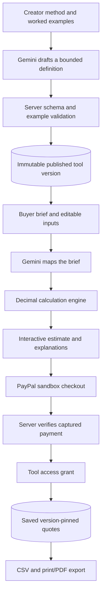

# TaskSlice expertise tools — implementation and test report

Date: 24 October 2026. Implemented locally in the existing TaskSlice project. No public deployment or real-money purchase was performed.

## Implemented

- New explore page with an interactive, animated quote preview.
- Creator editor: method text, studio attribution, live Gemini drafting, editable numeric rules and explanations, manual fallback.
- Worked-example editor and CSV import with validation; at least two different examples must pass before publishing.
- Private drafts with optimistic revision checks; immutable published versions.
- Buyer brief mapping through Gemini, disclosed assumptions and clarification for missing hours.
- Editable deliverables, rates, expenses and revision controls; immediate deterministic recalculation.
- Creator explanations and live contextual questions.
- Fixed-price USD 2.00 PayPal sandbox tool orders, idempotent retries and server-side access checks.
- Saved quotes, reload persistence, separate duplication, workspace listing, CSV export and a client-ready print/PDF view.
- Retained spreadsheet lessons at /lessons.
- Scoped responsive styles, keyboard-friendly controls, checkout focus management and reduced-motion support.

## Results

**Final suite: 34 passed, 0 failed, 0 skipped. Production build and TypeScript checks passed.**

| Verification | Result |
|---|---|
| Known quote totals, revision boundaries and contingency | Passed |
| Rounded invoice lines reconcile to the total | Passed |
| Invalid numeric values and unexpected executable fields | Rejected |
| Failed worked examples prevent publication | Passed |
| Stale draft/quote edits | Rejected |
| Saved quotes remain on the old version after republishing | Passed |
| Different sessions cannot open private drafts/quotes | Passed |
| Unpaid saving and demo access in sandbox | Rejected |
| CSV formula escaping and print HTML escaping | Passed |
| Legacy lesson journeys, persistence and CSV export | Passed |
| Existing payment validation and duplicate grants | Passed with fixtures |
| Live tool order creation and same-key retries | Passed; unpaid orders only |
| Browser build secret scan | Private API keys/passwords absent |

Final test command:

```sh
TEST_BASE_URL=http://127.0.0.1:4322 TEST_EXPERT_URL=http://127.0.0.1:4322 TEST_SANDBOX_URL=http://127.0.0.1:4321 npm test
npm run build
```

Both integration servers used the final production build. Demo HTTP tests used a separate temporary database. Sandbox checks created unpaid orders and never submitted a purchase.

## Live Gemini verification

These checks used the configured Google AI Studio key, separate from mocked AI unit tests:

1. Creator method extraction returned the specified 2 included rounds, 3 hours per extra round and 10% labour contingency.
2. A complete buyer brief mapped to 24 hours at USD 65/hour without clarification.
3. A brief lacking hours returned a clarification and zero placeholder hours rather than fabricated effort; the default rate was disclosed.
4. In the browser, a second website-design brief mapped to 20 hours at USD 75/hour, USD 50 expenses and 2 revisions. The deterministic total was USD 1,700.00.
5. A live explanation correctly identified USD 1,500 labour, USD 150 contingency and USD 50 expenses.

## Browser journey verified

The browser journey created a method with Gemini, reviewed the rules, checked both worked examples, published locally, adapted the tool to another client brief, saved/reopened a quote, duplicated it without overwriting the original, downloaded CSV and opened the print-ready quote. The print view displayed the expected USD 1,700.00 total and returned to the saved quote successfully.

The home revision slider changed the quote from USD 2,010.50 at 3 rounds to USD 2,439.50 at 5 rounds. Quote duplication was also checked against the final build without a reload.

Visual QA used the available desktop browser viewport. Mobile breakpoints are implemented in CSS; physical-device/mobile-emulation QA was not performed in this run.

## Architecture



See EXPERTISE_SPEC.md for modules, data tables, API endpoints and the calculation contract.

## Remaining limits

- The first method family is creative-project quoting, not arbitrary tool generation or arbitrary Excel import.
- Single configured seller account; creator names are attribution. Multi-seller onboarding, commissions and payouts are not implemented.
- Browser-bound guest identity; permanent accounts, cross-device access and recovery remain future work.
- PDF output uses the browser's print/save-as-PDF flow.
- Published rules and previews are visible; payment gates persistence/reuse/export, not formula secrecy.
- The submitted PayPal buyer approval, actual capture and paid tool unlock have not been re-verified end to end. An earlier purchase submission was blocked by automatic approval review; no alternative submission was attempted.
- Actual webhook/refund delivery still needs a public HTTPS endpoint and configured webhook ID.

## Run it

Double-click Start TaskSlice.command in the project folder, or run npm run dev there. Open http://127.0.0.1:4317. Existing private environment files are preserved. See README.md for the full guide and the clearly marked demo-access option.
