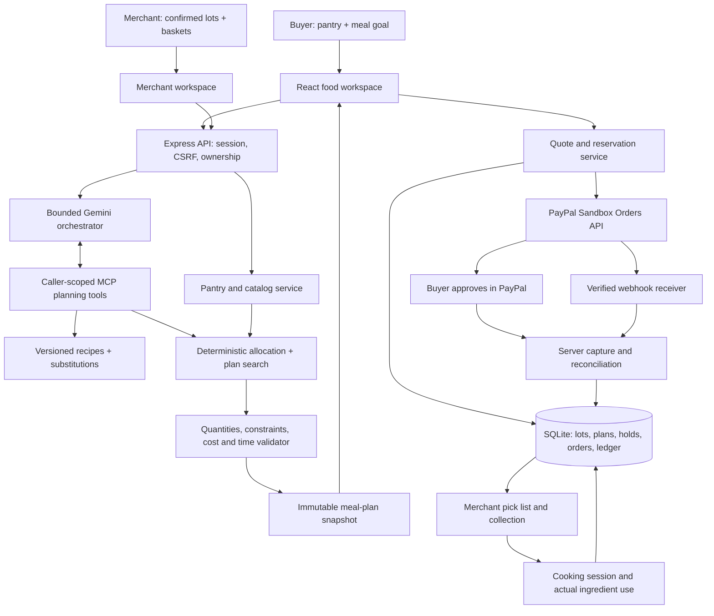

# ScrapDrop food planner — proposed architecture

Date: 27 October 2026. Status: design only; food features are not implemented. Existing sandbox app authentication has been verified, but that is not a completed food purchase, capture, or webhook test. Working product name remains provisional.

## 0. Revised product brief: make a meal cart worth purchasing

### What is sold

The merchant sells physical grocery packs and confirmed surplus bundles. Meal planning and cooking guidance are free in V1; recipes are not the purchased product. PayPal processes the exact grocery cart. Do not describe this as a recipe marketplace, recipe subscription, escrow service or supermarket integration that has not been built.

### Sharper proposition

**Turn food already at home plus confirmed local surplus stock into a complete, affordable set of meals before the shopper pays.**

Lead with a concrete audience: two-person households with a small cooking setup and a fixed grocery budget, buying from one participating produce seller. This is a hypothesis to validate with actual users, not a claim that all households need the app.

The revised core is a personalized grocery cart assembled from the merchant's actual fixed packs or confirmed bundles. Prepacked baskets remain eligible choices; they are not the only unit the engine can recommend. The merchant specifies sellable pack quantities. The app cannot order arbitrary grams unless the seller explicitly offers them.

### The four essential differentiators

1. **Complete-meal purchasing.** Show the full spending required for the same servings, including mandatory top-ups and whole-pack rounding. Display which household ingredients make each purchase worthwhile. Do not rank a discounted item independently of the meals it supports.
2. **A meaningful live change.** Change an input such as equipment, available time, pantry amount or ingredient exclusion. Gemini interprets the change; tools revalidate the entire meal set and cart. Show changed meals, purchase lines and reasons, not merely different wording.
3. **A packable seller order.** Authoritative confirmed stock -> reserved packs -> genuine PayPal sandbox capture -> exact pick list -> ready -> collection. An offer photo is optional; known quantities and actual fulfillment are essential.
4. **Evidence after checkout.** The original plan remains frozen. Record actual cooking and ingredient use; show projected versus observed outcomes separately. Measured leftover or discarded quantity is not inferred from a successful payment.

The visual centerpiece is an interactive ingredient allocation: pantry lot + purchased pack -> meal 1/2/3 -> projected remainder. Clicking a component highlights the relevant meal and purchase line. Animation communicates the allocation, rather than hiding an ordinary chat response.

### Competition boundary

Pantry recognition, expiry-aware recipe suggestions and surplus-grocery shopping already exist. The differentiation to demonstrate is the integrated, pre-purchase decision using the household's confirmed pantry, actual seller pack sizes, a common meal goal, equipment/time constraints and executable checkout. This is a proposed advantage, not proof that no competitor supports it.

### Commercial model

V1 revenue is the merchant's grocery sale. Record real cart totals and seller stock movement. A future platform fee or merchant service plan is a business hypothesis; no commission, split payout or recipe fee is added to the implementation without a separate design. Judge-facing documentation must distinguish implemented transactions from possible monetization.

### Criterion-to-evidence plan

| Equally weighted criterion | Product improvement | Required demonstration/evidence |
| --- | --- | --- |
| Technological implementation | Bounded Gemini tool use, shared ingredient allocation, pack-aware cart, transactional reservations and verified PayPal capture/webhooks | Real changed-input planning result; no invented stock/prices; last-pack race, stale cart, duplicate capture/webhook and collection-credit tests; one genuine sandbox transaction |
| Design | One buyer journey and a role-correct merchant view; progressively disclosed inputs and ingredient-to-meal visualization | A new user completes pantry confirmation, comparison and checkout without developer explanation; mobile/keyboard path works |
| Potential impact | Specific household spending decision and useful seller order | Small explicitly described household trial: planning time, same-goal spending, meals actually cooked, measured remaining/discarded food; seller pick-list check |
| Innovation/idea | Evaluate whole purchasable carts against meals and existing pantry, rather than recipe output alone | Reproducible example where sticker-price ranking and complete-meal spending differ; explain limitations and comparison scope |
| Presentation | One understandable input/change/purchase/outcome story | Under-three-minute video of functioning screens, live sandbox approval/capture and a real cooked meal if physically tested |

No numerical scoring estimate or winning probability is justified before implementation and external evaluation. Improve reliability and evidence before adding a second seller, nutrition dashboard, more sponsors or more agents. Technical implementation is also the first tie-break criterion in the supplied rules.

### Honest validation design

- Prepare a small set of different confirmed pantry/stock scenarios before choosing the showcase. Include a pantry-only route, a top-up purchase, an equipment restriction, stock exhaustion and an infeasible budget.
- Compute the baseline using the same people/servings, recipe requirements, available stock, prices, purchase pack sizes and explicitly stated pantry assumptions. Do not compare unlike meal goals or invented retail prices.
- Use a simple independent hand calculation for the showcase cart and quantities. Add adversarial engine tests beyond the selected successful scenario.
- Separate AI value from solver value: demonstrate the model interpreting a new brief/photo and a changed constraint; verify that the numerical answer still comes from the tools. The fixture path is for tests, not evidence of live AI capability.
- Invite a few household participants to practice the flow, report the actual sample size and errors, and avoid generalizing a small trial into population-wide savings.
- Record the source and license for recipes, photos and catalog data. Mark synthetic merchant stock explicitly until a real merchant confirms it. Do not imply partnership with an existing food-rescue platform.
- Third-party evaluations and sponsor licences must permit the intended hosted judging deployment. Sponsor categories require their specific conditions; package installation alone is insufficient evidence.

### Three-minute demonstration target

0:00–0:20: introduce the household's budget, pantry and meal goal.

0:20–0:55: show two complete feasible meal/cart choices, including extra packs and projected remainders. Explain the spending difference.

0:55–1:20: change one realistic constraint, show a genuine Gemini/tool-assisted revision and highlight the changed allocation.

1:20–2:00: select the cart, approve a genuine PayPal sandbox purchase and show server-confirmed payment.

2:00–2:30: show the seller's exact pick list, prepared/ready state and collection. The full flow must work; clearly label any video edit/time compression.

2:30–2:55: show cooking guidance and a real completed dish/recorded result when available. End with the supported measured outcome, not a universal savings claim.

This is a target script, not a guarantee every payment/provider response fits the allotted seconds. Rehearse before recording and trim secondary features.

## 1. Product contract

Help a household choose confirmed surplus groceries that become workable meals when combined with food it already owns. The decision is: **Which purchasable meal cart makes the best use of my pantry within my spending, equipment, and time limits?**

Inputs: confirmed pantry quantities, household/serving requirements, dietary exclusions, equipment, cooking availability, purchase budget, and confirmed merchant stock. Outputs: a small number of feasible multi-meal plans, exact purchase lines, ingredient allocation, cooking steps, and remaining ingredients. Recipes and planning are included guidance; the purchased product is food.

The distinctive hypothesis is that the cheapest-looking surplus offer can require more additional spending or leave less usable food than another complete meal cart. Demonstrate this with reproducible inputs and actual receipts/cooking; do not claim a globally novel invention or guaranteed zero waste.

### First release boundaries

- One grocery seller and one currency (USD sandbox), one collection location, and limited collection slots.
- Three dinners for one supported household serving variant; begin with two people. Add one/four-person variants only after recipe and quantity tests.
- Roughly eight original or appropriately licensed, explicitly versioned recipes, three produce baskets, and a few fixed top-up packs. Confirmed quantities, not surprise-bag guesses.
- Initially vegetables and straightforward pantry staples. No arbitrary recipe generation, raw-meat handling, medical diets, nutrition optimization, delivery logistics, marketplace payouts, or automatic purchasing.
- A curated recipe is computationally supported before it is physically tested. Record both states. User-facing claims must reflect the actual evidence.
- Manual entry always works. Gemini adds interpretation and supported adaptations; a provider outage must not disable pantry entry, deterministic planning, orders, or cooking progress.

## 2. Coherent user experience

Buyer navigation: **Plan meals / My pantry / My orders**. Merchant accounts additionally see **Shop**. Retire manufacturing entries from the food experience, while keeping legacy links and data available separately.

Four main screens:

1. **What do you have?** Manual pantry entry or photo -> proposed ingredients -> confirm names, quantities, units and relevant dates. Offer a clearly labeled sample pantry for first use.
2. **What do you need?** People, meals/dates, budget, equipment and available cooking time. Exclusions and permissions use progressive disclosure. Do not assume oil, salt or spices are owned.
3. **Compare complete meal plans.** Up to three genuinely different choices with meals, total new spending, an exact cart of confirmed packs/bundles, pantry ingredients used and forecast remaining food. Open an ingredient to see where it goes across meals. Change a constraint and compare again. If only one choice is feasible, show one; do not create decorative duplicates.
4. **Buy and cook.** PayPal review -> paid order -> merchant preparation -> collection -> recipe steps/timers -> record actual use and remaining ingredients. If no purchase is required, go straight to the supported pantry-only plan.

A cooking timeline and animated ingredient cards replace box-specific 3D. No 3D food model in the first release. The visually important connection is **this ingredient lot -> these meals -> this remaining amount**.

## 3. System architecture



Deploy the React build and Express API as one application with one database. No microservices, public MCP endpoint, additional AI vendor or message broker is required for the initial scope. A hosted SQLite deployment needs persistent storage and a single application writer instance; do not assume ephemeral hosting preserves orders. Use a managed database migration later if hosting requires multiple instances.

## 4. Reuse versus replacement

| Existing foundation | Treatment |
| --- | --- |
| React/Vite, navigation, motion, shared accessible controls | Reuse shell/patterns; add a separate food workspace |
| `server/market/store.ts` accounts and existing sessions/CSRF in `server/index.ts` | Reuse account IDs and identity controls |
| `server/paypal.ts` | Reuse sandbox OAuth, Orders API calls and webhook-verification primitives |
| `server/scrapdrop/payments.ts`, reservation/capture/pickup logic | Reuse verified patterns; extract genuinely domain-neutral helpers where useful |
| Existing material/kit schemas and `sd_*` order bodies | Do not disguise food as a material kit. Add food-specific tables/schemas and a dedicated payment adapter |
| Gemini mode, transport, quota and MCP connection pattern | Reuse infrastructure; create food tools and instructions |
| Cutting engine and parametric assembly geometry | Replace with recipe, units, ingredient allocation and meal-plan engine |
| AG Studio | Optional merchant stock/sales/actual outcome analytics after the main journey works |
| Bryntum | Optional merchant collection/capacity view later; simple cooking timeline first |

Existing TaskSlice/manufacturing routes and tables remain intact during the transition. A product/version discriminator must identify legacy orders; never cast an existing paid kit into a food order.

## 5. Core domain model

All quantities use typed integer base units: milligrams for mass, microlitres for volume, and whole pieces for count. Display g/kg/ml/l/pieces. Money uses integer cents. A count ingredient cannot silently become a fractional piece. Do not convert volume to mass without an explicit ingredient-specific conversion; raw and cooked weights are not interchangeable.

| Entity | Essential fields and meaning |
| --- | --- |
| Ingredient definition | Canonical ID, aliases, form/state, base unit, explicit metadata and allowed conversions |
| Pantry lot | Owner, ingredient ID, confirmed amount, location, entered date information/date type, source, revision and provenance |
| Merchant lot | Merchant, ingredient/form, usable quantity, declared date/condition, ingredient/allergen information, confirmation flag and revision |
| Sellable offer | Fixed pack or basket, exact component-lot quantities, price/currency, available count, collection constraints and version |
| Recipe version | Stable ID/version, supported serving variants, ingredient requirements, mandatory/optional status, equipment, preparation/cooking tasks, exclusion metadata and test evidence |
| Approved substitution | Source/target ingredient forms, explicit ratio, quantity bounds, recipe/task modifications, exclusion effects and verification state |
| Meal goal | Household/servings, dated meal slots, spending cap, available equipment/time, ingredient exclusions, accepted substitutions and objective |
| Meal plan snapshot | Recipe versions, pantry/catalog revisions, allocation per lot/meal, purchase pack counts, task schedule, totals, blockers, assumptions, engine version and content hash |
| Quote/order | Plan hash, frozen offer components/price, collection slot, expiration, reservation IDs, PayPal IDs, payment and fulfillment states |
| Cooking record | Plan/meal version, servings actually made, ingredient quantities actually used, completion key, timestamp and optional measured discarded amount |

Use a small ingredient ontology, not substring matching. Fresh tomato, canned tomato and tomato sauce are distinct forms. Substitution is permitted only through an explicit compatible rule. Unknown ingredients and unsupported conversions produce clarification rather than invented precision.

### Exclusions and uncertain input

Photo results are drafts with candidate names and uncertainty. The user confirms quantities; a photo does not establish weight, freshness, safety, allergens or shelf life. Merchant information must also be explicitly confirmed. Ambiguous exclusions, missing required ingredient information or unresolved quantity conversions block an automatic recommendation. Ingredient filtering is not an allergy-safety certification.

Store entered `use_by`, `best_before`, purchase and user-planned-use dates separately; never collapse them into one model-generated expiry value. Dates guide review and planning according to an explicit policy, not a model's visual judgment. Food-handling guidance must come from reviewed recipe/source material. Do not invent storage periods, extend a declared use-by date, or claim that cooking makes unsuitable food safe.

## 6. AI and MCP boundary

`FOOD_PLANNING_AGENT.md` is explicitly loaded by the server. It defines supported ingredients/recipes, units, clarification behavior, exclusions, permissible substitutions, tool usage and uncertainty. A file existing on disk does not automatically inform Gemini.

### Model responsibilities

- Interpret a household brief into a draft goal and focused follow-up questions.
- Interpret photos into draft ingredient candidates, preserving uncertainty.
- Propose supported recipe combinations and approved substitutions.
- Explain the numerical and practical differences returned by tools.
- Answer a cooking-step question using the selected recipe version, equipment and ingredient allocations.

### Typed planning tools

| Tool | Inputs | Authoritative output |
| --- | --- | --- |
| `inspectFoodCapabilities` | None beyond scoped session | Supported recipes, ingredients, equipment, substitutions and limits |
| `inspectPantry` | Optional ingredient filter | Only the caller's confirmed lots/revisions |
| `inspectOffers` | Confirmed collection window/filter | Current confirmed seller offers and component availability |
| `findRecipeCandidates` | Goal, exclusions, equipment | Supported candidates and specific rejected constraints |
| `evaluateMealPlan` | Recipe versions/serving variants, offer IDs, approved substitution IDs | Allocations, missing requirements, scheduled tasks, spending, expected remainders and blockers |
| `compareMealPlans` | Bounded candidate IDs | Deduplicated feasible alternatives and tool-derived differences |
| `explainCookingStep` | Saved plan/meal/step and question | Grounded context for an explanation; no plan mutation |

Tools receive account identity and stock snapshots from trusted server context, not an `ownerId` supplied by the model. Validate all arguments. No arbitrary SQL, shell execution, unrestricted URLs or cross-account queries.

A live planning action uses at most three provider rounds and one repair. The final result must pass the deterministic validator, including when Gemini stops without calling every suggested tool. Cache keys include owner, confirmed pantry revision, goal, offer revisions, recipe versions, engine version, prompt version, model and AI mode. Do not cache errors as successful plans.

The model cannot increase budget, lower servings, add equipment or relax exclusions. If no feasible plan is found, show the actual blocker and explicit user-controlled changes. It cannot approve, initiate or capture a purchase through the planning tool interface.

## 7. Deterministic planning engine

### Pipeline

1. Parse and validate confirmed inputs; normalize units/ingredient forms.
2. Reject recipe candidates that conflict with exclusions, equipment, supported serving variants or dated availability.
3. Generate a bounded candidate set for the requested meal slots. For the first release, enumerate three-meal combinations from the small catalog and permitted offer combinations. Document caps; this is not an unrestricted global optimizer.
4. For each candidate, allocate confirmed pantry lots across all meals. Prioritize eligible lots by the explicit planned-use policy. Never allocate the same gram twice.
5. Allocate selected basket contents. Any remaining mandatory deficit must be filled by an actual fixed top-up offer. Account for whole-pack rounding and resulting leftover quantities. A basket's unneeded components still count as purchased quantities and spending.
6. Schedule recipe tasks against available equipment and time. Initially use tested task durations and a conservative one-cook schedule. Oven/pan occupancy and dependencies are hard constraints; refrigeration, drying or other unverified timing is not guessed.
7. Check collection occurs before any meal depending on purchased ingredients. No ingredient can be used before it is available.
8. Verify servings, budget, ingredient compatibility, stock, constraints and conservation. An unresolved assumption is not a feasible result.
9. Rank feasible candidates by the selected objective, then deduplicate equivalent purchase/recipe/allocation results.

### Fundamental invariants

For every lot: `allocated across meals <= confirmed available quantity`.

For each mandatory recipe requirement: `compatible allocated quantity >= required quantity`.

For each offer: `purchased count` is a valid integer pack count, and every basket component is included.

`new spending = sum(frozen offer price × count) + disclosed mandatory charges`.

`projected remainder = confirmed pantry + selected purchases - planned use` (same canonical units/forms only).

No negative quantities, incompatible unit conversions, double allocation, hidden staple assumptions, unsupported ingredient swaps or uncovered mandatory ingredients.

### Comparison cards

Support objectives such as lowest new spending, highest priority-pantry use and shortest hands-on time, all subject to the same hard constraints. State what actually differs. Show estimated remaining fresh ingredients individually; do not add litres, pieces and grams into a meaningless single waste score.

Do not call projected remainder actual waste. Do not claim grams bought from surplus were necessarily saved from disposal. Actual usage/discard is recorded separately. A purchase saving requires an explicit comparable baseline with the same meal/serving scope and stated prices. No automatic CO2 or nutrition claims.

## 8. Persistence and concurrency

Proposed new tables: `food_ingredients`, `food_recipes`, `food_offers`, `food_merchant_lots`, `food_pantry_lots`, `food_plans`, `food_quotes`, `food_orders`, `food_holds`, `food_captures`, `food_webhook_events`, `food_pickups`, `food_cooking_records`, and `food_quantity_ledger`. Add constraints and schema migrations; JSON snapshots supplement transactional quantities rather than replace them.

- Every owner-scoped read uses the authenticated account ID.
- Pantry updates, cooking progress and merchant edits require an expected revision; stale tabs return a clear conflict.
- Saving a hypothetical meal plan does not consume or permanently reserve pantry food. Cooking completion validates current balances and atomically deducts actual quantities. Concurrent plans cannot both finalize using the same ingredients.
- A quote checks pantry and stock revisions again. Stock/price changes before checkout require an explicit updated plan/quote.
- After payment, preserve purchased components/prices and the original recipe snapshot. A subsequent pantry change can invalidate the cooking plan: warn and create a new linked plan revision using the paid goods, without charging for them again.
- Merchant collection credits purchased ingredients to the buyer's pantry exactly once, with source lot/order provenance. Planned purchased allocations map to those actual credited lots.
- Cooking completion records the actual ingredients/servings in a transaction. Retries reuse a completion key; changed payloads cannot silently overwrite finalized usage. The user must confirm actual use rather than the app deducting food on viewing a step.
- Pantry-only meals can be cooked before collection if their own allocations remain valid. A meal requiring uncollected goods is blocked. Cooking does not imply merchant fulfillment.

## 9. PayPal and fulfillment architecture

Use genuine PayPal sandbox checkout for the product demonstration. Existing app credentials remain server-side. App login accounts and PayPal buyer/seller accounts are separate.

1. Buyer selects a validated saved plan and collection slot.
2. Server recomputes the food quote from authoritative offer prices and revisions; records the frozen components, servings, recipe references and plan hash.
3. In a transaction, reserve offer/component quantities and collection capacity. Bundles and individually sold products share component-lot balances; reserving one must reduce availability of the other.
4. Create the PayPal order with a stable supported `PayPal-Request-Id`, persist its provider ID, and show buyer approval.
5. After approval, the server captures. Verify completed status, amount, currency, expected merchant and the correct internal order association. Browser success or an approved order alone is insufficient.
6. Commit stock once and mark the order paid. The merchant receives the exact pick list.
7. Merchant marks prepared/ready. Buyer sees the one-use pickup code. Operator redeems it once; collection credits the purchased food to the pantry once.
8. Cooking updates consumption independently.

Payment state and fulfillment state are separate. Suggested payment states: `creating`, `awaiting_buyer`, `capture_pending`, `paid`, `canceled`, `expired`, `needs_reconciliation`, `refunded`. Fulfillment: `not_started`, `preparing`, `ready`, `collected`, `needs_resolution`.

A timed-out capture is reconciled against the existing provider order; do not release its stock or create a fresh payment automatically. Confirmed unpaid cancellation/expiry releases holds. A paid stock discrepancy becomes a resolution state, not a success or an automatic second purchase. Full refund reconciliation is required before describing refunds as supported; partial refunds and partial fulfillment can be deferred explicitly.

Verified webhook events are durably recorded and processed idempotently. Callback and webhook delivery may race or arrive out of order; enforce state transitions and unique capture IDs. Acknowledge successful durable receipt, retain failed processing for bounded retry, and reconcile pending orders after restart. Reuse the existing publicly configured webhook path where appropriate, adding a food-order dispatcher. Register only events the implementation handles and test genuine delivery from the same sandbox app. A webhook for the hosted URL will not reach a localhost-only listener.

The no-purchase path saves a supported plan and starts cooking; never create a zero-value PayPal order. No multi-seller payouts, escrow, deposits or subscription billing are needed for V1.

## 10. Proposed API surface

All write routes use existing CSRF/origin protection and validated schemas. Rate-limit AI, auth, quoting and checkout appropriately.

| Route | Purpose |
| --- | --- |
| `GET /api/food/session` | Role, mode and capabilities without secrets |
| `GET/PUT /api/food/pantry` | Owner's confirmed lots; expected revision on writes |
| `POST /api/food/pantry/interpret` | Photo/text to draft only; requires explicit user action |
| `GET /api/food/offers` | Confirmed currently purchasable offers/collection windows |
| `POST /api/food/goals/interpret` | Brief -> structured draft and clarification questions |
| `POST /api/food/compare` | Deterministic comparison; works with AI disabled |
| `POST /api/food/plan-with-ai` | Bounded model/tool planning action |
| `GET/POST /api/food/plans` | Owner's saved frozen meal plans |
| `GET /api/food/plans/:id` | Snapshot, progress and any stale-input warnings |
| `PUT /api/food/plans/:id/progress` | Resume a cooking step; does not deduct food |
| `POST /api/food/plans/:id/explain` | Cached current-step explanation |
| `POST /api/food/plans/:id/quote` | Revalidated basket/top-up purchase quote |
| `POST /api/food/checkout` | Reserve and create genuine sandbox order |
| `POST /api/food/orders/:id/capture` | Authorized idempotent capture/reconciliation |
| `GET /api/food/orders/:id` | Buyer's current payment and fulfillment status |
| `POST /api/food/plans/:id/meals/:mealId/complete` | Confirm actual ingredient use atomically |
| `GET/PUT /api/food/merchant/lots` | Operator-scoped confirmed ingredient stock |
| `GET/PUT /api/food/merchant/offers` | Fixed pack/basket composition and price |
| `GET /api/food/merchant/orders` | Paid pick lists and fulfillment queue |
| `POST /api/food/merchant/orders/:id/ready` | Mark a paid prepared order ready |
| `POST /api/food/merchant/pickups/redeem` | One-use collection, once-only pantry credit |

Do not add a simulator checkout button to the product. Automated tests may inject a mocked payment transport behind test-only configuration. Final browser demonstration uses real sandbox approval/capture.

## 11. Suggested source layout

```text
src/food/
  FoodApp.tsx                 # one buyer/merchant shell
  PantryEditor.tsx            # manual confirmation + photo drafts
  MealGoalEditor.tsx
  PlanComparison.tsx
  IngredientAllocation.tsx    # ingredient -> meals -> remainder
  CookingGuide.tsx
  FoodOrders.tsx
  MerchantWorkspace.tsx
  domain.ts                   # schemas/types
  units.ts
  recipe-registry.ts
  planner.ts                  # deterministic bounded search/allocation
  schedule.ts
  food.css
server/food/
  routes.ts
  store.ts                    # migrations and owner-scoped persistence
  catalog.ts
  agent.ts
  tools.ts
  mcp.ts
  payments.ts                 # food-specific adapter over server/paypal.ts
  help.ts
  FOOD_PLANNING_AGENT.md
```

Prefer pure domain modules shared by server tests and previews; the server remains authoritative. Do not expose server secrets through frontend-prefixed variables. Recipe content and photos require clear provenance/licensing.

## 12. AI configuration, data and cost controls

Reuse `AI_MODE=fixture|live`, `GEMINI_API_KEY`, `GEMINI_MODEL`, the existing transport and budget controls. A key does not itself enable AI. No live calls for quantity edits, navigation, animation, timers, routine arithmetic or unchanged cached requests.

Deterministic compare can run on edits with explicit Compare action. Photo interpretation, brief interpretation, planning assistance and Explain this step are deliberate actions. Display a concise mode/status label, including fixture behavior. Fixture tests must not pretend natural-language interpretation happened live.

Separate caches for ingredient drafts, brief interpretation, plan proposals and step help. Scope them to the account and relevant content/revisions. Treat pantry photos and seller descriptions as untrusted data. Bound photo size/type, reject malformed files, and avoid logging photos, secrets, full credentials or dietary data. Retain photos only with an explicit purpose/retention decision; discarding after confirmed extraction is the preferred V1 default.

Before a final live check, budget the entire chain: image, brief and multi-round planning consume separate provider requests. Reuse confirmed input and deterministic results to keep the demo economical. Report actual provider usage and failures.

## 13. Build sequence and exit gates

1. **Recipe/data proof.** Define units, recipe variants and confirmed sample offers. Produce at least one real three-dinner example. Gate: all ingredient balances and recipe instructions reconcile; evidence status is visible.
2. **Deterministic engine.** Implement pantry allocation, bundle/top-up accounting, constraints, schedules and distinct comparisons. Gate: adversarial quantity/cost tests pass with AI disabled.
3. **One food workspace.** Pantry -> goal -> choices -> saved cooking guide, responsive/keyboard usable. Gate: a novice can explain why one basket was selected.
4. **Gemini bridge.** Add draft recognition, clarification, supported proposals and grounded explanations through real tools. Gate: mocked transport tests pass; one budgeted live scenario changes a real plan correctly.
5. **Food commerce.** Implement dedicated food order adapter, shared-lot holds, genuine sandbox checkout, exact pick list and once-only collection credit. Gate: PayPal approval/capture plus verified hosted webhook and fulfillment pass end to end.
6. **Cooking/outcome evidence.** Actual consumption, remaining stock, household trial and saved progress. Gate: an original or licensed real meal is cooked and recorded; measured results are distinguished from estimates.
7. **Submission polish.** Finish one three-minute causal demonstration. Add sponsor analytics only if useful and after the complete core flow passes.

Do not preserve unused manufacturing screens or vendor widgets simply because they already exist. Infrastructure reuse should reduce implementation work, not determine the food UX.

## 14. Verification plan

- Units: mass/volume/count boundaries, fractional count rejection, unsupported conversion, raw/cooked mismatch and pack rounding.
- Allocation: one ingredient shared across meals, duplicate consumption, identical names/different lots, insufficient pantry, no top-up offer, basket components not used and exact remainders.
- Constraints: unsupported serving variants, missing pan/oven, exclusion/unknown label, budget, collection after meal, expired/stale offers and impossible cooking window.
- AI: uncertainty/clarification, prompt injection in labels, cross-owner isolation, unapproved substitution, invented price/recipe, invalid tool call, bounded repair, cache invalidation, quota and provider failure/manual fallback.
- Commerce: stale quote, last-basket race, component stock sold separately, double click, retry after timeout, canceled/expired hold, pending capture lock, wrong amount/currency/merchant, duplicate/out-of-order webhook and restart recovery.
- Cooking: no purchase required; collected versus uncollected ingredient dependencies; once-only collection credit; stale pantry after payment; simultaneous meal completion; actual use different from estimate; zero/partial actual usage.
- Browser: manual path, image draft correction, meaningful replan, distinct plan cards, genuine sandbox checkout, seller pick/ready, collection, cooking resume, mobile and keyboard.
- Evidence: use synthetic stock labels honestly until a real grocer participates; verify actual meals and spending separately from software correctness. No invented waste-reduction percentages or health outcomes.

## 15. Proposed demonstration

Show a confirmed pantry and two named surplus baskets. Both look attractive by price. The engine shows how each supports the same three-dinner goal and identifies top-ups/unused components. Change equipment or exclude an ingredient; Gemini and tools produce a different valid route. Buy the chosen basket with genuine PayPal sandbox checkout. Show the merchant pick list and collected ingredients flowing into the cooking guide. Finish with a photographed cooked example and recorded actual quantities where available.

The result is a complete purchasing and cooking decision, not a tour of AI chat, stock tables and payment controls.

## References

- PayPal Orders v2: https://developer.paypal.com/api/orders/v2
- PayPal webhook overview/verification: https://developer.paypal.com/api/rest/webhooks/
- PayPal idempotency: https://developer.paypal.com/api/rest/reference/idempotency/
- Product comparison research: Samsung Food, SuperCook, Sorted Sidekick and Too Good To Go were reviewed in the preceding discussion. Our differentiating hypothesis is joint household-pantry + confirmed merchant-basket evaluation before purchase, not recipe generation alone.
