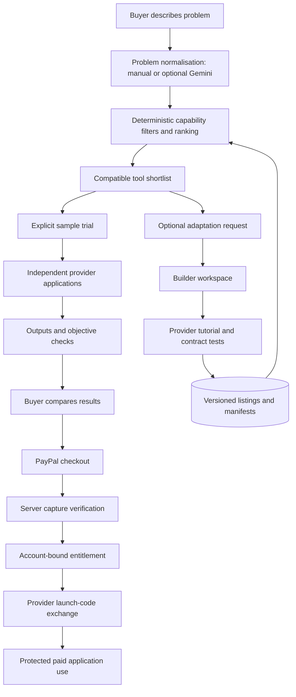

# TaskSlice: a marketplace for working solutions

**Status:** proposed implementation plan; not a description of the current build.

**Date:** 24 October 2026, Malaysia time.

**Working positioning:** Describe a problem. Try working tools against the same task. Buy the one that fits, or ask its builder for a specific adaptation.

This is a separate direction from the existing quote-calculator editor. The current application remains unchanged by this document. Gemini usage during implementation and routine testing must default to zero; limited live verification comes only after offline tests pass.

## 1. What we are building

A marketplace where builders sell access to independent web applications that solve practical, specific problems. Buyers evaluate actual interactions and results rather than relying only on a profile, screenshot or promise.

A tool can transform files, prepare documents, organise bookings or support another bounded task. It is not required to fit a shared pricing formula. TaskSlice supplies discovery, comparable demonstrations, checkout, entitlements and a place to return to purchased tools; builders supply the working applications.

For the first release, the purchased item is **access to a hosted web application**, with a clearly stated access period and usage allowance. It is not source-code ownership, ownership of the business or a lifetime hosting promise. Customisation is an optional request to the builder, not an automatic AI-generated implementation.

### The distinctive interaction

A buyer says:

> I have event photographs with inconsistent filenames. I need them named by event, date and sequence, ready to send to my client.

TaskSlice captures the input, required output and constraints. It finds tools that support that task and lets the buyer try compatible tools on the same small sample. Results appear side by side with actual output previews, limitations and prices.

The buyer can purchase the tool that works or ask, for example, “Can this also preserve my folder structure?” The request starts from a demonstrated tool and concrete missing capability.

This is the product's central differentiator. A generic listing directory, freelancer profile marketplace or AI search box is insufficient.

## 2. Difference from adjacent marketplaces

| Model | What buyers primarily evaluate | Proposed TaskSlice emphasis |
|---|---|---|
| Freelance services | A person, proposal and promised delivery | A working application and the result it produces on a relevant task |
| Source-code stores | A code licence, features and installation requirements | Usable hosted access; source-code transfer is not required |
| Software-business acquisitions | Ownership of a company/product and its commercial assets | Small purchases of task-specific software access |
| Software directories | Listings, descriptions and links | Actual compatible sample runs, output comparison and paid access |
| Current TaskSlice | Variations of a fixed quote calculation | Independent tools with different functionality and inputs/outputs |

This is a positioning hypothesis, not a claim that nobody has implemented similar features. Previous research identified Fiverr, CodeCanyon, Zero to Hundred and the HackMarket hackathon project as relevant precedents. The MVP must demonstrate the proposed distinction rather than claim novelty from the marketplace category alone.

## 3. Non-negotiable acceptance criteria

1. At least three functional applications across at least two genuinely different task families. Listing cards backed by the same calculator with renamed labels do not qualify.
2. At least two tools support a shared task and can be compared using the same compatible input.
3. The comparison shows actual output artifacts and observed execution status. It does not invent a universal AI quality score.
4. A builder can register a tool, follow the integration tutorial, complete a contract test and make a valid listing visible.
5. A buyer can purchase a defined access package, reopen the purchased tool and use its paid capability after server-verified access.
6. A listing with only a URL cannot claim that TaskSlice protects its paid functionality.
7. Buyer access and builder ownership use persistent account identity for the new marketplace, not only a disposable guest cookie.
8. Routine unit, integration, browser and payment-fixture tests make zero Gemini calls.
9. The first live Gemini smoke test happens only after unit/integration tests and the build pass.
10. Local publication, public deployment, mock verification and live verification must be labelled accurately in the product and report.

## 4. MVP tool catalogue

Build a small catalogue of real, clearly identified demonstration tools. Do not invent external providers, customer reviews, transaction counts or usage statistics.

### Tool A — Pattern Rename

- Problem: organise client image files without changing their contents.
- Input: a small batch of JPEG/PNG files, event label, date and filename pattern.
- Interaction: reorder files, edit the pattern and inspect old-to-new names.
- Output: ZIP containing the unchanged images under their new filenames, plus a mapping CSV.
- Deterministic checks: file count, extension preservation, unique output names and input/output byte hashes.
- Preview: process a small sample within documented limits.
- Paid capability: larger permitted batch and saved reusable naming presets.

### Tool B — Map Rename

- Same task family as Tool A, but supports a mapping CSV and folder-preservation option.
- Input: the same image sample, plus optional filename mapping.
- Interaction: inspect unmatched names, resolve collisions and keep or flatten folder structure.
- Output: ZIP and mapping report.
- Purpose: demonstrate a meaningful choice between two implementations of the same problem.
- Describe its limits honestly; it does not automatically recognise people or image contents.

### Tool C — Booking Board

- Problem: a small workshop organiser needs a shareable booking page with a fixed number of places.
- Input: session dates, capacity and booking form fields.
- Interaction: configure sessions, view available places and make test bookings.
- Output: a working booking page, reservation records and CSV attendee export.
- Deterministic checks: capacity cannot be exceeded, repeated submissions do not create duplicate reservations, private attendee details stay owner-only.
- Paid capability: publish and manage a saved booking board during the purchased access period.
- Purpose: prove that a tool can be an interactive web application with persistence, not only a file converter or calculator.

The two rename tools allow honest comparison. The booking application demonstrates breadth. Their own tools and trial results are separate from TaskSlice's discovery AI. They should run without Gemini during the hackathon demonstration.

## 5. Buyer experience

### A. Describe the problem

The primary entry is “What do you need to get done?”

Accept plain text and optional input metadata. A short structured fallback collects:

- Task family.
- Input format.
- Desired output.
- Required capabilities, such as folder preservation.
- One-time versus repeated use.

Gemini may convert an ambiguous description into this structure when explicitly requested. Straightforward filters, example problems and manual choices work without AI. Never send private file contents to Gemini merely because the buyer selected a file.

### B. Find compatible tools

Apply hard filters first. A tool that cannot read the input or produce the required output must not be presented as a fit merely because an LLM likes its description.

Rank compatible tools using explicit capability matches, price and requested constraints. Show a short, grounded explanation: “Supports JPEG/PNG, preserves folders and exports a ZIP.” Missing information is labelled unknown.

Gemini can help interpret language, but payment eligibility and actual compatibility are checked by code.

### C. Try the same task

Show a comparison tray for up to two compatible tools. Buyers choose a supplied sample or explicitly permit sending their own sample to each named provider.

Show the exact files/providers before transmission. A tool preview can be hosted by the provider or integrated with TaskSlice's sample-run contract. Do not silently forward one upload to every marketplace provider.

Display:

- Output preview and download when available.
- File count or other objective invariants.
- Observed run time, labelled as this run rather than a guaranteed speed claim.
- Provider-stated limits.
- Actual failure messages in buyer-friendly language.
- Price, access duration, usage allowance and the promised paid capability.

Do not compare unrelated tools as though they share a common quality measure. Ask for clarification when the task is not sufficiently defined.

### D. Purchase and return

Make the product being purchased explicit before PayPal opens. For example: “30 days of access; batches up to 100 images; saved naming presets.” Actual limits will be set after the tools' processing and hosting costs are measured.

A verified captured payment creates an entitlement. The tool checks that entitlement server-side before its paid operation. The buyer's library links to the actual application and displays the access expiry and remaining allowance where applicable.

If a provider becomes unavailable, show the failure and support path; do not mark the tool usable just because payment succeeded.

### E. Request an adaptation

“Almost fits?” creates a request attached to an existing tool and, with permission, the sample-run context. The buyer states a missing capability, desired result and optional budget. The builder can respond with scope, price and delivery estimate.

The initial MVP implements the request and response records. It does not pretend to deliver custom software automatically. Paid custom commissions and milestones are a later release, after the existing-tool purchase flow is reliable.

## 6. Builder experience

1. Create an account and open the builder workspace. A person can also act as a buyer.
2. Choose “Connect an existing website.” The first version does not deploy arbitrary uploaded repositories.
3. Supply a title, plain-language problem, working application URL, preview URL, support contact and capability manifest.
4. Define what a trial permits and what the access package buys.
5. Follow the guided provider integration tutorial in Section 7.
6. Run contract checks against sample data and entitlement states.
7. Preview the buyer listing and publish locally or to the deployed marketplace as appropriate.
8. Review purchases and adaptation requests from the builder workspace.

Supported listing states:

- **Draft:** visible only to its owner.
- **Preview only:** working demonstration; TaskSlice payment integration is not verified. No paid checkout.
- **Integration checked:** required contract tests passed at the recorded time.
- **Available for purchase:** integration checks and the seller's payment configuration are valid.
- **Unavailable:** required checks are failing or the provider has disabled the tool. New checkout is disabled while existing buyers receive a clear status.

An integration check is not a security certification or a guarantee of the provider's future availability.

## 7. Guided provider integration tutorial

This tutorial is a required product feature, not only a README link. Its purpose is to help a builder connect a real website and understand why a listing alone cannot enforce purchases.

### Tutorial design

- Step-by-step setup with progress saved to the builder's draft.
- A simple-language explanation first, with expandable implementation details.
- Copyable examples for a Node/Express provider and a framework-neutral HTTP contract.
- One minimal reference application that can be run locally without Gemini.
- A “Try a sample request” panel that shows a sanitised request and response.
- Explicit distinction between sandbox test credentials and production credentials.
- No unexplained security workflow in the buyer journey; technical setup belongs in the provider workspace.

### Step 1 — Describe and register the tool

Explain how to choose a clear problem statement and declare the supported inputs, outputs and limitations.

The builder supplies URLs and a manifest. The UI checks formatting, URL scheme, required fields and the allowed operation types. The reference tool shows a filled example beside an empty form.

Success condition: a draft exists and its declared capabilities can be read. This alone does not enable paid sales.

### Step 2 — Understand the integration boundary

Show a small diagram:

```text
Buyer's browser -> Provider's server -> TaskSlice entitlement check
                          |
                          +-> Run paid operation only when allowed
```

Explain:

- The PayPal Client ID is browser-public; PayPal secrets are not.
- A provider credential belongs only on the provider's server.
- A success redirect or hidden button is not proof of purchase.
- Browser-submitted fields such as `owned: true` never grant access.
- The provider's protected endpoint must reject missing, expired or revoked access.

Success condition: the builder has selected an integration approach supported by the MVP.

### Step 3 — Connect server-side access checks

The planned small SDK wraps the common checks but does not hide their meaning. Copyable code contains placeholders, never a real secret in rendered examples, screenshots or logs.

The server validates the audience/tool ID, account, package, expiry, operation and active entitlement. Credentials are scoped to one provider/tool. Replay-sensitive operations use a nonce or idempotency key. A revoked entitlement must not remain accepted because an old browser token still exists.

For the MVP, a provider-to-TaskSlice server request checks active entitlement before each paid operation. A short-lived launch code hands the buyer from TaskSlice to the provider without putting a reusable provider credential in a URL. The authenticated provider exchanges that code server-to-server and binds it to its own session. Launch codes are single-use, short-lived and bound to the tool and buyer. Browser tokens must never be sufficient to consume paid capacity alone.

Success condition: a protected test operation rejects an unauthorised request and accepts the correct test entitlement.

### Step 4 — Connect trial and output handling

Declare the trial limits and the paid-operation schema. The builder can supply a preview URL, a sample-run endpoint, or both.

The tutorial distinguishes:

- An externally opened preview: TaskSlice can verify that the URL is declared, but cannot automatically inspect its results.
- A compatible sample-run integration: TaskSlice can display outputs and run objective contract checks.

Only the second can advertise comparable sample results. Files or artifacts require explicit output metadata and scoped download access. Failed or incomplete runs must not be shown as passed.

Success condition: a sample input produces a valid response or artifact with the declared output format.

### Step 5 — Run the integration test panel

All tutorial checks use local fixtures and sandbox entitlement records; none need Gemini.

| Check | Expected result |
|---|---|
| No access supplied | Paid operation rejected |
| Valid access for this buyer/tool | Permitted within the purchased limits |
| Access for another tool or buyer | Rejected |
| Expired access | Rejected |
| Revoked/refunded access | Rejected |
| Repeated operation key | No duplicate paid consumption |
| Malformed sample input | Clear validation error |
| Trial over its declared limit | Rejected or clearly restricted |
| Provider timeout | Clear failure; no fake result or duplicate charge |

Show expected versus actual response and a last-tested timestamp. Record the tested manifest version and integration configuration. Editing those details makes old checks stale.

### Step 6 — Review the listing and enable sales

Show what buyers will see: tool function, live demonstration, compatible formats, paid capability, access duration, provider identity and support details.

Publishing requires current contract checks plus valid seller payment configuration. In the hackathon demo, clearly identify the configured sandbox seller. Do not label a builder connected to PayPal when only their display name was saved.

### Tutorial acceptance test

A new builder account must be able to connect the supplied reference application using the instructions alone, complete the checks and produce a purchasable listing. A reviewer who did not author the integration should repeat this journey before the feature is considered complete.

The documentation must describe the integration that actually exists. No fake SDK imports, imaginary endpoints or unimplemented upload/hosting claims may appear as working features.

## 8. Architecture



### Application components

Retain React/TypeScript/Motion, Express, SQLite and the existing server-side Gemini and PayPal adapters where their contracts remain correct.

Introduce separate domains:

- Identity and account sessions.
- Providers, tools and immutable listing/manifest versions.
- Problem descriptions and compatibility matching.
- Trial jobs and output artifacts.
- Purchases, entitlements and usage limits.
- Provider launch/exchange and contract testing.
- Adaptation requests and builder responses.

Do not make all tools subtypes of the existing quote engine. Reference providers can initially live in the same repository but must have distinct interfaces and handlers. Document which tools are reference/demo applications; do not claim operational isolation just because their routes differ.

### Persistent identity

Add account registration/login to the new marketplace, using standard server-side password hashing such as Node's scrypt, secure session cookies and sign-in throttling. Store hashes, never plaintext passwords. Keep buyer and builder capabilities under the same account.

A guest may explore and trial permitted samples. Signing in is required before purchase, saving a private board, publishing a tool or sending a private adaptation request. Migrate only records provably owned by the current guest session when attaching them to an account. Do not expose other guest records.

Account recovery and email verification need an actual delivery provider before a public production launch. A local-only account setup cannot be advertised as a production identity system.

## 9. Provider contract and website support

### Proposed capability manifest

```json
{
  "contractVersion": 1,
  "toolId": "pattern-rename",
  "toolVersion": "1.0.0",
  "title": "Pattern Rename",
  "taskFamilies": ["batch-file-renaming"],
  "inputs": ["image/jpeg", "image/png"],
  "outputs": ["application/zip", "text/csv"],
  "capabilities": ["filename-pattern", "preserve-file-bytes"],
  "limits": { "trialFiles": 3, "paidFilesPerJob": 100 },
  "appUrl": "https://provider.example/app",
  "previewUrl": "https://provider.example/demo",
  "sampleOperation": "rename-preview"
}
```

This is a proposed schema example. Endpoints and SDK code must be implemented before the tutorial presents them as usable.

### Initial submission support

- A working application URL plus explicit integration configuration.
- A versioned capability manifest.
- A supported sample-run contract for tools that want side-by-side output comparison.
- Server-checked entitlements for paid access.

### Not in the initial build

- Upload any ZIP/repository and automatically host it.
- Infer the complete functionality of an arbitrary website from its homepage.
- Inject TaskSlice access control into an unrelated external website.
- Run untrusted provider code inside the marketplace server.
- Embed every external site in an iframe regardless of its policies.

Automatic deployment of arbitrary provider applications requires a separate isolated execution/hosting system and must not be implied by an upload button. If an external app cannot be embedded, open it at its verified provider origin with the supported launch flow.

## 10. Trial jobs and artifact handling

Store each run's account/guest owner, tool and manifest version, input fingerprint, status, timestamps and output references. The run may be `queued`, `running`, `succeeded`, `failed` or `expired`.

MVP limits must cap file count, bytes, run time and output size. Reject unsupported extensions and filenames. ZIP processing must prevent path traversal, decompression bombs and filename collisions. Do not assume an image extension proves its content type.

Provider result claims are labelled as provider-reported unless TaskSlice checked the invariant itself. For rename tools, the marketplace can actually check counts, filename uniqueness and byte preservation. It cannot derive a meaningful universal “95% quality” score for arbitrary websites.

Externally fetched URLs and sample endpoints are a server-side request-forgery risk. Permit only configured integrations in the hackathon demo. Before general external registration, validate HTTPS origins and ownership, block private/loopback/link-local destinations and recheck redirects/resolved destinations. Never implement a generic unrestricted server URL fetcher.

Use random artifact identifiers and owner-scoped download checks. Keep files outside publicly served directories. Temporary input/output files expire under an explicit retention policy, with cleanup tested. Repeated identical trial requests can reuse a valid cached result for the same owner/tool version without another provider run.

## 11. PayPal and the commercial boundary

Reuse the existing amount/currency/recipient checks, server-created prices, idempotency, capture recovery and verified webhook handling. Replace lesson/tool string assumptions with explicit marketplace product identifiers where needed.

An order snapshots provider, tool version, price, currency, purchased package and recipient before checkout. Capture creates an entitlement in one transaction. Duplicate completion events cannot create extra grants or duplicate usage allowance.

Use standard fixed-duration access packages for the first demo. Recurring subscriptions are a later feature; do not imply ongoing renewals are implemented. Refund/reversal handling revokes access according to the supported event lifecycle. The provider checks current entitlement state before paid operations.

### Seller onboarding

A true marketplace needs an authorised multi-seller payment arrangement, including provider onboarding and routing purchases to the correct seller. Do not collect builders' PayPal login passwords or ask them to paste merchant secrets into public forms.

Before implementing real multi-seller checkout, verify the PayPal product, account eligibility and sandbox onboarding capabilities available to this project. If the required marketplace capabilities are unavailable, the hackathon demo uses one explicitly identified sandbox seller operating the reference tools. Other builders may complete preview-only registration, but their paid listing cannot silently route funds to that demo merchant.

Do not call the platform an escrow service, automatically hold funds for milestones or claim creator payouts without an actual supported payment integration. Multi-seller production readiness is an explicit dependency, not a UI checkbox.

## 12. Proposed data model

| Entity | Main contents |
|---|---|
| accounts | Identity, password hash and public display data |
| account_sessions | Hashed session token, account, expiry and CSRF material |
| providers | Owner account, display profile, integration state and seller connection reference |
| tools | Provider, current version, visibility and availability |
| tool_versions | Immutable manifest, capability declarations, package terms and presentation data |
| provider_credentials | Scoped credential hashes or encrypted references; never browser-visible |
| integration_checks | Tested tool/configuration version, expected/actual results and timestamp |
| problem_requests | Owner, structured task requirements and original text |
| trial_jobs | Owner, tool version, input fingerprint, job state and observed timings |
| artifacts | Job ownership, content type, safe storage reference and expiry |
| purchase_orders | Product/package snapshot, seller, amount/currency, idempotency and PayPal IDs |
| entitlements | Account, tool/package, valid dates, status and originating purchase |
| usage_events | Operation key, entitlement, usage quantity and result |
| launch_codes | Hashed short-lived code, account/tool binding, expiry and consumed state |
| adaptation_requests | Buyer, provider/tool, missing capability, private context and status |
| adaptation_responses | Builder's proposed scope, estimate and response text |
| ai_test_runs | Test scenario, mock/live source, model, request count and token usage when available |

SQLite is suitable for the local demonstration. A public multi-instance service needs shared database/storage and rate limiting; that is a separate deployment task.

## 13. Proposed API groups

Endpoint names are planning contracts, not existing routes.

- `/api/auth/*`: registration, sign-in/out and session identity.
- `/api/providers/*`: profile, integration configuration and credential lifecycle.
- `/api/tools/*`: public listings and immutable versions.
- `/api/problems/*`: normalisation and compatibility matching.
- `/api/trials/*`: create job, status and owner-scoped outputs.
- `/api/artifacts/*`: scoped download access.
- `/api/provider-tests/*`: sample contract and entitlement checks.
- `/api/checkout/*`: order creation, capture and status.
- `/api/entitlements/*`: buyer library and authenticated provider checks.
- `/api/launch/*`: single-use launch and server-side exchange.
- `/api/adaptations/*`: buyer requests and builder responses.

## 14. Gemini usage policy — development and testing

### Binding requirement

**No real Gemini calls during routine development tests. Use Gemini only when genuinely needed for the final smoke test, after unit and integration tests pass.**

The current app activates AI largely from API-key presence. The first implementation task is to replace that implicit behaviour with an explicit provider mode. Merely loading the existing `.env` must not turn an offline test server into a live AI client.

### Proposed modes

```dotenv
# Default for development and automated tests
AI_MODE=fixture
ALLOW_LIVE_AI_TESTS=false

# Enabled only for the final, deliberately invoked smoke run
# AI_MODE=live
# ALLOW_LIVE_AI_TESTS=true
# AI_TEST_REQUEST_BUDGET=3
```

These are proposed settings to implement. They are not claimed to work in the current build.

- `fixture`: deterministic recorded/synthetic schema-valid outputs; UI/report labels simulated interpretation accurately.
- `off`: structured/manual problem entry and deterministic matching remain usable.
- `live`: real Gemini behind the single server adapter; final tests additionally require the explicit live-test flag and request budget.

### What does not need Gemini

- Tool creation forms and capability manifest validation.
- Provider integration tutorial, sample payloads and code snippets.
- Identity, ownership, pricing and entitlements.
- File processing, booking logic and artifact generation.
- Capability filtering and explicit match reasoning.
- PayPal fixtures or sandbox order creation.
- UI animations, responsive layout, listing display and exports.
- Most free-text parsing tests: supply deterministic fixtures at the adapter boundary.

### What may use Gemini

- Interpret a genuinely ambiguous buyer problem into a bounded task schema.
- Help a provider draft a capability description from their own supplied documentation, followed by explicit review.
- A final semantic smoke scenario to confirm different wording maps to the expected task family.

Do not use Gemini as a build-time content generator, a general test runner, a verifier of every file output or an automatic judge of provider quality.

### Fixture and cache rules

- Keep successful, ambiguous, unsupported and malformed cases in version-controlled fixtures containing synthetic data only.
- Validate fixture output with the same schemas as live output.
- Cache a validated live interpretation by normalised text, model and prompt/schema version, scoped to its owner where appropriate.
- Editing task text is not an automatic provider call. Require an explicit interpretation action.
- Browsing pages, typing, refreshing, switching tabs and rerunning tests do not invoke Gemini.
- No automatic retry loops. Quota/timeouts produce a usable manual fallback and a clear status.
- Store request counts and token usage when returned, never API keys or private input bodies in general logs.

### Final smoke budget

The initial final-smoke run has a **hard maximum of three real requests**, including retries:

1. Interpret one buyer problem into the expected input/output and capability requirements.
2. Draft one provider capability description from a small supplied specification.
3. Interpret either an ambiguous problem or a paraphrase; choose the scenario that best checks remaining risk.

Reuse responses and cached results for browser demonstrations. If a request fails, investigate the offline fixtures and transport checks first. Any new model/schema change that requires more live verification must be explained and counted; do not silently broaden the budget.

Use short synthetic text. Do not send raw uploaded images, booking attendee details or a whole repository. Cap model output per scenario and avoid multiple models unless the configured one is demonstrably unavailable. The budget limits requests, not a guaranteed monetary cost; record usage separately.

## 15. Implementation sequence and exit conditions

### Phase 0 — Preserve the current build and lock AI testing down

- Save an identifiable source snapshot of the existing app without secrets/databases.
- Retain legacy screens behind their current routes during migration.
- Introduce fixture/off/live AI modes and a network guard for tests.
- Ensure `.env` presence cannot enable live Gemini in unit/integration tests.
- Add a request-budget counter for explicitly enabled final smoke tests.

**Exit:** the existing regression suite runs without a Gemini network request. A test that accidentally calls the provider fails immediately with a useful message.

### Phase 1 — Identity, catalogue and independent application contracts

- Implement persistent account sessions and provider ownership.
- Introduce versioned manifests, listing states and package terms.
- Build the three reference tools with independent functions.
- Replace calculator-specific listing assumptions with general task/input/output capabilities.

**Exit:** each reference app performs its own function with fixture inputs. An account cannot edit another builder's listing or view private buyer records.

### Phase 2 — Provider integration tutorial

- Build the six-step guided setup from Section 7.
- Supply a minimal runnable reference provider and accurate copyable examples.
- Implement launch/exchange and server-side entitlement checks.
- Implement the integration test panel, including expiry, revocation and wrong-tool cases.

**Exit:** a new builder can follow the tutorial, connect the reference provider and pass the contract checks without a Gemini call. An unintegrated URL remains preview-only.

### Phase 3 — Problem-to-trial discovery

- Implement manual problem entry and fixture-backed text interpretation.
- Add deterministic filters and explainable capability matching.
- Build compatible two-tool comparison and explicit sample-sharing controls.
- Run real file operations and display actual artifacts/checks.

**Exit:** the same sample can be processed by both rename tools, with output differences visible and no fabricated comparison score.

### Phase 4 — Purchase, paid use and return visits

- Integrate explicit product/package snapshots with PayPal sandbox.
- Verify captures and create account-bound entitlements atomically.
- Enforce entitlement/usage limits on the provider server.
- Add the purchased-tool library and expiry/status views.
- Respect the seller-onboarding limitation in Section 11.

**Exit:** unpaid access is blocked; a verified capture unlocks the correct package; wrong-tool and revoked access are rejected; duplicate processing cannot grant twice. Live buyer purchase submission remains a separate explicitly authorised test.

### Phase 5 — Targeted adaptation requests

- Attach requests to demonstrated tools and missing capabilities.
- Let buyers share selected context with the builder.
- Add builder scope/estimate responses and account-bound visibility.
- Keep payments for custom work out of this release.

**Exit:** the builder can respond to a concrete gap without turning the marketplace into an undifferentiated job board.

### Phase 6 — Product polish and offline verification

- Refine desktop/mobile layouts, clear state labels, keyboard access, focus management and reduced motion.
- Keep animations focused on input-to-output changes, comparisons and successful completion.
- Remove old “method/calculator” language from the new marketplace path.
- Test timeouts, unavailable providers, missing outputs, empty states, oversized inputs and access recovery.
- Run all tests and the production build with Gemini blocked.

**Exit:** complete offline suite and build pass; trial outputs are correct; payment and provider mocks are labelled accurately; no secrets appear in browser assets or archives.

### Phase 7 — Minimal live checks and report

- Enable the three-request Gemini smoke budget only now.
- Run only the selected semantic scenarios.
- Verify PayPal app connectivity and unpaid orders separately from Gemini.
- Perform a sandbox buyer approval/capture only with the necessary explicit authorisation.
- Record what was mocked, what was live and what is still unverified.
- Demonstrate the reference application trial, purchase and protected paid capability rather than ending at checkout buttons.

**Exit:** an accurate completion report, reproducible setup, actual demo artifacts and an explicit list of external integration limits.

## 16. Test matrix

| Layer | Required tests | Gemini calls |
|---|---|---:|
| Unit | Schemas, ranking, filename planning, collision handling, booking capacity, entitlement dates, prices | 0 |
| AI adapter contract | Fixture outputs, invalid schemas, ambiguity, unsupported tasks, timeouts and budget exhaustion | 0 |
| API integration | Account isolation, publishing state, trial jobs, downloads, replay protection and adaptation privacy | 0 |
| Provider tutorial | Missing/wrong/expired/revoked access; valid sample operation; stale manifest checks | 0 |
| Payment fixtures | Duplicate captures, wrong recipient/amount/currency, pending/reversed/refunded states | 0 |
| Browser journeys | Buyer comparison, provider tutorial, paid-state fixture, library, actual outputs and errors | 0 |
| Sandbox payment connectivity | OAuth, unpaid order creation, status and retry identity | 0 |
| Final Gemini smoke | Selected semantic integration scenarios after all earlier checks pass | At most 3 |

Do not equate a mocked paid entitlement with a completed PayPal purchase. Do not equate a schema-valid AI response with a correct tool recommendation. Both need the relevant assertions and honest reporting.

## 17. The intended hackathon demonstration

1. Show a builder's working rename application and its successful provider integration checks.
2. A buyer describes a real filename problem.
3. TaskSlice identifies compatible tools and processes the same three-image sample in both.
4. Show the renamed filenames, ZIP output and byte-preservation checks. Make the folder-preservation difference visible.
5. Purchase a clearly defined access package through PayPal sandbox and show that protected paid use is unlocked.
6. Return to the buyer's library and reopen the actual tool.
7. Briefly show the booking application to prove the platform accepts a different kind of web tool.
8. Show an adaptation request for a concrete missing capability.

The memorable moment is a buyer seeing two real solutions handle their task, selecting one and using it after purchase. AI interpretation and payment support that experience; neither substitutes for functional tools.

## 18. Risks and deliberate boundaries

- **Marketplace cold start:** begin with useful first-party reference tools and recruit a small number of real builders. Do not fill the catalogue with fake providers.
- **Tools may disappear:** availability checks and support paths are required; do not promise indefinite hosting for a small one-time fee.
- **Different tools are difficult to compare:** restrict direct comparison to compatible task families and measurable outputs.
- **Arbitrary hosting is a separate product:** connect existing websites first; do not repeat the earlier mismatch between an upload promise and a settings form.
- **Multi-seller payment capability may be unavailable:** make it an explicit dependency and constrain paid demo listings to the authorised seller.
- **Provider websites can be unsafe or misleading:** require verified integration origins, scoped credentials and honest last-tested state; do not claim a contract test certifies all software behaviour.
- **AI can misclassify a task:** hard compatibility checks and manual correction remain available.
- **Production scope is larger than a hackathon:** local success is not proof of public marketplace readiness.

## 19. Definition of done

The plan is implemented only when a real provider application can be connected using the tutorial, a buyer can compare actual compatible outputs, the purchase unlocks protected access, and the buyer can return to use the purchased application. The booking example must remain functionally distinct from the file tools.

A catalogue of links plus checkout buttons, three reskinned calculators, a tutorial for endpoints that do not exist, or mock outputs labelled as live do not satisfy this definition.

## 20. Research references from the preceding discussion

These links support the market context, not a claim of exhaustive competitor research or guaranteed novelty:

- Fiverr custom web applications: https://www.fiverr.com/categories/programming-tech/software-development/web-application
- CodeCanyon PHP/software listings: https://codecanyon.net/category/php-scripts
- Zero to Hundred source-code marketplace: https://zerotohundred.ai/
- HackMarket project and Future Unicorn winner designation: https://devpost.com/software/hackmarket
- SCU Hack-a-Stack Endurance Track official winner gallery: https://scu-hack-a-stack-endurance.devpost.com/project-gallery

Platform-specific API and payment details must be checked against official documentation when that implementation phase starts. No Gemini request is needed to maintain this plan or execute its offline development workflow.
