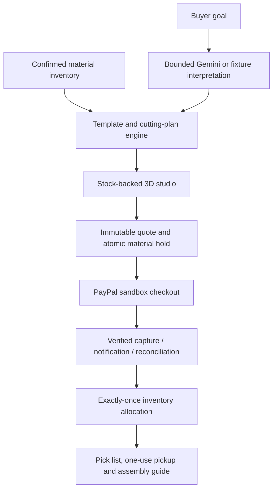

# ScrapDrop — a little leftover, a lot of possibility

ScrapDrop turns confirmed leftover craft materials into personalized project kits. Describe what you want to make, customize the finished result in 3D, inspect the actual included pieces, and buy the exact kit through PayPal sandbox for studio pickup.

The project replaces TaskSlice's website marketplace. Existing code, accounts and legacy payment records are retained; new physical-kit orders use their own stock/payment tables and never issue software-access grants.

## Try it locally without keys or spending

Requires **Node.js 24+**. From this repository:

```sh
npm ci --include=dev
npm run demo
```

Open **http://127.0.0.1:4321**. Set `SCRAPDROP_DEMO_PORT` if that port is in use. This explicit local demo uses `.data/scrapdrop-demo.sqlite`, fixture AI and a clearly labeled simulated payment. It deliberately disables PayPal and Gemini credentials even if your private `.env` contains them.

| Role | Email | Local demonstration password |
| --- | --- | --- |
| Buyer | `maker@scrapdrop.test` | `MakeSomething123!` |
| Shop operator | `studio@scrapdrop.test` | `MakeSomething123!` |

These public synthetic accounts exist only in the explicitly created local demo database. They are not production accounts or PayPal buyer/seller logins. Do not seed them into a public real shop.

## Complete demonstration

1. On the homepage, describe a gift or notebook project. Pick your budget, hands-on time, and tools. **Find my possibilities** uses labeled fixtures by default; direct project selection also works.
2. Open **The little gift box**. Drag the 3D object, change a card or ribbon shade, use **See the parts**, change dimensions, and inspect the measured cutting guide. Color choices select actual compatible stock; dimensions must fit the supplied rectangle.
3. Sign in as the local buyer. **Review this kit → Use simulated payment** consumes the exact reserved pieces once. The order page explicitly says it is not a PayPal purchase.
4. Sign out and sign in as the local operator. **Shop workspace → Orders & pickup** shows the immutable pick list. Mark the packed kit ready.
5. Sign back in as the buyer, open **My kits**, and view its private pickup QR/code and print-ready assembly guide.
6. As the operator, enter that code in **Orders & pickup → Confirm collection**. A second attempt is refused.
7. Inventory availability reflects the allocated pieces. The test suite also starts two separate processes competing for the last piece and verifies that only one succeeds.

Three supported templates are included: a folded gift box, a removable notebook wrap, and a layered bookmark. The notebook and listed tools are buyer-supplied. These are authored project designs, not arbitrary AI-generated meshes or a verified manufacturing service.

## Existing private configuration and actual PayPal sandbox

Keep your existing `.env`; do not overwrite it with `.env.example`. Private keys remain server-only. For a fresh configuration, copy the example and fill the relevant values locally.

```sh
PORT=4321 APP_BASE_URL=http://127.0.0.1:4321 APP_MODE=sandbox AI_MODE=fixture npm run dev
```

`npm run dev` reads `.env` when present. Set the sandbox app Client ID/secret and webhook ID using the existing setup. Account passwords are not API credentials. Production serving uses `npm run build` and `npm start`, Node 24, and HTTPS.

Before shop management, create/sign in to your own account and open **Shop workspace**. With no operator configured it displays your account ID. Set that existing account as `SCRAPDROP_OPERATOR_ACCOUNT_ID`, then restart. Public signup never automatically grants inventory privileges. Configure the operator before inviting judges.

PayPal checkout charges the frozen, server-priced materials kit in USD, including the displayed preparation fee. It reserves whole units for ten minutes before capture, locks them while payment is uncertain, verifies canonical capture amount/currency/seller/order, then allocates stock exactly once. Canceled unpaid holds release; refunds do not automatically restock used physical materials. The existing `/api/paypal/webhook` verifies notifications and dispatches new kit orders separately from retained legacy software orders.

The synthetic prototype is pickup-only with no shipping and an explicitly displayed $0 tax assumption. It does not implement production tax calculation, independent seller onboarding/payouts, escrow, or real physical shop fulfillment.

## AI and request limits

Gemini interprets the buyer's goal and optionally drafts labels from an operator-selected image. The server independently checks supported templates, tools, dimensions, stock and price. Photo suggestions never establish exact measurements, quantities, material composition or safety. Photo sharing requires an explicit operator action; only the selected image is sent.

- `AI_MODE=fixture` is the default. Routine tests make zero live requests even with a key present.
- `AI_MODE=live` plus a valid `GEMINI_API_KEY` enables explicit requests. The configured `GEMINI_MODEL` must support the requested modality/schema.
- Normal verification has a maximum of three requests per process, including failures; `AI_TEST_REQUEST_BUDGET` cannot raise that ceiling.
- `SCRAPDROP_AI_DAILY_LIMIT` caps each identity at 0–3 requests per UTC day. `SCRAPDROP_AI_TOTAL_LIMIT` sets a persistent total quota (default 3, maximum 100) across all ScrapDrop requests for the database. Invalid/zero budgets deny calls.
- Optional controlled judging mode: `AI_RUNTIME_MODE=judging` and `AI_JUDGING_PROCESS_BUDGET` allow up to 30 per process outside tests, still subject to the persistent total and per-identity caps. This is opt-in; default caps stay conservative.
- Rotation, color swaps, exploded views, dimensions, quantities, prices, stock checks and checkout never invoke Gemini. If AI cannot run, manual project selection remains usable.

## Render and persistent records

Keep the existing service connected to the renamed `miko-keng/scrapdrop` repository. Build: `npm ci --include=dev && npm run build`. Start: `npm start`. Set `NODE_VERSION=24`, `HOST=0.0.0.0`, `APP_MODE=sandbox`, `PAYPAL_ENV=sandbox`, and `APP_BASE_URL` to the service's actual HTTPS origin. The old `taskslice.onrender.com` address can remain while the product branding changes.

**Durable inventory and purchases require persistent storage.** Default free Render local files disappear on restart/redeploy. A persistent disk requires a paid service; alternatively adapt to a managed transactional database. This implementation uses a single SQLite instance. If you choose a disk mounted at `/var/data`, set `DB_PATH=/var/data/scrapdrop.sqlite`; images are stored in that database as bounded BLOBs. Changing the DB path starts a new database unless existing records are migrated. Do not purchase a plan implicitly or run multiple SQLite instances against ephemeral copies.

A disposable free preview may be used with its reset behavior disclosed. The local demo instructions above are the reproducible no-spend judging path. Independent BatchStudio/provider deployment is no longer required.

## Tests and architecture

```sh
npm run build
npm test
```

The build checks TypeScript and creates production assets. Tests cover template geometry/BOM correspondence, stock fitting, stale quotes, account privacy, concurrent scarcity, payment capture/recovery fixtures, immutable orders and pickup. Optional legacy/live tests remain skipped unless explicitly enabled. The live verification report distinguishes actual API calls from fixtures.



See [the detailed implementation plan](SCRAPDROP_IMPLEMENTATION_PLAN.md) and [current verification report](SCRAPDROP_BUILD_REPORT.md). Prior TaskSlice documents are historical and do not describe ScrapDrop's new purchase model.

## Important limits

Material photos/measurements and project assembly remain human-confirmed; actual shade/texture and handmade outcomes vary. The 3D view is representative authored geometry. A 2D design/cutting fallback remains available if WebGL fails. The printed layout is not a guaranteed 1:1 printer calibration—measure dimensions before cutting.

No unverified universal fit, image-to-CAD, safety certification, production shipping/tax, or measured environmental-saving claims are made. Accounts have no connected email recovery yet. A public production shop needs operational/legal/returns/privacy decisions beyond this sandbox prototype.

Source and original illustrations are MIT-licensed. Third-party dependencies retain their own licenses; see `LICENSE` and `ATTRIBUTIONS.md`.

Collection windows are capacity-limited and frozen with each order; unpaid cancellation releases capacity. Demo windows are generated for the next three days in Malaysia time.
