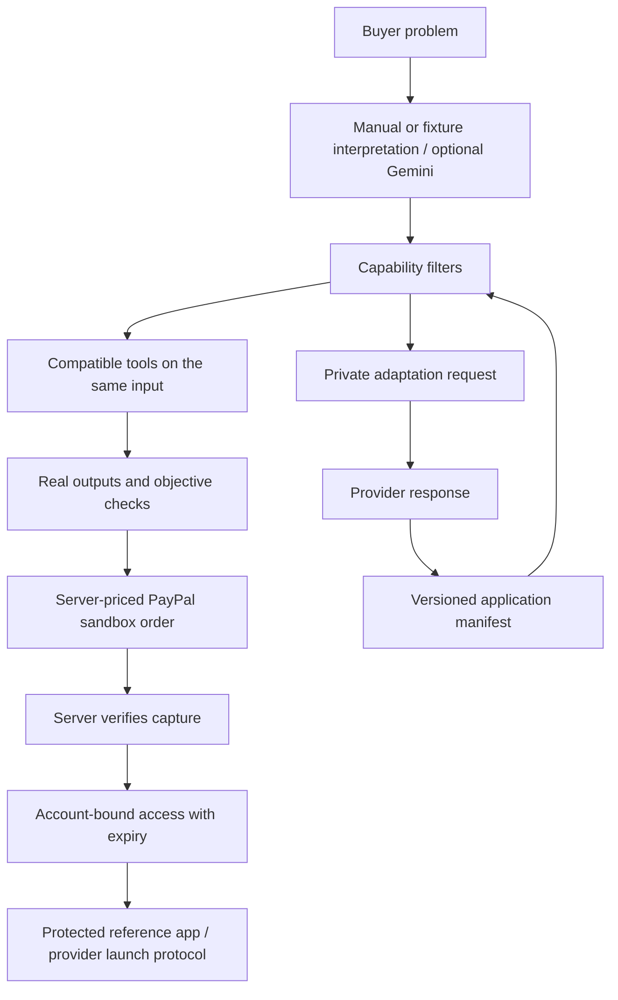

# TaskSlice — a marketplace for working solutions

Describe a problem, compare compatible applications using the same real input, and buy time-limited hosted access to the application that fits. Builders bring their own working websites. The included file and booking apps are reference products, not the limit of what builders can offer.

This is the local marketplace implementation of `MARKETPLACE_IMPLEMENTATION_PLAN.md`. It replaces the quote-calculator homepage. Earlier source and data are retained; the old quote engine is not the marketplace's application model.

## Open the current build

The current preview is **http://127.0.0.1:4321/**. Port 4317 was already occupied by an earlier TaskSlice server, so this build uses 4321. `Start TaskSlice.command` uses 4321 by default and recognises an already-running marketplace.

Requires Node.js 24+. Keep your existing `.env`; do not overwrite secrets with the example.

```sh
npm ci
PORT=4321 APP_BASE_URL=http://127.0.0.1:4321 AI_MODE=fixture npm run dev
```

For a fresh setup, copy `.env.example` to `.env` and fill only the relevant server-side credentials. The normal `npm run dev` uses the configured PORT; the explicit command above selects the preview port. `npm run build` checks TypeScript and builds the client. `npm start` serves the build; hosted production needs HTTPS because production session cookies are Secure.

## Try the buyer experience

1. Open **Explore solutions**. Describe an image-renaming or booking problem, or choose a category. Fixture interpretation is deterministic and visibly labelled. Unsupported problems do not receive invented tools.
2. Select **Pattern Rename** and **Map Rename**, then **Run same sample**. The same three actual PNG files run through both handlers. Compare resulting filenames and folder preservation; download the ZIP and mapping CSV. Hash and count checks come from the actual files.
3. Open an application. Upload your own JPEG/PNG files, change the filename pattern and order, or import a mapping CSV. Map Rename also accepts an image folder. The preview permits three images. Source and output image bytes are unchanged; image content is not sent to Gemini.
4. Create a TaskSlice account before purchasing or saving. It is separate from PayPal. Passwords are hashed with scrypt; your purchases and builder records follow your account across sign-ins.
5. **Get this application** opens PayPal sandbox checkout. Reference products cost $5, $7 and $9 USD respectively. The server controls price and verifies canonical payment amount, currency and recipient. This buys hosted access, not source ownership. Access lasts 30 days from the first access check after verified capture, without automatic renewal.
6. Paid rename access allows 100 images per run and saved naming presets. Booking Board allows up to 20 saved booking pages. Set a future session date and capacity; share the booking link, inspect the private attendee list and export CSV. Attendee reservations are free and do not send email.
7. Return through **My workspace**. Trial downloads expire after 24 hours. Ask for a specific adaptation from the tool page and track responses in your workspace. Reference-app requests remain local; nothing is sent to an external company.

The sample tools are deliberately small examples. Independent providers can register applications in other fields through **For builders**.

## Test paid capability without a payment

For a separate local demonstration, set `APP_MODE=demo` and restart. A clearly labelled **Activate demo access** button appears on reference apps. This is recorded as demo access, never as a PayPal purchase. Sandbox mode rejects the demo endpoint. Do not change your PayPal environment to live; this release supports sandbox only.

Keep a demo database separate if you want to avoid mixing demo and sandbox records:

```sh
PORT=4333 APP_BASE_URL=http://127.0.0.1:4333 DB_PATH=/tmp/taskslice-demo.sqlite APP_MODE=demo AI_MODE=fixture node --import tsx server/index.ts
```

The account cookie is shared across ports on the same hostname, so sign in again when switching between separate local databases.

## Connect a provider

Open **For builders** and follow six steps: register your website, connect server access, run the reference server, test integration, preview and publish locally. Read the complete implemented protocol in [public/provider-guide.md](public/provider-guide.md). The runnable provider is `examples/provider-reference.mjs`.

Provider credentials are issued once, stored only as hashes by TaskSlice, and belong on the provider server. The protocol uses short-lived one-use launch codes, server-to-server exchange, and current entitlement checks on every protected operation. Integration checks call the running reference app; they are not simulated green checkmarks. A changed manifest invalidates the previous check and is retained as a new version.

Independent HTTPS URLs can publish previews and receive private adaptation requests. **Independent paid checkout is disabled until seller onboarding and correct payee routing exist.** The single configured sandbox seller operates the three reference apps only. External contract tests are restricted to the configured local reference origin; arbitrary submitted URLs are not fetched. A URL alone cannot protect a paid application.

The uppercase reference server demonstrates access integration only. It is not the proposed product catalogue or a requirement to build basic tools.

## Architecture and flow



- `src/App.tsx`, `src/market/`: marketplace screens, Motion animation, matching model and responsive styling.
- `server/market/routes.ts`: accounts, catalog, trials, private downloads, access, bookings, builder workflow and adaptation requests.
- `server/market/files.ts`: bounded image validation, filename mapping, unchanged-byte ZIP generation and objective checks.
- `server/market/store.ts`: marketplace SQLite tables, scrypt identity and transactional reservations.
- `server/market/protocol.ts`: server-authenticated provider exchange and verification.
- `server/market/ai.ts`, `server/ai-mode.ts`: explicit fixture/off/live AI modes and bounded live verification.
- `server/index.ts`, `server/paypal.ts`, `server/store.ts`: reused CSRF/session middleware, PayPal creation/capture/status, verified webhook handling and grant logic.
- `examples/provider-reference.mjs`: separate running website used by provider contract tests.

SQLite keeps accounts, provider manifests and version history, jobs, private binary artifacts, bookings, orders and grants. Reference apps currently share the marketplace process. They have distinct functions but are not isolated provider infrastructure. Trial execution is synchronous and bounded; there is no worker queue or arbitrary code hosting.

## Gemini usage

`AI_MODE=fixture` is the default, even when `.env` contains a Gemini key. Routine tests force fixture mode. `AI_MODE=off` also avoids provider calls and retains deterministic/manual matching. No image bytes, attendee lists or payment details are sent to Gemini.

Only explicit final verification uses `AI_MODE=live`. Tests additionally require `ALLOW_LIVE_AI_TESTS=true`. `AI_TEST_REQUEST_BUDGET` is clamped to 0–3 requests per process. Invalid budgets disable calls. The final smoke run made **two successful live requests** after the initial offline suite and build passed. Subsequent checks and the running preview remain in fixture mode.

The existing Google AI Studio key and configured model were reused. Routine tests inject mock responses into the AI transport and cannot silently use the key. For broader production AI usage, replace this verification-only process budget with a deliberate operational quota policy.

## Configuration and private data

Use the PayPal REST sandbox app Client ID and secret. Buyer/seller passwords do not authenticate the API. Optional `PAYPAL_MERCHANT_ID` adds an explicit seller check; otherwise the canonical recipient is resolved and stored from PayPal. `PAYPAL_WEBHOOK_ID` is required for live webhook verification after registering a public HTTPS URL ending in `/api/paypal/webhook`.

`.env.test.local` is not loaded by the application. Both private environment files, local databases, dependencies and logs are excluded from the source archive. Never expose private values through `VITE_` variables. The Client ID is intentionally public for the PayPal browser SDK; the secret stays on the server.

Uploaded file content is not stored separately as raw input, but generated ZIPs contain the same image bytes and remain private for up to 24 hours. Jobs store a hashed input fingerprint, names and output metadata. Cleanup runs on trial/download access, with expired entries excluded from the workspace. Booking and account records persist locally. Download artifacts before they expire.

## Validation and current limits

Run `npm test` for offline checks. It includes self-contained marketplace HTTP tests, a separate real provider process and a full application server test with an isolated database. Build first because the full-server check serves production assets. Legacy opt-in HTTP/live checks remain skipped unless explicitly configured.

See `MARKETPLACE_BUILD_REPORT.md` for executed checks and limits. A real sandbox order was created and reused on retry at the server price; it remains unpaid. The PayPal SDK rendered in the browser. Completed checkout, actual webhook delivery and live refund/reversal delivery were **not** exercised in this build. Fixture tests cover capture validation and revocation. Do not describe those fixtures as live payment evidence.

Public production requires account recovery/email verification, independent PayPal seller onboarding, external-origin ownership validation and request restrictions, operational limits, shared storage if scaled, provider credential rotation and a deployment review. This build stays local and does not deploy or host arbitrary provider source.

The earlier quote app is retained in `src/ExpertiseApp.tsx` and `LEGACY_EXPERTISE_README.md`; the earlier lessons remain under `/lessons`. New marketplace navigation is the supported entry point.
