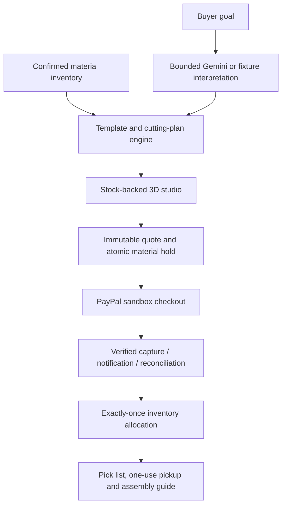

# ScrapDrop — a little leftover, a lot of possibility

ScrapDrop turns confirmed leftover craft materials into personalized project kits. Describe what you want to make, customize the finished result in 3D, inspect the actual included pieces, and buy the exact kit through PayPal sandbox for studio pickup.

The project replaces TaskSlice's website marketplace. Existing code, accounts and legacy payment records are retained; new physical-kit orders use their own stock/payment tables and never issue software-access grants.

## Try it locally without keys or spending

Requires **Node.js 24+**. From this repository:

```sh
npm ci --include=dev
npm run demo
```

Open **http://127.0.0.1:4321**. Set `SCRAPDROP_DEMO_PORT` if that port is in use. This explicit local demo uses `.data/scrapdrop-demo.sqlite`, fixture AI and a clearly labeled simulated payment. It deliberately disables PayPal and Gemini credentials even if your private `.env` contains them.

| Role | Email | Local demonstration password |
| --- | --- | --- |
| Buyer | `maker@scrapdrop.test` | `MakeSomething123!` |
| Shop operator | `studio@scrapdrop.test` | `MakeSomething123!` |

These public synthetic accounts exist only in the explicitly created local demo database. They are not production accounts or PayPal buyer/seller logins. Do not seed them into a public real shop.

## Complete demonstration

1. Choose **Make a project** (`/make`). Start from a written idea or choose a supported template. An idea is interpreted only when you press **Fill my plan from this idea**; review and apply its draft. Fixture interpretation is labeled, and omitted details stay for you to complete.
2. Enter quantity (1–100), dimensions, deadline, available hands-on minutes, optional USD materials/service budget and measured owned materials. Mark tools you have or explicitly commit to obtaining them; tools are not sold. Click **Compare my options** directly; editing fields clears stale results but does not disable comparison. Issues appear in the results and block saving/checkout until resolved.
3. Optionally allow smaller sizes with explicit minimums, and select any additional acceptable shop shades. **Compare my options** checks material fit, stock, tools, time, deadline and budget. Drag the 3D preview, inspect parts and read the measured sheet layouts.
4. Sign in as the local buyer. Review the missing-material basket and collection window. **Review top-up with PayPal → Use simulated payment** consumes the exact reserved pieces once. Local demo orders explicitly say they are not PayPal purchases. If all materials are owned, save a free making plan instead.
5. Sign out and sign in as the local operator. **Shop workspace → Orders & pickup** shows the immutable shop-only pick/cut list. Mark the packed order ready.
6. As the buyer, open **My projects**, view the private pickup QR/code and print-ready assembly guide. As the operator, confirm collection using that code; repeats are refused.
7. Beside the preview, in a saved making plan, or in a paid order, choose **Learn to make this**. Follow the hinged 3D steps or equivalent 2D cutting guide. Paid orders retain their purchased dimensions; signed-in saved plans/orders automatically save your step and completion ticks.
8. After collection and making, expand **Record what you actually made**. Save a draft, then record good/spoiled quantity, actual hands-on minutes, costs and measured reusable offcuts. **Finish batch & credit offcuts** deducts used whole owned sheets/segments and adds measured offcuts once. **Mark batch made** remains a simpler alternative; it cannot double-deduct materials.

Three supported templates are included: a folded gift box, a removable notebook wrap, and a layered bookmark. The notebook and listed tools are buyer-supplied. These are authored project designs, not arbitrary AI-generated meshes or a verified manufacturing service.

## Existing private configuration and actual PayPal sandbox

Keep your existing `.env`; do not overwrite it with `.env.example`. Private keys remain server-only. For a fresh configuration, copy the example and fill the relevant values locally.

```sh
PORT=4321 APP_BASE_URL=http://127.0.0.1:4321 APP_MODE=sandbox AI_MODE=fixture npm run dev
```

`npm run dev` reads `.env` when present. Set the sandbox app Client ID/secret and webhook ID using the existing setup. Account passwords are not API credentials. Production serving uses `npm run build` and `npm start`, Node 24, and HTTPS.

Before shop management, create/sign in to your own account and open **Shop workspace**. With no operator configured it displays your account ID. Set that existing account as `SCRAPDROP_OPERATOR_ACCOUNT_ID`, then restart. Public signup never automatically grants inventory privileges. Configure the operator before inviting judges.

PayPal checkout charges the frozen, server-priced materials kit in USD, including any selected purchased-sheet cutting fee. It reserves whole units for ten minutes before capture, locks them while payment is uncertain, verifies canonical capture amount/currency/seller/order, then allocates stock exactly once. Canceled unpaid holds release; refunds do not automatically restock used physical materials. The existing `/api/paypal/webhook` verifies notifications and dispatches new kit orders separately from retained legacy software orders.

The synthetic prototype is pickup-only with no shipping and an explicitly displayed $0 tax assumption. It does not implement production tax calculation, independent seller onboarding/payouts, escrow, or real physical shop fulfillment.

## AI and request limits

Gemini interprets the buyer's goal, optionally drafts labels from an operator-selected image, and answers explicitly requested tutorial questions grounded in the current recipe. Tutorial answers are cached per identity, recipe snapshot, step, question, photo and AI configuration. The server independently checks supported templates, tools, dimensions, stock and price. Photo suggestions never establish exact measurements, quantities, material composition or safety. Photo sharing requires an explicit action by the person uploading it; only the selected image is sent.

- `AI_MODE=fixture` is the default. Routine tests make zero live requests even with a key present.
- `AI_MODE=live` plus a valid `GEMINI_API_KEY` enables explicit requests. The configured `GEMINI_MODEL` must support the requested modality/schema.
- Normal verification has a maximum of three requests per process, including failures; `AI_TEST_REQUEST_BUDGET` cannot raise that ceiling.
- `SCRAPDROP_AI_DAILY_LIMIT` caps each identity at 0–3 requests per UTC day. `SCRAPDROP_AI_TOTAL_LIMIT` sets a persistent total quota (default 3, maximum 100) across all ScrapDrop requests for the database. Invalid/zero budgets deny calls.
- Optional controlled judging mode: `AI_RUNTIME_MODE=judging` and `AI_JUDGING_PROCESS_BUDGET` allow up to 30 per process outside tests, still subject to the persistent total and per-identity caps. This is opt-in; default caps stay conservative.
- Rotation, color swaps, exploded views, dimensions, quantities, prices, stock checks and checkout never invoke Gemini. If AI cannot run, manual project selection remains usable.

## Render and persistent records

Keep the existing service connected to the renamed `miko-keng/scrapdrop` repository. Build: `npm ci --include=dev && npm run build`. Start: `npm start`. Set `NODE_VERSION=24`, `HOST=0.0.0.0`, `APP_MODE=sandbox`, `PAYPAL_ENV=sandbox`, and `APP_BASE_URL` to the service's actual HTTPS origin. The old `taskslice.onrender.com` address can remain while the product branding changes.

**Durable inventory and purchases require persistent storage.** Default free Render local files disappear on restart/redeploy. A persistent disk requires a paid service; alternatively adapt to a managed transactional database. This implementation uses a single SQLite instance. If you choose a disk mounted at `/var/data`, set `DB_PATH=/var/data/scrapdrop.sqlite`; images are stored in that database as bounded BLOBs. Changing the DB path starts a new database unless existing records are migrated. Do not purchase a plan implicitly or run multiple SQLite instances against ephemeral copies.

A disposable free preview may be used with its reset behavior disclosed. The local demo instructions above are the reproducible no-spend judging path. Independent BatchStudio/provider deployment is no longer required.

## Tests and architecture

```sh
npm run build
npm test
```

The build checks TypeScript and creates production assets. Tests cover template geometry/BOM correspondence, stock fitting, stale quotes, account privacy, concurrent scarcity, payment capture/recovery fixtures, immutable orders and pickup. Optional legacy/live tests remain skipped unless explicitly enabled. The live verification report distinguishes actual API calls from fixtures.



See [the detailed implementation plan](SCRAPDROP_IMPLEMENTATION_PLAN.md) and [current verification report](SCRAPDROP_BUILD_REPORT.md). Prior TaskSlice documents are historical and do not describe ScrapDrop's new purchase model.

## Important limits

Material photos/measurements and project assembly remain human-confirmed; actual shade/texture and handmade outcomes vary. The 3D view is representative authored geometry. A 2D design/cutting fallback remains available if WebGL fails. The printed layout is not a guaranteed 1:1 printer calibration—measure dimensions before cutting.

No unverified universal fit, image-to-CAD, safety certification, production shipping/tax, or measured environmental-saving claims are made. Accounts have no connected email recovery yet. A public production shop needs operational/legal/returns/privacy decisions beyond this sandbox prototype.

Source and original illustrations are MIT-licensed. Third-party dependencies retain their own licenses; see `LICENSE` and `ATTRIBUTIONS.md`.

Collection windows are capacity-limited and frozen with each order; unpaid cancellation releases capacity. Demo windows are generated for the next three days in Malaysia time.

## Owned materials and batch top-ups

Open `/make` (**Make a project**). Older `/batch` and `/studio` links redirect to this same planner. Supported projects can be planned in quantities of 1–100. Add your measured card/fabric sheets and unbroken ribbon segments, deadline, available hands-on minutes and tools. Account inventories are private and revision-checked.

1. Try **3 sheets → 4 gift boxes**: three 200 × 300 mm owned sheets plus one 2,600 mm ribbon segment leave one shop sheet to buy, USD 1.90 at seed prices.
2. Try **30 event bookmarks**: three 300 × 420 mm sheets and two 3,000 mm ribbon segments cover 18 card blanks and 28 ribbons. The original 40 × 140 mm design needs two shop sheets plus one ribbon segment, USD 4.60. Within the example’s explicitly permitted minimums of 34 × 119 mm, a 34 × 130 mm alternative uses the owned sheets for all 30 projects and needs only one USD 0.80 ribbon segment.
3. Compare dimensions and required purchases, inspect 3D and the labeled sheet layouts, then review the top-up. Shop stock, prices, owned inventory revision and pickup capacity are rechecked server-side; quantities/prices from the browser are never trusted.
4. Optional cutting of **purchased sheets only** adds USD 2.50 per order. Ribbon-only purchases do not attract this fee. The service cuts purchased outer sheet blanks and includes the remaining material. Buyer-owned sheets, detailed cuts, ribbon trimming, folding, hole punching and assembly remain the buyer’s work; required tools are not removed. The operator sees the frozen shop-only pick/cut list. A batch occupies one pickup booking.
5. If you own everything, save a free making plan without PayPal. After making it, choose **Mark batch made**. Paid top-up plans require collection first. The inventory update is atomic and idempotent, and cannot make quantities negative.

The layout uses conservative rectangular grids with both orientations, 2 mm edge margins and 3 mm gaps. It is not a general industrial nesting optimizer. Pattern/grain constraints, machine scheduling, costed labor, multi-supplier purchasing and certified manufacturing specifications are outside this version. Time is a conservative template pace plus setup, not a measured labor prediction. Owned materials are self-reported and are not reserved across simultaneous plans; competing plans are checked when marked made. The balance subtracts whole used sheets/segments: measure and add usable offcuts separately rather than treating leftover area as guaranteed usable stock. Cash avoided is compared at selected shop unit prices, not claimed as profit or verified productivity gains.

## Unified planner and AI boundaries

The idea interpreter fills an editable requirements draft; it does not calculate prices, invent measured inventory, sell missing tools or generate new manufacturing recipes. Gemini receives only an explicitly submitted brief. Local fixture mode uses a small deterministic parser and does not have Gemini’s language coverage. Check the source label before presenting an AI demonstration.

The server recomputes every option and final quote using the same verified template engine. Dimensions can change only when resizing is enabled, and only within the buyer’s stated minimums. Additional shop shades require explicit permission. The comparison samples target, midpoint and minimum dimensions, checking up to 400 combinations; it is a bounded comparison, not a claim of a globally optimal nesting solution. Quantity, tools and deadline are retained across options. Budget covers materials plus the optional cutting service; separately arranged tools and travel are not priced.

This release unifies project planning, brief interpretation, explicit design flexibility, missing-tool arrangements and cutting-service copy. Job profit calculations and actual-versus-estimated production feedback are deferred.

## Planner buttons and end-to-end checks

**Compare my options** is available on initial load and after editing. It is temporarily disabled only while a planner operation is in progress (comparison, saving materials, preparing checkout, saving a making plan or marking one made). No requirements-confirmation checkbox is needed. Invalid inputs return an error; missing tools, insufficient time, expired deadlines, stock shortfalls and exceeded budgets are shown in computed results and prevent continuation.

**Save my making plan** appears below the selected comparison result when it needs no purchase (`total = 0`). It is enabled when all readiness checks pass; anonymous buyers are prompted to sign in. A paid shortfall uses **Review top-up with PayPal** instead. Use **3 gift boxes · no purchase → Compare my options → Save my making plan** for the shortest saving demonstration. Saving opens the **Saved making plans** section, where instructions persist after reloading. Saving does not consume owned materials; marking the plan made does.

See [planner browser E2E results](PLANNER_E2E_REPORT.md) for the verified flows and reproduction steps.

The expanded [varied-input browser E2E report](PLANNER_INPUT_MATRIX_E2E_REPORT.md) covers materials, dimensions, quantity and budget variations as well as the full simulated collection lifecycle. Worked examples reset the optional cutting service. A design with no fitting supply shows an unavailable total rather than presenting its unpriced shortfall as a free making plan.


## Making tutorials, results and economics

**Learn to make this** opens eight authored steps with Back/Next, numbered navigation, completion ticks, replay, pause, camera reset and measurements. Left/Right arrows navigate outside form fields; Escape closes. Your operating system’s reduced-motion setting snaps to each step’s final pose. Switch to **2D cutting guide** if preferred or if WebGL is unavailable. **Print all steps** prints the measured diagram and every step; printouts must be checked with a real ruler.

The gift box uses real wall/tab/lid hinge rotations from the shared recipe. Notebook-wrap hems and pockets rotate; layered bookmarks bond, punch and receive ribbon. These are illustrative assembly motions, not cloth/knot/adhesive physics. `src/scrapdrop/recipes.ts` owns dimensions, cuts, folds, authored steps and gift-box hinge definitions. Automated checks match the flat gift-box net to its assembled centerline geometry at several sizes. **Physical assembly trials are still pending**, and that status is visible in the tutorial. Do not represent these checks as physically verified fit or strength.

The tutorial uses frozen saved/purchased plans, distinguishes YOURS and SHOP allocations, and retains detailed/owned-material cutting when purchased outer blanks were precut. Future unsupported recipe versions are refused by the saved-progress service rather than silently migrated. Saved progress and production records are private and revision-checked. Paid-order progress requires payment; production results require collection.

**What could this batch earn?** estimates contribution from selling price, purchased materials/service, entered owned-material cost, labor, consumables, overhead and payment fees. **Cash avoided** stays separate and is never added to revenue/profit. Taxes, selling success and any costs you leave at zero are excluded. Actual results recompute contribution using good quantity and recorded time. Finishing requires all planned pieces to be accounted for as good or spoiled. Measured offcuts must fit their source dimensions and remaining material allowance; crediting and owned-material deductions commit atomically once. Self-reported measurements still require your judgment.

**Explain this step / troubleshoot** sends only an explicit question and recipe context. An optional photo is resized/re-encoded, stripped of metadata and sent only after the photo checkbox and help action; raw photos are not saved in tutorial records. Photo suggestions always remain uncertain. Fixture mode explicitly says that no image was assessed. Cached live answers and authored guidance remain labeled.

To toggle Gemini locally without replacing credentials:

```sh
npm run ai:on   # sets AI_MODE=live in .env
npm run ai:off  # sets AI_MODE=fixture in .env
```

Restart your server after either change. On Render, change **AI_MODE** in the service’s Environment settings and redeploy/restart; a local `.env` change does not change Render. Normal navigation, animation, cutting calculations, progress and economics use no model calls. Routine tests force fixture mode. The existing process, identity/day and database quotas still apply. See [tutorial verification](TUTORIAL_BUILD_REPORT.md), [physical/novice trial pack](MAKING_TRIAL_PACK.md) and [three-minute demonstration outline](SUBMISSION_DEMO.md).
