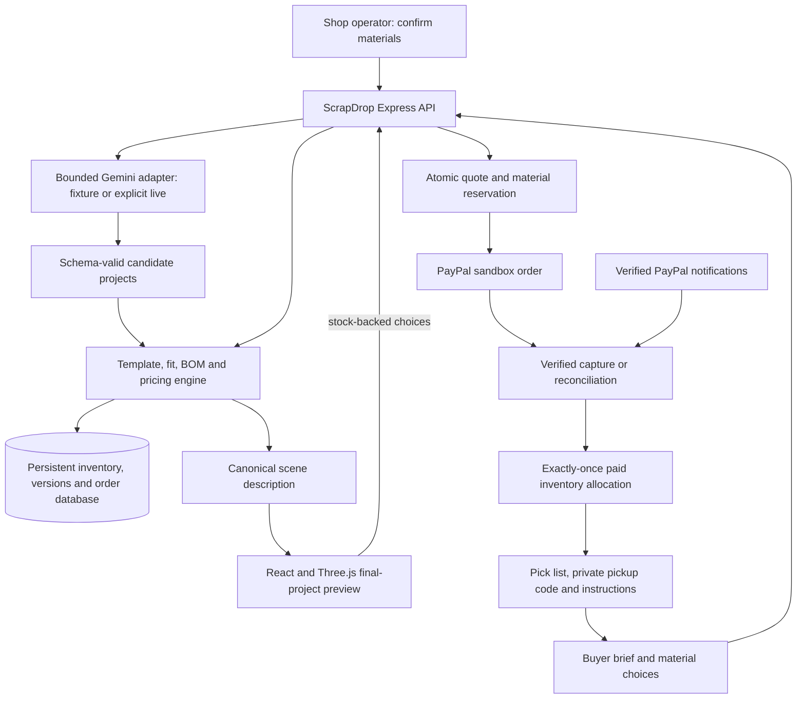

# ScrapDrop implementation plan

**Date:** 25 October 2026, Asia/Kuala_Lumpur.  
**Status:** approved product direction; proposed engineering work, not a claim that ScrapDrop is already implemented.  
**Replaces:** TaskSlice's independent-web-application marketplace direction.  
**Working positioning:** Turn leftover materials into a project someone wants to make. Customize the finished result in 3D, then buy the exact kit through PayPal.

## 1. Product decision

ScrapDrop helps a craft shop or makerspace turn confirmed surplus stock into useful, personalized project kits. A buyer describes an occasion, budget, available time, and tools they already own. AI proposes suitable projects from the actual inventory. The buyer explores a 3D representation of the final object, changes compatible colors/materials, sees the included pieces, and purchases a specific kit for pickup.

The purchase is a physical materials kit with assembly instructions. It is not a software subscription, a URL listing, a commission to a developer, or a promise that AI will manufacture an arbitrary object.

The first release represents one shop operated by the application's owner, using one PayPal sandbox merchant. Other people can buy kits, but independent shops cannot collect payments through our merchant account. Multi-shop onboarding and payouts are explicitly deferred.

The defining demonstration is: **the same limited material can enable several attractive projects, but a paid allocation makes that stock unavailable to another buyer.** The 3D customization must remain connected to those real material choices throughout checkout and fulfillment.

## 2. Audience and problem

Primary supplier: a small craft shop or makerspace with usable paper/cardstock, rectangular fabric offcuts, ribbon segments, and simple decorative supplies. Primary buyer: a beginner who wants a feasible gift or craft activity without buying large quantities or working out every required material.

Problems addressed:

- Surplus pieces are hard to sell individually because their usefulness is unclear.
- A buyer sees a pile of materials rather than an achievable finished object.
- Generic AI project ideas may require supplies that are missing or incompatible.
- A pretty generated picture does not establish what is included in the purchase.
- Several attractive kit ideas can compete for the same remaining pieces.

Positioning hypothesis: inventory-constrained project generation, an editable 3D result tied to its material list, and an actual paid pickup flow together are more useful than a surplus listing directory. This is not a claim of worldwide novelty, proven market demand, or quantified environmental savings.

## 3. Scope and exclusions

### Required for the hackathon release

- One explicitly configured shop/operator, persistent buyer accounts, and an operator-only inventory workspace.
- Original sample inventory and a real image-upload flow with optional AI-assisted labeling.
- Human-confirmed material types, usable dimensions, quantities, colors, condition, and prices.
- Three authored project templates with deterministic geometry and material requirements.
- Text-based AI matching and bounded personalization using confirmed inventory only.
- Up to three feasible project suggestions; fewer when fewer are feasible.
- Interactive 3D final-object preview, real material swaps, assembled/exploded views, and a synchronized materials list.
- Server-authoritative quotes, atomic temporary stock reservations, PayPal sandbox checkout, verified capture, and paid inventory allocation.
- Buyer order history, immutable purchased-kit detail, assembly instructions, pickup code, and operator fulfillment.
- A complete fixture-based demo and a small, separately recorded live-AI/payment verification.

### Deferred

- Developer registration, provider keys, external-app sample endpoints, builder requests, and application access subscriptions.
- Arbitrary generated code, arbitrary uploaded 3D models, image-to-mesh generation, photogrammetry, cloth physics, or guaranteed photorealism.
- Inferring exact dimensions, safety, counts, or manufacturing feasibility from photographs alone.
- Free-form CAD, 3D printing, shipping logistics, automatic tax jurisdiction support, multi-currency pricing, and independent seller payouts.
- Food, medical products, electrical projects, load-bearing parts, children's safety certifications, and performance claims for unknown materials.
- Automatic consumption of leftover subregions from an irregular offcut; the initial stock unit is an individually allocatable piece or a lot of identical pieces.
- A social feed, chat system, review marketplace, autonomous agents, auditing dashboards, or approval workflows in the buyer experience.

## 4. Current foundation versus new work

The existing code is TaskSlice. Preserve its history and any real sandbox records. Do not rename directories or deployment domains merely to implement the new product identity.

| Existing foundation | ScrapDrop treatment |
| --- | --- |
| React, TypeScript, Vite, Express, Node SQLite | Retain; add isolated ScrapDrop modules and schema migrations. |
| Account hashing, sessions, ownership, CSRF/origin checks | Reuse after verifying buyer/operator boundaries. |
| PayPal sandbox transport, create/capture request identity, webhook verification | Reuse transport and validation patterns; add a physical-kit order handler. |
| Legacy payment grant logic | Do not call it for physical kits. Kit payment consumes reserved inventory; it must not issue software-access grants. |
| Booking capacity transaction patterns | Adapt concepts to material reservations and pickup capacity; do not equate a booking row with a stock ledger. |
| File validation, private artifacts, CSV/ZIP utilities | Reuse suitable pieces for uploads and instruction packages. |
| AI fixture/live adapter | Retain zero-call routine tests; extend deliberately for bounded multimodal input. |
| Marketplace comparison, provider tutorial, request inbox, BatchStudio | Remove from primary navigation. Retain archived source/records until migration is verified; no further provider work in this plan. |
| Three.js viewer and project geometry | New work. No existing 3D preview is claimed. |
| Inventory, templates, kit feasibility, quotes, reservations, fulfillment | New work. |

The prior plan is archived at `docs/archive/TASKSLICE_MARKETPLACE_PLAN_2026-10-24.md`. This document is the active product implementation plan.

## 5. Six-step product journey

### Step 1 — Shop brings its leftover materials

Operator uploads JPEG/PNG photographs or starts from labeled sample stock. AI-assisted labeling is an explicit action, not triggered by file selection, typing, or navigation. If images will be sent to Gemini, state that before the action; manual entry remains available.

AI suggests labels and approximate color families. Each suggestion is a draft. Operator confirms type, usable rectangular dimensions in millimeters, quantity, shade, condition, and price before stock becomes sellable. Uploaded photographs are not sufficient evidence of exact size or number. Unknown material composition remains unknown.

Model each distinct piece as a separate stock item, or group only pieces with the same relevant dimensions, material, appearance, and condition. A lot of differently sized scraps cannot advertise the largest piece's dimensions for every unit.

### Step 2 — Buyer describes what they want to make

Collect: occasion/use, budget, maximum hands-on time, supported skill level, preferred colors, quantity of finished projects, and owned tools. Example: "A small birthday gift under $12. I have scissors and glue and about 30 minutes."

Offer a few useful starting points. Keep manual choices available when AI is disabled or unavailable. Clarify whether time means hands-on work or includes drying. Budget uses USD in the first sandbox release and includes every charged line item shown before PayPal.

### Step 3 — Show feasible project kits

AI proposes only supported template IDs and candidate inventory IDs. The deterministic engine checks type, dimensions, compatibility, quantity, required tools, and price. It rejects invented IDs and incompatible allocations. If no project fits, explain the blocking constraint and offer a specific adjustment; do not invent stock.

Show up to three project cards with an actual rendered preview, final dimensions, estimated authored effort, required tools, included materials, availability-at-check-time, and price. Do not present the same project three times with only different adjectives. Viewing suggestions does not reserve materials.

### Step 4 — Buyer customizes and inspects the result in 3D

This is a required core feature, not optional decoration. The main view shows the assembled finished object rather than only floating raw supplies. Buyer can rotate, zoom, reset the view, select a part, swap an available material/color, open the exploded view, inspect dimensions, and see exactly which supplies correspond to the finished parts.

Swapping a color means selecting an actual compatible stock item with that color; it is not arbitrary paint applied to a model while a different material is shipped. A temporarily uncommitted preview can update immediately, but price and stock validity are confirmed by the server before continuing.

Assembled model, exploded parts, material list, cutting diagram, quoted price, and later purchased snapshot derive from the same validated configuration. See Sections 7–10 for the detailed 3D contract.

### Step 5 — Reserve and pay for the exact kit

An explicit checkout action revalidates the configuration, creates a frozen quote, and atomically reserves all required material units. Show the reserve-until time, exact contents, pickup location/window, required tools, price, and representative-preview label before opening PayPal.

PayPal purchase approval alone is not paid fulfillment. Only a verified completed capture for the correct order, currency, amount, and seller converts its material reservation into a paid allocation. Handle slow, canceled, pending, repeated, and uncertain payment states without overselling.

### Step 6 — Collect and make

Buyer sees a paid order, pickup QR/code, assembly guide, final design configuration, and included-material checklist. Operator sees the matching pick list, marks the kit ready, and confirms collection. Instructions distinguish "in your kit" from "bring your own tools."

The order's 3D preview and contents remain the purchased version even if stock, prices, template code, or preferences change later. Any real substitution needs the buyer's explicit agreement; the MVP does not silently substitute.

## 6. Demonstration inventory and templates

Use synthetic, clearly labeled sample stock and original photos. For a physical demonstration, record and measure real stock separately. Do not invent customers, sales, reviews, recovered waste totals, or time-saving evidence.

### Initial template catalogue

| Template | Final output and 3D behavior | Required deterministic checks |
| --- | --- | --- |
| `folded-gift-box-v1` | Small rectangular cardstock gift box with a lid or authored fold structure, an optional compatible ribbon band, and an optional tag. Assembled/exploded/fold-step views. | Exact supported dieline fits inside one confirmed usable rectangle with margin; valid fold/tab geometry; ribbon path and allowance fit the supplied segment. |
| `notebook-wrap-v1` | Removable fabric/card wrap around one supported notebook size, plus an optional ribbon closure. Preview the cover, folds, and closure separately. | Supplied notebook is included as a priced item or explicitly buyer-owned; panel dimensions include fold allowances; selected material supports the authored construction. |
| `layered-bookmark-v1` | Layered cardstock bookmark with an optional ribbon tassel. Preview front/back, layer separation, and material colors. | Supported strip layout fits the allocated piece; ribbon segment and attachment placement satisfy the recipe; no required tool/material is omitted. |

Start with the gift box as the vertical slice. Add the other two only after the same configuration drives geometry, BOM, pricing, and checkout correctly. Author template effort and tool requirements; AI may explain them but cannot invent measured completion times.

For each template, deliver: a versioned parameter schema; approved material types; stock-slot requirements; deterministic fit rules; geometry recipe; cut/fold plan; parts-to-stock mapping; assembly guide; and known limitations.

Minimum scene fixtures: a successful default, a compatible color swap, an unavailable option, and a size/material combination that fails. At least one demonstrated change must affect geometry or assembly, not only color.

## 7. Detailed 3D experience for Step 4

### Workspace layout

Desktop: one large 3D canvas, a compact customization panel, and a persistent order summary in the same view. Mobile: canvas first, then accessible material choices and summary; avoid forcing drag gestures to navigate the page. Keep "Continue to checkout" visible without covering the object or essential controls.

Primary controls: rotate by dragging, zoom, reset view, assembled/exploded toggle, and a short assembly-step control. Optional auto-rotate starts only when the buyer asks. Do not show a complex modeling toolbar, timeline editor, or coordinate controls.

### Required interactions

1. Show the finished project on entry with a useful camera angle and readable scale label.
2. Click/tap a part or select its named materials-list row to highlight both. Do not rely on color alone to identify it.
3. Select from stock-backed swatches labeled with material name, shade, availability, and any price difference.
4. Animate compatible changes while preserving camera framing. Dispose of obsolete geometry/materials.
5. Separate parts in exploded view with numbered labels corresponding to the material list. The separation is explanatory, not a claim about assembly tolerances.
6. Step through the authored construction sequence; fold/position transforms must correspond to the actual guide.
7. Toggle dimension labels in mm. Show finished dimensions and relevant supplied-piece dimensions separately.
8. Increase kit quantity and see stock and price validation. Do not infer additional capacity from a scene containing only one displayed kit.
9. If a chosen item becomes unavailable, explain which part needs replacement and retain the buyer's other settings. Never silently choose a different shade.
10. Capture a thumbnail or use a deterministic pre-rendered fallback for cards/order history. A screenshot is presentation only, not the purchase source of truth.

### What the preview promises

The preview represents the selected design, supported dimensions, parts, and confirmed material variations. It is not an exact photograph of the finished handmade result. Texture, lighting, shade, folds, and small imperfections may differ. Display a concise "Design preview · actual material appearance may vary" note with the real stock photo nearby.

A real stock photo and declared material identity must remain visible. A visual approximation cannot conceal an incompatible material or arbitrary substitution. Do not recolor a stock photograph to make nonexistent inventory appear available.

## 8. 3D implementation architecture

Use a lazy-loaded Three.js viewer inside React. Direct Three.js with a small React adapter is sufficient; add a React-specific scene wrapper only if it reduces lifecycle complexity. Select and pin compatible versions during implementation. Do not install a large CAD/physics stack for three bounded craft templates.

Core boundaries:

- `ProjectTemplate`: version, parameter schema, parts, stock slots, fit calculations, assembly sequence, and deterministic instructions.
- `ValidatedKitConfiguration`: template/version, parameters, part-to-inventory allocations, quantities, and inventory revisions.
- `KitSceneDescription`: serializable geometry primitives, transforms, part IDs, approximate appearance, units, bounds, and assembly positions.
- `KitViewer`: renders that scene and emits local user selections. It cannot create quotes, change inventory, or mark orders paid.
- `KitQuote`: server-generated immutable price/BOM/design snapshot with a configuration hash and expiry.

Use authored shape/extrusion geometry, planes with thickness, box panels, and simple ribbon paths. No LLM-authored JavaScript, SVG scripts, URLs, shaders, or executable geometry. Map validated enum values/numbers onto trusted template functions. Material photos can appear beside the scene; texture loading is limited to trusted stored assets.

Use one explicit conversion from millimeters to scene units across all templates. The assembly scene and cutting geometry share the same dimensional formulas. Approximate cloth drape is authored and labeled; it is not a material simulation.

Each visible part has `partId`, `stockSlotId`, and allocation references. One physical sheet may create several visible panels; the BOM must count the purchased sheet once, not once per rendered panel. Optional decorations cannot appear unless included or clearly identified as buyer-supplied.

### Performance and accessibility targets

- Viewer is code-split; inventory, text flow, and checkout do not wait for its bundle.
- Target an initial scene payload below 250 KB excluding reusable libraries and stock photographs; keep textures bounded and compressed.
- Aim for smooth interaction on an ordinary phone; cap device pixel ratio, avoid heavy post-processing and shadows, and render on demand where possible.
- Pause rendering offscreen and when the tab is hidden; handle WebGL context loss and clean up on unmount.
- Supply a non-WebGL 2D assembled illustration, exploded diagram, named materials list, and dimensions. All purchases remain possible without 3D.
- Use normal HTML controls with keyboard support, visible focus, labeled swatches, status announcements, and reduced-motion behavior. No essential detail depends on hover or dragging.
- Performance figures above are engineering targets, not claims already measured.

## 9. One configuration governs preview and purchase

Proposed example shape (IDs are illustrative; measurements must pass the template's actual fit rules):

```json
{
  "templateId": "folded-gift-box-v1",
  "templateVersion": 1,
  "parameters": { "widthMm": 80, "depthMm": 60, "heightMm": 35 },
  "projectQuantity": 1,
  "allocations": [
    { "slotId": "body", "inventoryId": "stock-card-olive", "units": 1, "revision": 4 },
    { "slotId": "ribbon", "inventoryId": "stock-ribbon-cream-800mm", "units": 1, "revision": 2 }
  ],
  "buyerOwnedTools": ["scissors", "ruler", "glue"],
  "configVersion": 1
}
```

The browser sends preferences and stock IDs, never authoritative amounts or quantities to deduct. The server normalizes configuration, expands the template recipe, validates the cutting plan and stock, calculates the BOM/price, and returns the canonical configuration plus revision/hash.

A local material swap can render optimistically without an AI request. Debounce/cancel ordinary server validation; attach a configuration sequence number and discard stale responses. While a configuration is unvalidated or invalid, checkout is disabled and a short status explains why.

The quote's canonical hash covers template version, relevant parameters, allocations/revisions, quantity, price components, currency, and fulfillment terms. The frozen order snapshot includes the canonical JSON and scene/template version. Never rely on a client screenshot or a mutable catalog reference to establish what was purchased.

## 10. Inventory and feasibility rules

### Stock representation

Each item stores confirmed material type, shade identifier/hex approximation, supported condition, usable dimensions, stock unit, quantity, unit price in integer cents, photo reference, revision, and active/sellable state. Record AI-suggested versus operator-confirmed fields.

For MVP, units are discrete pieces or predefined segments. Ribbon may be offered as a confirmed 800 mm segment; continuous length cutting and residual-length accounting are deferred. Two identical rectangle pieces can be a lot of quantity two. Irregular scraps require a conservatively confirmed usable rectangle or remain unavailable to the automatic kit planner.

Use a ledger for received, reserved, released, sold, returned, damaged, and operator-adjusted units. Reserve the whole offcut unit even if a design uses only part of its area. The buyer receives that allocated unit unless the recipe explicitly sells a pre-cut pack. Display remaining scrap as part of their kit; do not claim the shop retained or resold it.

### Deterministic feasibility

- Supported template and parameter ranges only.
- Correct material type, thickness/rigidity class where relevant, minimum usable dimensions, and all required components/tools.
- A generated cut/fold layout fits a specific rectangle, with margins, allowances, permitted rotations, and non-overlap. Total area alone does not prove fit.
- Exact project quantity multiplies the BOM correctly; variants sharing a stock item are aggregated before stock checks.
- Available units equal sellable stock minus unexpired holds and paid allocations, according to one consistent ledger/counter model. Never subtract the same sale twice.
- Colors are soft preferences unless the buyer explicitly makes them a hard requirement.
- Authored maximum hands-on time and tool prerequisites are shown; drying/waiting time is separate.
- No stock claim, project recommendation, price, or carbon-saving statistic comes from an unchecked LLM assertion.

## 11. AI behavior and cost discipline

### Meaningful AI responsibilities

1. Optional vision-assisted stock drafts: suggest bounded material labels and colors from an operator-selected image. Exact dimensions/quantity/composition require confirmation.
2. Interpret a buyer's language into a strict goal schema: occasion, supported use, budget, time, colors, quantity, skill, and owned tools.
3. Suggest supported template IDs and candidate compatible material IDs, explaining why each serves the buyer's goal. Output passes the same deterministic feasibility engine used by manual selection.
4. Personalize short explanations and authored instruction wording without changing the underlying recipe or omitting required steps.

The system must produce genuine personalization, such as choosing a glue-based project when the buyer has no sewing equipment or changing the kit when a required color/stock item is unavailable. A keyword classifier alone is not the intended AI experience.

### Boundaries

- AI cannot change stock, calculate authoritative totals, choose the merchant, capture payments, grant operator roles, or mark pickup complete.
- Only normalized inventory fields and thumbnails explicitly approved for AI use are provided. No buyer credentials, payment information, order history, or hidden file contents are sent.
- Buyer free text and uploaded image content are data, not system instructions.
- Strict schemas reject unsupported template IDs, stock IDs outside the supplied candidate set, extra executable fields, invalid numbers, and impossible requirements.
- Prefer one interpretation/proposal call with a compact inventory summary. Deterministic feasibility filtering and ranking run locally/server-side without repeated model judging.
- A failed/ambiguous response produces a clarification/manual selection, not an invented valid kit.

### Development, final smoke, and judging

- Routine unit, integration, browser, and payment-fixture tests use `AI_MODE=fixture` with network transport blocked. Presence of a real key never enables calls.
- Color swaps, rotation, camera movements, exploded views, quantity edits, quote refreshes, checkout, inventory validation, and page reloads make zero Gemini calls.
- Cache validated responses by owner/shop, stock revision, normalized brief, model, prompt/schema version, and selected image hash. Never reuse a stale stock-dependent allocation without revalidation.
- No automatic retry loop and no second-model fallback during routine testing.
- Only after offline tests and build pass: at most three real requests for initial final verification—one stock-photo draft, one buyer proposal, one constrained revised goal. Failures count toward the budget.
- Label fixture/manual/live sources accurately. Record actual response validation and usage; never describe fixture output as live AI.
- The existing text-only transport needs a deliberate multimodal extension for the optional photo scenario; adding an image picker alone does not implement vision.
- The current three-request-per-process verification guard must not silently become the judging service's lifetime allowance. Before enabling a live hosted judging mode, implement a separate explicit per-session/day cap and total operator-controlled budget, with fixture/manual fallback and a clear status. Do not remove cost guards globally.

## 12. System architecture



There is one trusted application backend and one shop in the MVP. No provider verification handshake, external builder URL, arbitrary code execution, or independent seller payment routing is necessary.

## 13. Payment and scarce-stock reservation design

### Separate payment from fulfillment

The existing TaskSlice order handler purchases software access. ScrapDrop needs a new product kind and fulfillment path. Reuse OAuth, request identity, server-side capture inspection, and signature verification. Do not reuse `grantCapture` unchanged: it writes legacy software-access grants and does not atomically consume physical inventory.

Use a shared payment-observation layer with an explicit dispatcher for `legacy_access` versus `scrapdrop_kit`. New order/provider metadata must identify the local order, product kind, immutable quote, amount, currency, and expected merchant. Existing legacy captures and webhook reconciliation must keep working during migration.

### Quote and hold flow

1. Client sends canonical configuration ID/hash, chosen pickup window, and a stable checkout request key.
2. Server checks account, current template/stock revisions, required tools acknowledgment, exact BOM, and server-derived line prices. The quote expiry is explicit.
3. In a short SQLite `BEGIN IMMEDIATE` transaction, reserve all material units and pickup capacity or none. Aggregate duplicate stock IDs first. Initial hold duration: ten minutes, configurable and server-timed.
4. Create the local order and bind it to the immutable quote/hold. Persist it before contacting PayPal. Use the same PayPal create request ID on retries.
5. On timeout, return a pending/reconciliation state rather than creating another order or granting fulfillment. Never keep a DB transaction open across a network call.
6. Show the hold countdown without extending it on every refresh. A changed design requires a new validated quote/hold and explicit replacement of the old one.

### Capture race rules

When the buyer approves on PayPal, the server atomically verifies that the reservation is still active and transitions it into a capture-in-progress lock before requesting capture. The expiry worker uses a conditional state transition and cannot release a lock while capture is in flight.

If the hold expired first, decline to initiate capture and ask the buyer to revalidate stock. PayPal buyer approval is not a stock reservation or evidence of captured funds.

If capture was sent but its outcome is unknown or pending, retain the stock lock, show "Checking payment," and reconcile against PayPal. Do not expire/release that stock merely because the browser closed or a normal hold deadline passed. An unresolved lock appears in the operator's action list; it cannot be silently freed while money may have been captured.

On verified completed capture, one transaction records the unique capture, consumes the held units exactly once, marks the order paid, and creates fulfillment/pickup records. Validate canonical local/PayPal order linkage, amount, USD currency, seller, and capture status. All paths—browser callback, worker, and webhook—call the same idempotent finalizer.

A completed capture discovered after a terminally released reservation is an exception: record payment, block fulfillment, attempt a fresh atomic allocation only if still feasible, otherwise mark `paid_needs_resolution` for refund/manual resolution. Never hide the payment or allow inventory to go negative. This exception is explicitly tested even though normal server-side capture locking is designed to prevent it.

### PayPal scope

Use sandbox Orders v2 create/approve/capture, canonical status lookup, idempotent requests, and verified webhook delivery. All prices originate in the quote, not the browser or AI. First release uses USD to match the existing validated transport; changing currency requires explicit conversion-free display, validation, and tests.

Pickup-only checkout has no shipping line. For the synthetic sandbox demo, show the final total and label any configured zero tax/fee assumptions; this is not a production tax implementation. Do not promise escrow, split payments, automatic merchant onboarding, or money movement that has not been built.

### Notifications and recovery

Retain `/api/paypal/webhook` and dispatch to the correct product handler after verification. Required implemented lifecycle cases include completed/pending/denied captures and refunds/reversals, using applicable documented event types checked against PayPal's current event catalogue during implementation. Persist notification receipt and processing status so duplicates and crashes can be retried.

Approval events do not mark an order paid. A webhook simulator event is not proof of an actual checkout/refund lifecycle. Live final verification must record actual order/capture/notification evidence without exposing credentials.

### Refunds and stock

Payment status and physical stock are separate. A refund/reversal blocks future pickup, but it does not automatically make materials sellable: an already packed, cut, collected, or damaged kit may not be recoverable as its original stock units. Operator confirms returned usable units before the ledger restores them. Partial refunds retain explicit amounts and do not assume the whole kit was returned.

## 14. States and transitions

Keep payment, reservation, and fulfillment state separate rather than overloading one status field.

| Entity | States | Important constraint |
| --- | --- | --- |
| Inventory item | draft, active, paused, exhausted | Draft/unconfirmed or paused units cannot enter new quotes. |
| Kit configuration | draft, valid, stale, invalid | A valid scene alone is not reserved stock. |
| Quote | active, expired, superseded, committed | Committed prices/design do not change with catalog edits. |
| Reservation | held, capture_locked, committed, released, expired, needs_resolution | Ordinary expiry applies only to held; uncertain capture retains allocation lock. |
| Payment | creating, awaiting_buyer, capture_requested, pending, paid, denied, refunded, partially_refunded, reversed, needs_reconciliation | Only canonical verified completion permits paid allocation. |
| Fulfillment | awaiting_payment, paid_needs_resolution, preparing, ready, collected, canceled | A pickup code is redeemable only for paid, fulfillable, nonrevoked orders. |

Transitions use conditional updates and unique keys. Worker jobs must be safe to resume after restart and use bounded retries with visible unresolved states. Every reservation release and stock consumption is recorded once with a stable event identity.

## 15. Proposed persistent data model

Use new namespaced tables and migrations. Keep existing TaskSlice tables until legacy compatibility and record retention are verified. The final SQL can normalize the following logical entities differently, but all stated constraints must remain enforceable.

| Entity | Minimum fields |
| --- | --- |
| `sd_shops` | id, operator account, name, pickup location, active, currency, expected merchant configuration reference |
| `sd_material_images` | id, shop, private storage reference, MIME/size/hash, AI-sharing choice, created/deletion timestamps |
| `sd_inventory` | id, shop, type, condition, shade, usable dimensions, unit type, confirmed quantity, price cents, photo, revision, confirmed/active flags |
| `sd_stock_ledger` | id, item, integer delta or explicit reservation event, reason, order/reservation, unique event key, timestamp |
| `sd_templates` / versions | id, version, supported parameters, slots, geometry/recipe version, authored instructions, active |
| `sd_briefs` | id, buyer or guest, normalized goal, source label, relevant stock revision, created/expiry |
| `sd_configurations` | id, owner, template/version, parameters, allocations, canonical hash, validation status, version |
| `sd_quotes` | id, buyer, configuration snapshot/hash, BOM, price lines, total cents, currency, stock revisions, pickup terms, expiry |
| `sd_reservations` / lines | id, buyer/order/quote, item units, pickup slot units, status, expiry, lock/commit/release metadata |
| `sd_orders` | id, buyer, quote/reservation, immutable design/BOM/terms, payment and fulfillment state, local/provider request IDs |
| `sd_payments` | unique capture ID, local/provider order linkage, verified cents/currency/merchant, observed status, reconciliation metadata |
| `sd_pickups` | order, hashed random code, ready/collected timestamps, operator actor, revocation state |
| `sd_artifacts` | order/owner, type, private storage reference, checksum, created/retention policy |
| `sd_ai_cache` / usage | owner/shop, normalized cache key, schema/model version, validated bounded result, expiry, request counters |

Use integer quantities and integer cents. Keep revisions monotonically increasing. A stock adjustment cannot reduce sellable units below existing paid allocations or holds without an explicit exception path. Define whether the authoritative counter represents on-hand or unallocated units, then derive availability consistently; do not mix both meanings.

Persist complete purchase snapshots; mutable inventory/template IDs alone are insufficient. A viewer for an older order needs a retained scene recipe version or frozen bounded scene description.

## 16. Proposed API and module boundaries

API prefix: `/api/scrapdrop`. Existing account sessions can be reused; operator-only endpoints require the explicitly configured shop operator account. No first registrant automatically becomes the operator.

| Endpoint | Purpose |
| --- | --- |
| `GET /shop` | Public shop/pickup information and supported template summaries. |
| `GET /inventory` | Public sellable material summaries without private operational fields. |
| `POST /operator/images` | Validate/store a private material image. |
| `POST /operator/images/:id/suggest` | Explicit bounded AI labeling; returns drafts only. |
| `POST /operator/inventory` | Create operator-confirmed sellable stock. |
| `PATCH /operator/inventory/:id` | Revision-checked updates with reservation-aware constraints. |
| `POST /ideas` | Interpret a brief/propose candidates using fixture/manual/live adapter. |
| `POST /configurations/validate` | Deterministic feasibility, canonical scene, BOM, and indicative price; no hold. |
| `POST /quotes` | Freeze server-validated configuration and terms. |
| `POST /checkout` | Idempotently create stock hold/local order/PayPal order. |
| `GET /orders/:id` | Owner-scoped canonical payment/fulfillment/hold status. |
| `POST /orders/:id/capture` | Check hold, lock capture, invoke/reconcile PayPal, finalize once. |
| `POST /orders/:id/cancel` | Cancel only eligible pre-capture state and release resources safely. |
| `GET /orders/:id/instructions` | Private paid order guide and purchased design. |
| `POST /operator/orders/:id/ready` | Confirm actual packing and enable pickup. |
| `POST /operator/pickups/redeem` | Validate code and atomically record one collection. |
| `POST /operator/orders/:id/return` | Confirm actual return/restock separately from payment refund. |

These are planned routes; do not show them as implemented until tests pass. Image and mutation endpoints enforce account ownership, origin/CSRF checks, bounded payloads, and rate limits. Personalization remains possible for a guest, but checkout/order history binds to an account.

Proposed modules:

```text
src/scrapdrop/
  ScrapDropApp.tsx          # product routes and shell
  InventoryWorkspace.tsx   # shop stock confirmation
  BuyerBrief.tsx
  ProjectIdeas.tsx
  KitStudio.tsx            # Step 4 customization
  KitViewer.tsx            # lazy-loaded Three.js lifecycle
  KitMaterials.tsx         # accessible material/part controls
  Checkout.tsx
  OrderDetail.tsx
  FulfillmentWorkspace.tsx
  templates/               # trusted template schemas and scene recipes
  model.ts
  style.css
server/scrapdrop/
  routes.ts
  store.ts                 # migrations and scoped persistence
  inventory.ts
  templates.ts
  feasibility.ts
  quotes.ts
  reservations.ts
  payments.ts              # physical-kit payment finalizer
  fulfillment.ts
  ai.ts
  artifacts.ts
  fixtures/
tests/
  scrapdrop-templates.test.ts
  scrapdrop-inventory.test.ts
  scrapdrop-payments.test.ts
  scrapdrop-http.test.ts
```

Shared geometry/recipe definitions must be importable without browser/WebGL dependencies so the server can validate geometry and tests can inspect it. The viewer consumes validated definitions; it is not the source of feasibility truth.

## 17. User interface and motion

Visual direction: a warm, professional craft studio with clear photographic stock and a prominent finished-project stage. Use color intentionally for actual material swatches, not arbitrary status decoration. Keep normal commerce language: "Make something," "What's included," "See the parts," "Reserve this kit," and "Ready to collect."

Primary navigation: Make a kit, My orders, and Shop workspace only for the operator. Retire Explore tools, For builders, provider tutorial, and software-access packages from the new primary flow.

Motion has a functional purpose:

- Move a selected material into its corresponding part with a brief highlight.
- Interpolate between assembled and exploded positions.
- Animate size/shape changes while retaining orientation and scale context.
- Indicate a successful reservation or paid confirmation once, without implying payment before verification.
- Stop animations for reduced-motion preferences and offer direct step changes.

Avoid a constantly spinning model, mandatory cinematic intro, chat panel for every control, fake progress stages, invented quality scores, technical endpoint names, or a multi-step approval process. Checkout states use honest messages such as "Reserved for 08:42," "Checking payment," "Paid—preparing your kit," and "This material is no longer available."

Required error states: no feasible kit, unsupported project, AI unavailable, missing tool, unknown dimensions, insufficient stock, invalid cutting layout, stale color choice, expired quote/hold, pending payment, canceled checkout, failed 3D initialization, and already-used pickup code.

## 18. Security, privacy, and operational limits

- Reuse secure account/session practices and audit owner scoping when adapting routes. Shop operator ID is explicit configuration, never inferred from public signup.
- Provider credentials are unnecessary for ScrapDrop; existing PayPal/Gemini secrets remain server-only and private env files remain ignored.
- Restrict uploaded images to decoded/validated JPEG/PNG with bounded dimensions and bytes. Initially cap at six images, 2 MB each, 12 MB total. Strip irrelevant metadata where appropriate; filenames/EXIF do not establish stock truth.
- Only the operator-selected image is sent for explicit vision assistance; do not forward the entire inventory photo archive or buyer order records.
- Render AI text as text, validate JSON, and disallow arbitrary markup, executable geometry, URLs, files, or instructions that mutate stock/payment.
- Buyer order pages, artifacts, and pickup codes require ownership. Public preview links must not expose addresses, buyer identity, internal notes, or pickup secrets.
- Generate unguessable pickup codes, store hashes, scope validation to the correct shop/order, rate-limit attempts, and redeem atomically. The code can identify a kit but cannot override payment/readiness/revocation checks.
- A browser screenshot, URL query flag, client price, or client-side "paid" variable is never authority.
- Keep inventory/photo/order retention documented. The existing 24-hour trial-artifact expiry must not silently delete a paid order's promised instructions; use a separate paid-artifact policy and disclose it.
- Production rollout requires explicit decisions on account recovery, privacy/retention, shop returns, taxes, inventory provenance, and physical fulfillment. Sandbox demo labels remain visible during the hackathon.

## 19. Deployment and migration

### Preserve first

Create an identifiable source/database backup before migration without publishing secrets or private customer data. Add schema migrations with version tracking and a rollback plan. Do not reset an existing database to make the new homepage work.

Retain old order/capture identities and product-kind routing so a late TaskSlice notification cannot be interpreted as a ScrapDrop stock purchase. Legacy software grants never count as paid material kits.

### Hosting

Use the existing repository and a single main Render service. The separate BatchStudio service is not required for ScrapDrop. No new provider-server deployment is part of this plan. Product branding can change to ScrapDrop while the existing `taskslice.onrender.com` domain remains until a deliberate domain change.

Stable stock, orders, pickup codes, and reservations require durable storage. Render's ordinary ephemeral filesystem cannot support a trustworthy lasting inventory demo. Options: a persistent disk with one SQLite-serving instance, or a managed database/object store with suitable transactional guarantees. Choose/configure an option before final judging deployment; do not silently purchase a paid plan. A resettable ephemeral instance may be used only as an explicitly labeled disposable preview.

For SQLite, use a persistent database path and a persistent sibling directory for retained uploads/artifacts, backups, and enough bounded storage. Single instance only; do not horizontally scale a file database. Serve static browser assets separately from private artifacts.

### Configuration plan

Keep existing names for working credentials; do not rewrite `.env` secrets during a documentation migration.

- `APP_BASE_URL`: actual deployed origin.
- `APP_MODE`, `PAYPAL_ENV`: explicit sandbox settings.
- Existing PayPal sandbox app credentials and webhook ID.
- Existing `GEMINI_API_KEY` and a configured model supporting the selected input/output; verify actual model capability before live testing.
- `AI_MODE`: fixture for implementation; explicit bounded live mode for final verification/judging.
- `DB_PATH`: durable main database path.
- Proposed `SCRAPDROP_STORAGE_PATH`: durable private photo/artifact directory.
- Proposed `SCRAPDROP_OPERATOR_ACCOUNT_ID`: existing operator account.
- Proposed `SCRAPDROP_HOLD_SECONDS=600`: ordinary pre-capture hold.
- Proposed AI judge/session/day caps and an explicit total operator budget; specify units and fail-closed behavior.

Add these examples only when their implementation exists. Existing provider allowlist/IDs are legacy configuration, not prerequisites for ScrapDrop. Keep webhook listener URL aligned with the deployed application; changing branding alone does not require creating a new webhook.

## 20. Implementation phases and exit criteria

### Phase 0 — Freeze the product boundary and preserve TaskSlice

Archive the old plan; record current build/test status; back up private state securely; map payment/event dispatch boundaries; define a single shop account. Establish fixture mode before new AI work.

**Exit:** baseline tests/build pass and stored legacy payments cannot be misrouted to physical inventory.

### Phase 1 — Inventory and one complete template

Implement stock units, confirmations, revisions, ledger, operator ownership, sample fixtures, and the gift-box recipe. Implement rectangle fitting/cut layout, BOM, and price calculation before visual polish.

**Exit:** a gift box is either demonstrably feasible from specified pieces or rejected with a specific reason; stock never becomes negative.

### Phase 2 — Step 4 3D vertical slice

Build the lazy-loaded viewer, canonical scene schema, assembled/exploded views, part selection, stock-backed swatches, dimensions, assembly steps, and accessible fallback. Drive all from the same gift-box configuration used by the server.

**Exit:** a color swap changes its actual stock allocation; changing dimensions updates scene and cut plan; every displayed component maps to a purchased or buyer-owned item.

### Phase 3 — Buyer brief and AI-supported project suggestions

Add the remaining two templates, structured/manual brief, schema-validated fixtures, optional vision drafting, and constrained AI proposals. Offline fixture cases cover valid, ambiguous, unsupported, and infeasible results.

**Exit:** a buyer can get up to three genuinely feasible choices; no AI transport is contacted by routine tests or local interactions.

### Phase 4 — Reservation and PayPal checkout

Implement quotes, atomic all-or-nothing holds, capture locking, provider-order identity, physical-kit finalization, verified notifications, cancellation, and recovery. Keep real stock mutations independent of browser success messages.

**Exit:** concurrent buyers cannot buy the same last piece; retries cannot consume twice; pending/uncertain capture does not release stock prematurely; exact paid design survives later inventory edits.

### Phase 5 — Fulfillment and complete buyer return journey

Build operator pick lists, ready/collected states, private pickup code, paid instructions, and order history. Add return/restock distinction and block pickup after revocation/refund as appropriate.

**Exit:** a buyer can return after sign-in and see the purchased kit; the operator can fulfill it exactly once and cannot reveal another buyer's private data.

### Phase 6 — Product polish, browser verification, and resilient deployment

Refine motion, mobile gestures, keyboard operation, 2D fallback, loading/errors, and performance. Remove marketplace-first language from new routes. Validate persistence through restart with seeded demo stock and outstanding order/hold states.

**Exit:** desktop and mobile happy paths/errors work, the offline suite/build pass, and the service recovers state rather than resetting inventory after restart.

### Phase 7 — Minimal live verification and hackathon submission

After all offline checks: run the selected maximum-three-call Gemini smoke; complete a deliberate sandbox buyer checkout with necessary user interaction; verify the resulting capture/webhook/stock/pickup flow; separately exercise refund/reversal evidence where available. Record limitations honestly.

Produce a concise project description, tool-use explanation, public licensed source, judge setup/demo access instructions, and a public video under three minutes. Label original sample stock and fixture mode. No real-money purchase is necessary.

**Exit:** judges can reproduce the exact demonstrated path without developer provider setup or unexplained private configuration.

## 21. Verification matrix

| Layer | Meaningful coverage | Live Gemini calls |
| --- | --- | ---: |
| Template/geometry unit | Parameter bounds, actual rectangle fit/non-overlap, fold allowances, dimensions, BOM aggregation, scene-to-material mapping | 0 |
| Inventory transactions | All-or-nothing reservation, simultaneous last-unit attempts, lot quantities, revision conflicts, adjustments with held stock | 0 |
| Configuration UI | Local color swap selects real stock, stale responses discarded, quantity feedback, missing material recovery | 0 |
| Viewer | Part selection correspondence, assembled/exploded/assembly steps, camera reset, reduced motion, cleanup/context loss, 2D fallback | 0 |
| Price/quote | Integer cents, total reconciliation, immutable snapshot, expired/superseded quote, client price tampering | 0 |
| Capture fixtures | Wrong merchant/amount/currency/order, pending/denied states, duplicate callbacks, late completion after release, no legacy grant creation | 0 |
| Race/recovery fixtures | Expiry versus capture CAS, capture timeout, restart while locked, duplicate webhook/worker finalization, cancellation after capture starts | 0 |
| Fulfillment/privacy | Owner-scoped instructions/orders, operator role, pickup code guessing/reuse, not-ready/unpaid/refunded pickup, return/restock separation | 0 |
| AI adapter | Strict schemas, invented IDs, invalid dimensions, unknown composition, injection text, cache revisions, timeout, request budget and no hidden network | 0 |
| Browser end-to-end | Stock setup, brief, three choices where feasible, 3D material change, fixture payment, paid order, pickup, sold-out second buyer | 0 |
| Real sandbox | OAuth/order/retry, deliberate buyer approval/capture, actual verified webhook, inventory finalization and status reconciliation | 0 |
| Final live AI smoke | Selected photo, buyer proposal, constrained revised goal after offline suite passes | At most 3 |

Use deterministic fixtures and actual assertions; do not write tests merely mirroring UI labels. Browser visual checks do not establish material fit. Geometry tests do not establish a completed payment. A simulated capture or webhook must never be reported as a real PayPal checkout.

Test the scarce-stock race with two independent database connections to the same test database, not just sequential HTTP calls against a single synchronous handler. Inject uncertain provider responses and control the clock to verify expiry/reconciliation behavior.

## 22. Hackathon demo storyboard — target 2 minutes 45 seconds

| Time | Demonstration |
| --- | --- |
| 0:00–0:15 | A small pile of confirmed leftover materials and the buyer's practical goal. |
| 0:15–0:35 | Show the stock-photo draft and confirmed measurements; use a prepared draft if live latency would disrupt the story, clearly identified. |
| 0:35–0:55 | Buyer asks for a beginner gift within budget; AI proposes feasible projects from that stock. |
| 0:55–1:30 | Rotate the finished gift box, switch to an available ribbon/card shade, explode its parts, and show the synchronized included-material list. Change one size to demonstrate geometry and fit. |
| 1:30–2:00 | Reserve the exact kit and deliberately complete PayPal sandbox checkout. Show verified paid status. |
| 2:00–2:20 | Return to the purchased design, show pickup code/instructions and the shop's pick list. |
| 2:20–2:35 | Show a second buyer's affected stock availability or sold-out option; no fake sale counter. |
| 2:35–2:45 | Explain AI's constrained personalization, PayPal's actual sale, and the real-world audience. |

Payment footage may be edited for time while preserving the actual sequence. Use original/authorized assets and no unlicensed music. Do not claim automated generation of a photo-real finished object when the shipped viewer uses authored project geometry.

## 23. Definition of done

ScrapDrop is implemented only when all of the following are demonstrated:

1. Confirmed stock powers three supported templates with different real outputs.
2. A buyer's brief affects feasible project choices rather than only marketing copy.
3. Step 4 shows the final project in interactive 3D with real stock-backed color/material swaps, part inspection, and a 2D fallback.
4. Scene, cutting plan, BOM, quote, purchased design, and operator pick list agree.
5. A kit that cannot fit the available pieces is rejected before checkout.
6. Concurrent buyers cannot consume the same final units, and ambiguous payment cannot silently release them.
7. A completed verified sandbox capture purchases materials exactly once; no software-access grant substitutes for this.
8. Buyer order history and a private pickup flow work through collection.
9. Offline tests and production build pass with zero Gemini requests; live checks are separately counted and reported.
10. The hosted judging path is persistent/reproducible, adequately documented, and accurately represented in the video.

A generic AI listing generator, a freely recolored 3D model disconnected from inventory, a checkout button without stock reservation, or a fixture-only demo presented as live AI/payment does not satisfy this plan.

## 24. Evidence, references, and deferred research

The winner comparison informed product patterns; it does not establish that this combination has never existed or that we will win a prize. Do not copy winners' code, brands, assets, or pitches without applicable permission/license.

- Weight Coach and Tailored Labs: organizer's 2025 Bolt winner announcement: https://bolt.new/blog/2025-bolt-hackathon-winners
- Polyfork and NoBanks Nearby: organizer's 2026 Gemini XPRIZE winner announcement: https://xprize.devpost.com/updates/44259-winners-are-live
- Polyfork's project description: https://devpost.com/software/polyfork
- Adjacent surplus selling: https://www.toogoodtogo.com/en-us/surplus-food-marketplace
- Adjacent photo-assisted listing: https://innovation.ebayinc.com/stories/magical-bulk-listing-tool-is-ebays-latest-ai-powered-time-saver-for-sellers/
- Three.js official documentation, consulted for the proposed renderer: https://threejs.org/docs/
- PayPal Orders v2 reference, consulted for create/capture architecture: https://developer.paypal.com/api/orders/v2
- PayPal webhook overview, consulted for notification architecture: https://developer.paypal.com/api/rest/webhooks/
- Hackathon official requirements: https://paypalaihackathon.devpost.com/rules
- Render persistent storage: https://render.com/docs/disks

Verify exact SDK versions, model availability/multimodal support, applicable capture/refund event names, and deployment settings against their official documentation when those phases begin. This planning change makes no Gemini calls, submits no payments, and does not deploy or purchase infrastructure.

## 25. Unified project planner — implemented 26 October 2026

Approved scope: priorities 1–5 only. `/make` replaces the separate single-kit studio and batch entry flow; `/studio` and `/batch` remain redirect aliases. The same quantities, owned inventory, template geometry, 3D preview, production guide and server-priced checkout apply to one project or up to 100.

An explicitly submitted written brief produces an editable draft containing the supported template, quantity, budget in USD cents, deadline, hands-on time, target/minimum dimensions, permitted colors and explicitly owned tools. Unknown details remain null. The buyer reviews applied form values before comparison. Fixture mode uses a conservative local parser; live mode uses schema-validated Gemini output and existing per-identity/database/process caps. Manual input remains available on failure. No automatic model calls occur during editing, layout comparison, 3D, pricing or checkout.

Design changes require explicit minimum dimensions and allowed extra shop shade IDs. The bounded solver samples each target, midpoint and minimum and evaluates up to 400 configurations, excluding infeasible alternatives and redundant inferior choices. It retains quantity, deadline, time and tool arrangements. Every selected option is recalculated against current stock and owned-inventory revision at quotation.

Missing tools block readiness until the buyer marks them owned or explicitly agrees to obtain them separately. Tool arrangements are frozen in the guide and displayed at checkout; no unstocked tool is added to the basket. Purchased-sheet cutting is USD 2.50/order when sheet units are purchased, zero for ribbon-only top-ups. It covers outer blank cuts with remaining material included. Buyer-owned cutting, detailed cuts, ribbon trimming, scoring/folding, hole punching, gluing and assembly remain buyer responsibilities. The USD budget includes selected service fees, but separately arranged tools/travel are unpriced.

Deferred: full job economics, actual production feedback, industrial nesting/grain handling and arbitrary manufacturing recipes. This release does not claim measured profitability or labor savings.
