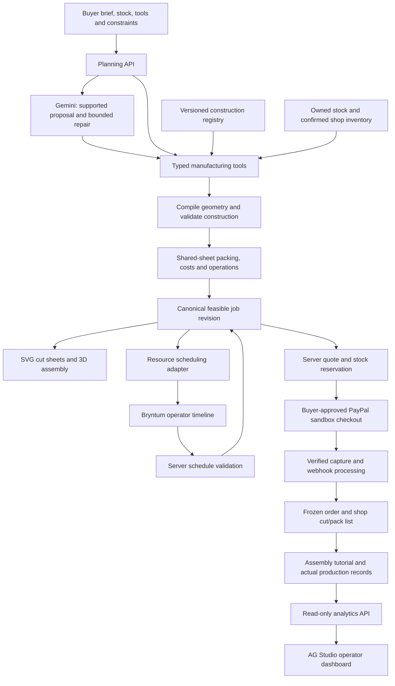

# ScrapDrop manufacturing implementation plan

Revised 26 October 2026, Asia/Kuala_Lumpur.

Implementation status is tracked in [MANUFACTURING_BUILD_REPORT.md](MANUFACTURING_BUILD_REPORT.md); the baseline table below records the starting point before this build.

Status: approved implementation plan. Existing capabilities and verified package setup are distinguished below from proposed work. This replaces the earlier manufacturing proposal; it does not change the user's test/rehearsal guide.

## 1. Product direction

ScrapDrop helps small print shops and market sellers turn measured leftover paper/card into a feasible production job. It connects what to make, what material fits, what to buy, when to make it and how to assemble it.

The central promise is: **Plan a complete batch from what you already have; buy only its verified shortfall.**

The initial audience is a small shop with a limited stock of sheets/offcuts, one cutting station and one or two people. This is bounded paper/card production planning, not universal CAD or machinery control.

The differentiator is a connected calculation: changing the product size or available tool changes the actual construction, parts, shared cutting layout, production operations and purchase lines. AI prose, a generic dashboard and a timeline alone do not establish that connection.

### Demonstration job

A seller needs 12 retail display sets before a deadline. Each set contains one folded price-card holder, two hang tags and one product sleeve: 12 holders, 24 tags and 12 sleeves in total.

The buyer describes the job and supplies missing product dimensions, available sheets, tools, budget and time. ScrapDrop proposes supported constructions, places compatible parts together on sheets, compares feasible plans and quotes the exact confirmed shortfall. After PayPal sandbox checkout, the shop sees the purchased cut/pack list and the buyer receives matching assembly guidance. Recorded production results feed an operator analytics view.

Those demand counts are fixed; sheet counts, savings, time and price must be computed from the entered dimensions and stock. Do not hardcode an impressive outcome.

## 2. What exists today

| Area | Verified foundation | Still required |
| --- | --- | --- |
| Planning and commerce | Owned-first planning, stock/shortfalls, sandbox checkout, saved snapshots and fulfillment | Multi-product jobs with shared-sheet allocation |
| Recipes/tutorials | Existing gift-box, wrap and bookmark flows; dimensions, instructions, progress and 2D/3D fallbacks | Reusable parts/joints supporting additional construction families |
| Production records | Actual outcomes, offcut credits and economics | Per-product outcomes, operation timing and comparable analytics |
| Gemini | Existing fixture/live configuration and contextual assistance | A bounded planning loop that invokes deterministic manufacturing tools |
| AG Studio | ag-studio/ag-studio-react 3.0.0 installed; provider prepared; local licence checker accepts Studio Pro AI trial | Mounted analytics, data adapter and grounded AI integration |
| Bryntum | Scheduler Pro trial and React wrapper 7.3.7 installed; imports bundle; code/build checks pass | Browser runtime/trial check, actual resource schedule and persistence |

Neither sponsor interface is currently complete or mounted. The Bryntum install used the public trial alias with installation scripts disabled; the downloaded Gantt ZIP was not used. Do not change that decision silently if runtime trial initialization fails.

## 3. Tools and boundaries

| Tool | Concrete responsibility | What it does not decide |
| --- | --- | --- |
| Gemini | Interpret a brief, choose supported constructions, explain alternatives and request typed planning calculations | Prices, authoritative geometry, stock truth, payment authorization |
| Deterministic application code | Compile parts, validate joints, pack sheets, calculate shortages, costs and feasibility | Unsupported manufacturing claims |
| AG Studio | Operator dashboard for estimated versus actual output, material use, spoilage, time and contribution | Checkout, geometry validation or source-of-truth record editing |
| Bryntum Scheduler Pro | Visual worker/equipment assignments, working time and dependencies | Unverified machine capability or guaranteed collision-free scheduling without validation |
| Three.js and SVG | Assembly animation and measured cut/fold diagrams from the same recipe | Inventing geometry from a product label |
| PayPal sandbox | Buyer-approved purchase of actual shortfall materials/services and verified payment events | Autonomous buying, escrow or unsupported seller payouts |

Use an ordinary accessible editable table for the first parts/stock editor. Do not add a separate standalone AG Grid dependency merely to fill a sponsor checklist. AG Studio may use its own grid/chart facilities within its supported API.

APIMatic and Channel3 are deferred. No additional service keys or registrations are needed to begin this plan. Keep existing PayPal/Gemini configuration and the installed sponsor packages.

## 4. Buyer and operator experience

One Make workspace, with progressive disclosure rather than a collection of disconnected dashboards:

1. **Describe the batch.** Natural language or manually selected supported products, quantities and dimensions. Separate hard constraints from changes the buyer permits.
2. **Add what you have.** Sheet dimensions/counts, material/thickness/colors, usable offcuts, tools and available working time. Make missing tools explicit.
3. **Compare feasible plans.** Show the resulting objects, owned/new material, measured cut sheets, purchase amount and estimated completion. Explain why an option cannot meet a constraint.
4. **Inspect and purchase.** Select a product/part, inspect assembly and measurements, swap only allowed materials/colors, then buy confirmed shortages through PayPal.
5. **Make and record.** Follow grouped cutting/scoring/assembly guidance, resume progress and record actual output/time/offcuts.

The operator gets a separate Production view with a resource timeline and analytics tabs. Buyers see a concise estimated finish; they do not need to operate Bryntum or AG Studio to complete checkout.

Keep the existing calm visual style with purposeful animation: sheet placements, selected-part highlights, real fold transitions and visible recalculation feedback. Retain keyboard support, reduced motion, printable/2D instructions and mobile cards. Avoid decorative controls without working behavior.

## 5. Shared data and architecture

### Canonical entities

- ManufacturingJob: owner, revision, requested product rows, quantities, deadline, budget, available tools and allowed changes.
- RecipeV2: immutable family/version, bounded parameters, material rules, parts, panels, folds, joints, tool requirements, operation graph and evidence status.
- MaterialLot: owner/shop source, revision, dimensions, usable count, thickness, color and orientation constraints.
- CutPlan: part demand, individual sheet instances, placements, rotations, margins/gaps, used stock and remaining regions.
- ProductionOperation: product/part references, setup, unit time, waiting duration, predecessor IDs and eligible resources.
- ProductionSchedule: working calendar, resource assignments, intervals, validation results and revision.
- FrozenJobSnapshot: recipe versions, dimensions, allocation, accepted plan, quote and schedule assumptions used at purchase/save time.
- ProductionResult: good/spoiled quantities by product, actual hands-on/wait time, purchased-material use and measured reusable offcuts.

All dimensions have declared units, normalized to millimetres internally. Store money in the existing exact-money convention, not binary floating point. Use stable part/operation IDs across views.

Model output is schema-validated declarative data. Formulas remain reviewed application functions; never execute model-generated JavaScript, expressions or arbitrary URLs.

### Proposed code organization

Extend existing code rather than starting a second application:

- src/scrapdrop/manufacturing/: shared types, construction registry/compilers, geometry checks, packing, operations and compatibility adapters.
- server/scrapdrop/manufacturing/: job persistence, orchestration, typed tools, quote adapter and analytics projection.
- server/scrapdrop/MANUFACTURING_AGENT.md: versioned server-loaded planning instructions.
- src/scrapdrop/ManufacturingWorkspace.tsx and shared part/sheet/assembly views.
- src/scrapdrop/ProductionSchedule.tsx: lazy-loaded Bryntum adapter.
- src/scrapdrop/ProductionInsights.tsx: lazy-loaded AG Studio panel using the existing AgStudioScope.tsx.
- tests/: calculation, API, payment and browser acceptance coverage.

Names are proposed implementation boundaries, not a claim these files exist yet. Existing recipes.ts, batch.ts, production.ts, tutorials, server routes/store and payment modules remain the migration starting points.

## 6. Implementation sequence and completion gates

### Phase A — compatibility and sponsor runtime probes

- Establish the current regression baseline and identify saved/purchased v1 snapshot formats.
- Mount an isolated local Bryntum test with one cutter, two jobs and a dependency; check real rendering, engine propagation, React lifecycle and cleanup.
- Verify the trial works with installation scripts disabled. If it does not, inspect documented alternatives before changing installation policy; bundling success alone is insufficient.
- Mount an isolated AG Studio panel with synthetic production records. Verify supported dataset/widget APIs, theme, licence behavior and keyboard interaction.
- Check each optional panel can fail without breaking the Make/checkout flow. Use local data and no Gemini requests in these probes.

Gate: actual browser evidence for both packages, or a documented fallback for the blocked integration. Do not spend the core implementation schedule fighting a sponsor runtime.

### Phase B — recipe engine and three construction families

Implement flat tags/backing cards, folded price-card holders and product sleeves. Start sleeves with one reviewed glued construction. Add locking/no-glue variants only after their geometry and physical operation are established.

Define panels, cut/score lines, holes/tabs/joints and operation dependencies in one representation. Check positive dimensions, part bounds, matching joints, allowances and supported material/tool ranges. For example, tags needing a hole punch must not be presented as tool-complete when it is absent. Offer an explicitly supported alternative or report the missing tool.

Compile the same data to measured 2D and assembled/folded 3D. Parameters and selected material allocation must affect the actual preview and instructions. Unsupported products receive a clear explanation and supported alternatives; do not substitute a box behind an unrelated label.

Gate: each supported request produces its own correct parts, measurements and guide. Untested physical constructions remain marked as prototypes. Physical build trials require the user; software checks cannot prove adhesive performance or stability.

### Phase C — mixed-product planning and economics

Expand set demand into parts, then pack compatible parts together on actual sheet instances using a deterministic rectangle heuristic. Respect margins, gaps, orientation, material/thickness and allowed colors. Bounding rectangles are an initial conservative approach, not arbitrary polygon nesting or a claim of global optimality.

Allocate owned material before confirmed shop stock without assigning any sheet twice. Compare separate layouts against shared layouts with computed counts. Track cut placements and leftover regions; only measured usable offcuts become inventory after production.

Generate grouped operations: cut all relevant blanks, score batches, then assemble/finish. Separate machine occupation, hands-on labor and passive drying. Validate budget/tools and derive time estimates with declared assumptions.

Show material cash avoided separately from contribution after labor, owned-material value, consumables and fees. With zero confirmed shortages, allow a saved making plan without forcing PayPal checkout. If tools are missing, identify the blocker; do not silently add tools to the cart or claim cutting service supplies glue/scissors.

Gate: part counts conserved, no overlap/out-of-bounds placement, no duplicate allocation, and cart lines agree with the plan. A size/quantity/material change invalidates stale calculations and quotes.

### Phase D — useful Gemini planning agent

The server explicitly loads MANUFACTURING_AGENT.md and the supported capability registry; placing a file in the repository does not automatically give Gemini knowledge.

Instructions cover units, supported families, required dimensions, hard constraints, permissible substitutions, tool requirements, uncertainty and when to stop. Gemini chooses a supported construction and parameters, then invokes typed tools such as:

- inspectCapabilities and inspectInventory
- compileRecipe and validateRecipe
- solveSharedSheets
- estimateOperations and validateSchedule
- comparePlans

The server tool functions calculate quantities and constraints. Gemini reads structured violations and may attempt one repair within permitted changes. It returns a feasible proposal or an honest unresolved constraint. Never reduce requested quantity or raise budget without the buyer changing it.

Use one planning run plus at most one repair round per action, bounded further by existing request/token limits and quotas. Reuse fixture/live mode. Cache by normalized request, stock/job revisions, recipe/tool versions and model configuration. Navigation, animation, cell edits and quote calculation make no model calls. Manual planning remains usable during provider failure.

Gate: a non-box brief becomes a real supported plan; a missing tool or changed size triggers an evidenced repair/alternative. Trace actual tool calls for engineering/demo evidence, without introducing an approval workflow into the UI.

### Phase E — buyer workspace and coherent tutorials

Connect the first four buyer steps to the canonical revision. Selecting a part highlights its placement and assembly panel. Edits mark results stale and trigger explicit deterministic recalculation; avoid silent background Gemini calls.

Use real fold hinges, tab placement and supported joints. Keep Back/Next/replay/reset, step progress, measurements and tool reminders. Distinguish owned from purchased materials and skip only purchased outer-blank cutting when that paid service is included. Detailed cutting/scoring and owned-sheet work remain visible.

Save recipe version, selected dimensions/materials and tutorial position. Preserve accessible 2D/print and reduced-motion behavior. Keep v1 saved plans/orders on their original recipe/rendering path.

Gate: supported products, cut diagrams, tutorial and purchased dimensions agree across reload and resume; legacy orders still work.

### Phase F — Bryntum production scheduling

Create resources for the cutting station and available people with working calendars. Map canonical operations and assignments into Scheduler Pro. Use its dependency engine for propagation; do not assume dependency propagation automatically resolves every exclusive-resource conflict.

Validate every schedule change server-side: dependencies, resource capability, working hours, concurrent exclusive use and deadline feasibility. Implement deterministic serial placement for the initial one-cutter workflow. Reject or visibly flag conflicts after drag/resize, with a restore action; do not persist an infeasible schedule as confirmed.

For a job requiring both a worker and cutter simultaneously, reserve both. Passive drying need not occupy a worker but may occupy a declared drying resource. Shared resources across jobs come from the same persisted schedule, with revision checks to prevent two users overwriting availability.

Compare finish time with and without an available paid outer-cutting service only when its actual duration/availability is known. Never invent a guaranteed shop completion time. Scheduling estimates do not silently reserve seller capacity or promise appointments.

Gate: delaying a predecessor shifts its successor; two jobs cannot both claim the exclusive cutter; an infeasible deadline is visible. Refresh and concurrent edits preserve validated state. A simple validated operation list remains usable if Bryntum is unavailable.

### Phase G — exact PayPal shortfall and fulfillment

Adapt composite material/service lines into existing server-authoritative checkout. Freeze job/recipe/allocation versions, recheck price/stock and validate paid-service eligibility. Keep existing reservation expiry, capture recovery, webhook verification and deduplication guarantees.

The buyer explicitly starts and approves sandbox checkout. Only verified server payment state unlocks the corresponding purchased fulfillment. A later edit creates another proposal and cannot rewrite a paid job. Do not advertise multi-seller payout, escrow or an external supplier order.

The shop receives only the purchased cut/pack requirements. The buyer retains owned-material tasks. Collection and production results use the same frozen snapshot; stock/offcut updates are transactional and exactly once.

Gate: mixed job → verified shortfall purchase → matching shop list → collection → matching tutorial → recorded production. Exercise a real sandbox capture/webhook after fixture regressions; report simulated flows separately.

### Phase H — AG Studio production insights

Expose an authenticated, owner/shop-scoped read-only projection of canonical jobs and finalized results. Start with useful views:

- Planned versus completed good units by product/recipe.
- Estimated versus actual hands-on time, with sample counts.
- Spoiled pieces and material utilization using declared measurement methods.
- Purchased material spend and cash avoided shown separately.
- Estimated/actual batch contribution with visible cost assumptions and missing-data states.

Label estimates and actuals distinctly. Avoid combining incompatible units/material types into a misleading yield percentage. Never present seeded demo records as real production evidence.

Wire AG Studio using its documented dataset/widget mechanisms confirmed in Phase A. Add a small operator-facing question entry only after the analytics work: for example, “Which recorded batches took longer than planned?”

Use a server-backed Gemini adapter if Studio's supported runner API permits it; do not assume enabling AgStudioAiModule automatically connects Gemini. Restrict questions to authorized analytics fields, allowlisted aggregate operations and bounded rows. No arbitrary SQL, record mutation, purchases or browser-exposed model secrets. Ground numeric answers in computed aggregates, distinguish insufficient data and cache repeated questions.

Gate: chart/table totals reconcile to records, tenant isolation holds, and an answer cites the job/result basis. If the AI runner API is incompatible, deliver the working Studio analytics and clearly defer its AI question feature rather than mock the integration. Missing/expired licence falls back to ordinary summary cards and tables.

### Phase I — outcomes, physical evidence and release

Record good/spoiled units per product, actual time and measured reusable offcuts. Keep drafts distinct from finalized results. Only use finalized observations to compare/calibrate estimates, with visible sample counts and no unsupported learning claims.

Run broad automated/browser tests before simplifying the user's three-minute practice route. Prepare physical-trial instructions and record actual user-provided observations; do not fabricate a novice trial or completed craft.

Gate: public source/setup/licence, working judge access, truthful tool list, under-three-minute video and an end-to-end sandbox demonstration. No automatic paid subscription or deployment is part of this plan revision.

## 7. Configuration, packaging and fallback

- Keep the existing Gemini fixture/live switch and quotas. No Gemini key in frontend configuration.
- Keep VITE_AG_STUDIO_LICENSE_KEY in ignored .env.local for local builds. It is a browser licence when bundled, not a server secret. Hosted build configuration is separate.
- Add independent UI feature flags for Studio and the resource timeline, with deterministic/core fallback views. Flags alone do not remove dependencies from a build.
- Pin versions/lockfile; lazy-load heavy sponsor code only in the operator view. Do not copy vendor sources/assets into public source or strip trial checks.
- Verify clean npm installation with scripts disabled. Document any required approved vendor initialization before relying on it in Render; do not enable lifecycle scripts globally.
- The AG Studio key was checked as an evaluation licence expiring 10 December 2026. Hosted-use terms and coverage through judging still require confirmation. Bryntum runtime/issued evaluation coverage must also be verified. Retain usable fallbacks beyond trial availability.
- No Channel3, APIMatic or extra AI-service account is required for the committed scope.

## 8. Engineering test coverage

Fixtures first; live Gemini only after deterministic tests pass. Tests should target meaningful calculations/state transitions, not mirror component implementation.

| Layer | Required coverage |
| --- | --- |
| Recipes | Parameter boundaries, dimensions/allowances, joint matching, unsupported tools/materials, correct product geometry |
| Packing | Mixed sizes, allowed rotations, exact margins, holes treated conservatively, no overlaps, conservation, shared-sheet comparison and stock exhaustion |
| Costs/quotes | Exact money, zero shortfall, budget infeasibility, independent cash avoided/contribution, stale quote after revisions |
| Agent | Clarification, supported proposal, one bounded repair, rejected tool arguments, provider failure, cache/quota and no unsolicited live calls |
| Schedule | Predecessors, working calendars, cutter/worker conflicts, simultaneous resource requirements, drying, stale revisions and infeasible deadlines |
| Commerce | Reservation races/expiry, duplicate create/capture/webhook, wrong user, snapshot immutability, fulfillment consistency and exactly-once credits |
| Analytics | Reconciliation, units, missing-data states, seeded labels, authorization, aggregate grounding and model response limits |
| Browser | Full mixed-job flow, manual fallback, part selection, tutorial personalization/resume, two tabs, mobile/keyboard/reduced motion and failed optional panels |
| Compatibility | Existing v1 saved/paid plans, tutorial progress, clean install/build, missing/expired sponsor setup and lazy-load recovery |

Live checks: one bounded Gemini plan/repair scenario, one grounded analytics question if implemented, and one real PayPal sandbox shortfall purchase through fulfillment. Repeat live calls only for a new unresolved failure. Report physical trials and browser/runtime checks separately from software unit tests.

## 9. Evidence against judging criteria

| Criterion | Concrete evidence |
| --- | --- |
| Technological implementation | Gemini invokes real tools; compiled geometry drives cutting/assembly; PayPal verifies an exact shortfall; sponsor panels use real job/results data |
| Design | A clear buyer journey, progressive controls, matching 2D/3D guidance and focused operator scheduling/insights |
| Potential impact | Measured sheet/purchase differences, observed setup/production time and spoilage for a specified small-shop task |
| Innovation | A constrained brief changes supported construction and jointly packed production, then propagates to procurement and making |
| Presentation | One retail-set example, one meaningful change, exact purchase, assembly and recorded results in a concise working demonstration |

The rehearsal should emphasize the causal story, not a tour of every sponsor control. Prepare honest fixture labels and show a physical sample only when actually made. Keep the existing demo guide intact until the expanded implementation has passed its own tests.

## 10. Delivery order and scope control

Build in this order: **runtime probes → recipe/data core → shared cutting/economics → Gemini tools → buyer/assembly flow → Bryntum scheduling → composite PayPal fulfillment → AG Studio insights → full verification/evidence.**

The core vertical slice is one non-box composite job, including shared cutting and exact sandbox shortfall purchase. Finish that before adding many product names or analytics widgets. Three construction families are the initial target; physically verified variants may be fewer until evidence exists.

If a sponsor runtime or licence blocks progress, retain the working core and document the integration as incomplete. Do not replace real functionality with a mock sponsor response or claim an installed package is an integrated feature.

## References

- Project requirements and criteria: https://paypalaihackathon.devpost.com/rules
- AG Studio React licensing/setup: https://www.ag-grid.com/studio/react/licence-install/
- AG Studio sponsor offering: https://paypalaihackathon.devpost.com/details/aggrid
- Bryntum React documentation: https://bryntum.com/products/schedulerpro/docs/guide/SchedulerPro/quick-start/react
- Bryntum public trial repository: https://bryntum.com/products/scheduler/docs-llm/guide/Scheduler/npm/repository/public-repository-access.md
- Bryntum sponsor offering: https://paypalaihackathon.devpost.com/details/bryntum
- Local setup evidence: AG_STUDIO_SETUP.md and BRYNTUM_SETUP.md.
