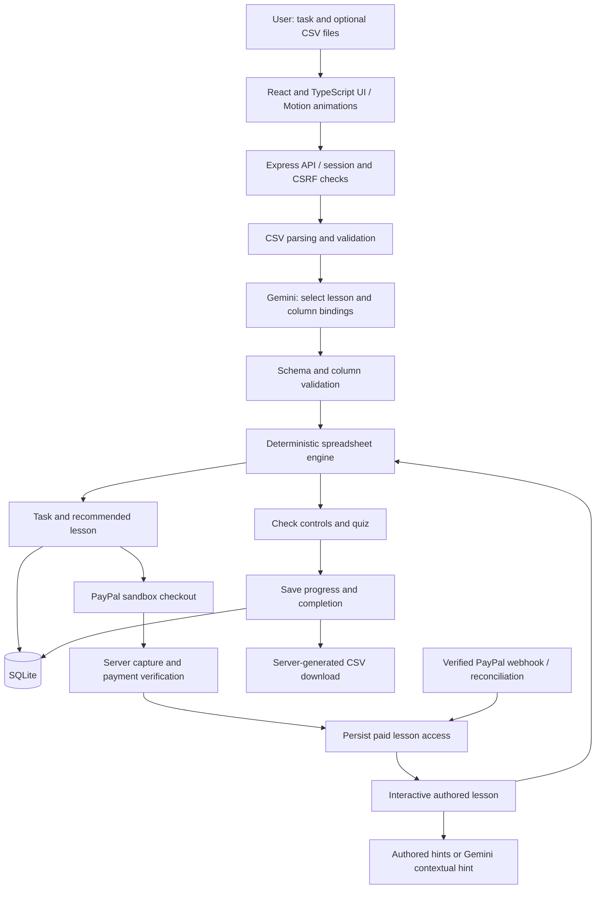

# TaskSlice — test results and architecture

Test date: 23 October 2026. Provider: Google Gemini (`gemini-3.5-flash-lite`). Payments: PayPal sandbox only.

## Verified results

| Check | Result | Evidence and scope |
|---|---|---|
| Automated suite | 25 passed, 0 failed, 0 skipped | Unit, HTTP integration, and opt-in live PayPal order test |
| Production build | Passed | TypeScript check plus Vite production assets |
| Sales lesson | Passed via HTTP | Live AI task matching, demo access, exercise completion, saved progress, safe CSV export |
| Table matching lesson | Passed via HTTP | Same full lesson journey with two sample tables |
| Exception lesson | Passed via HTTP | Same full lesson journey with numeric threshold checking |
| Session isolation | Passed | Another session cannot read tasks/exercises |
| Completion and access gates | Passed | Unpaid and incomplete exports blocked; stale edits rejected |
| CSV arithmetic and safety | Passed | Exact decimal sums, missing data, unique lookup keys, boundaries and formula escaping |
| Gemini structured task analysis | Passed live | Real model responses validated against schema and actual columns |
| Gemini contextual hint | Passed live through HTTP | Real contextual hint returned with AI source |
| AI failure handling | Passed with simulated responses | Truncated output rejected; thought parts excluded; provider diagnostics hidden |
| PayPal app credentials | Passed live | OAuth and unpaid sandbox order creation succeeded |
| PayPal idempotency and order lookup | Passed live | Same retry key returns the same local and PayPal order |
| Sandbox demo bypass | Blocked as expected | Demo access returns 403 in sandbox mode |
| Capture validation | Passed with fixtures | Wrong amount/currency/seller and pending status cannot unlock access; repeated captures grant once; late completion cannot restore refunded access |
| Browser checkout | Passed up to final purchase | Chrome loaded the PayPal SDK, created an order, accepted sandbox buyer login and showed USD 2.00 purchase review |
| Browser payment capture and paid unlock | Not completed | Automatic approval review rejected final purchase submission, requiring explicit authorization; no workaround attempted |
| Actual webhook delivery and refund lifecycle | Not verified | Public HTTPS webhook URL and webhook ID have not been configured |

Test databases were separate temporary files, preserving the main app database. Tests created unpaid PayPal sandbox orders. No real-money payments were made. Browser login was performed through computer-use automation; it is not yet a committed, unattended browser regression suite.

## Architecture



### 1. Browser and application server

React renders the task form, lesson recommendation, checkout dialog, practice controls, hints, quiz and learning library. Motion provides animations. Vite produces static frontend assets, served by Express in production. Express also owns every `/api` operation.

A guest session cookie identifies the learner. The database stores a hash of the random cookie token. Mutating requests require an origin check and a session-specific CSRF token. Tasks, exercises and orders are scoped to their owning learner. Clearing cookies loses access to that guest identity; there is no permanent user-account recovery yet.

### 2. Task analysis

`POST /api/tasks` accepts a goal plus sample selection or up to two CSV files. The parser enforces the supported file, row and column constraints, preserves leading-zero identifiers and infers conservative column types.

The server sends Gemini the goal, column IDs/types and up to five sample rows per table. When sample sharing is disabled, it sends the goal and schema without cell values. The key stays on the server. Gemini returns JSON selecting one of three authored lessons and proposing bindings. Zod validation and checks against the actual columns run before the deterministic engine validates the requested operation. Unsupported or ambiguous tasks must be resolved before purchase.

Gemini interprets intent and explains concepts. The spreadsheet engine computes results using decimal arithmetic. Fixed catalog code sets lesson prices. AI does not grant purchases or mark a lesson passed.

### 3. Checkout and access

The browser loads PayPal's JavaScript SDK with the sandbox app Client ID, which is designed to be public. The app Client Secret stays on the server.

`POST /api/orders` creates a fixed-price USD 2.00 sandbox order. A request key makes retries idempotent. The server identifies the seller from PayPal's order data and persists it; `PAYPAL_MERCHANT_ID` is an optional explicit seller check.

The buyer signs into PayPal's sandbox directly. Following approval, the browser asks `POST /api/orders/:id/capture` to capture. The server queries PayPal and checks capture status, amount, currency and seller before recording payment and granting lesson access in a database transaction.

Repeated capture requests cannot create duplicate grants. Pending or uncertain payment stays locked until reconciliation confirms it. A worker runs every 30 seconds to reconcile uncertain orders. Verified webhook processing supports completion, refunds and reversals, but actual delivery has not been exercised without public HTTPS configuration.

### 4. Learning and export

`POST /api/exercises` checks lesson access before opening an exercise. The UI uses the shared deterministic engine to show immediate previews. Edits save with a revision number to reject stale writes.

`POST /api/exercises/:id/check` recomputes the result and checks the chosen controls and authored quiz answer on the server. Progress and completion are saved. `GET /api/exercises/:id/export` requires access and completion, then recomputes and exports CSV with formula-like cells escaped.

`POST /api/exercises/:id/hints` serves authored hints; a custom question invokes Gemini using the lesson context and an authored hint.

### 5. Storage and secrets

SQLite stores sessions, tasks, datasets within task records, exercises, orders, access grants, captures, webhook events and rate counters. The main store is local `.data/taskslice.sqlite`. The cleanup worker removes tasks/exercises older than seven days and expired sessions/rate counters. This is a local, single-instance architecture; permanent accounts, shared storage and horizontally scalable rate limits require further work before a larger deployment.

`.env` holds server API configuration. `.env.test.local` holds sandbox browser-test account details and is not automatically loaded by the app. Both are ignored by Git and have owner-only filesystem permissions. Secrets are excluded from the source archive.

## Gemini limits

The key works; that does not mean unlimited usage or establish the project's billing tier.

Google enforces requests per minute, input tokens per minute and requests per day, with model- and account-specific quotas. Limits apply per Google project, so making another key in the same project does not increase allowance. Daily request quotas reset at midnight Pacific time. Exceeding quota returns a rate-limit error, commonly HTTP 429 / RESOURCE_EXHAUSTED.

Exact active quotas must be viewed while signed into the associated project at https://aistudio.google.com/rate-limit. They cannot be inferred from a successful generation request. Google documents that actual capacity can vary.

TaskSlice currently allows 20 task requests per hour per learner and 30 hint requests per hour per learner. These are app limits, independent of Google's shared project quota. Each successful task analysis uses one Gemini request; each custom hint uses another. Authored hints, spreadsheet previews, checking and CSV export do not call Gemini. Analysis caps output at 4,096 tokens, hints at 2,048, with a 20-second request timeout. There is no automatic provider retry/backoff or project-wide token budget yet.

Google offers free access to selected models within quota; the dashboard determines the project's actual free/paid status. Do not enable billing solely to run these tests. Free-tier data can be used for product improvement under Google's terms, so use synthetic data while developing.

Sources:
- https://ai.google.dev/gemini-api/docs/rate-limits
- https://ai.google.dev/gemini-api/docs/billing
- https://ai.google.dev/gemini-api/docs/pricing

## Repeat the tests

Run the app in two separate instances using separate test databases: a demo instance for all lesson journeys and a sandbox instance for the live unpaid-order test. Set the appropriate ports and `APP_BASE_URL` values. The demo HTTP test uses real Gemini when its server loads the Gemini key.

```sh
TEST_BASE_URL=http://127.0.0.1:4318 TEST_SANDBOX_URL=http://127.0.0.1:4319 npm test
npm run build
```

Without these test URLs, the integration tests are intentionally skipped. The sandbox test creates an unpaid order and never approves/captures it. Browser buyer login, purchase approval, cancellation, refund and webhook delivery need separate browser/service checks.
