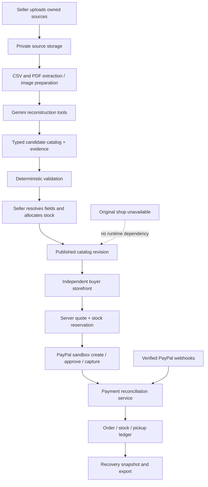

# RestoreCart — implementation plan

Status: proposed implementation, not built or deployed. Prepared 27 October 2026.

Companion: [Scenario cases and verification](./SCENARIO_CASES.md).

## 1. Product decision

**RestoreCart reconstructs a small seller's catalog from available business records, opens an independent temporary shop, accepts PayPal sandbox payments and produces a recovery package.**

Primary audience: a small seller with simple physical products, an unavailable or broken storefront, and some surviving product records. Start with local pickup and a single merchant.

The specific promise is business continuity for a supported catalog, not automatic repair of a broken website. Customers reach the rescue shop through a link or QR code that the seller shares. RestoreCart cannot redirect an inaccessible original domain unless the owner can change that domain's routing. It cannot take online payments without internet access or while PayPal itself is unavailable.

### The central demonstration

A seller's original shop is unavailable. An older catalog lists a blue mug at $18, while a newer stock spreadsheet lists it at $20. Gemini connects the matching SKU, exposes the disagreement and presents evidence. The seller chooses $20 and allocates three mugs to the rescue shop. A customer buys two mugs and a tote for $52 through PayPal sandbox. RestoreCart records the verified payment, reduces available emergency stock, provides pickup information and exports the paid order for recovery.

### What distinguishes the proposal

The complete cycle is the intended contribution:

`mixed surviving records → source-backed reconstruction → isolated stock allocation → independent selling → recovery handoff`

AI store builders and backup products already exist. Do not claim that catalog extraction, storefront generation or backups are new. RestoreCart must demonstrate the continuity cycle and its difficult cases, not depend on an unsupported claim that no competitor exists.

## 2. First-release boundaries

| Include | Defer |
| --- | --- |
| One configured sandbox merchant and one currency, USD | Multiple unrelated merchants and seller onboarding |
| CSV inventory, text-based PDF catalog and JPEG/PNG source images | Arbitrary website scraping, remote URL fetching and password-protected source imports |
| Simple products and explicit variants identified by SKU | Bundles with component inventory, subscriptions, preorders and made-to-order goods |
| Source evidence, proposed matches and correction UI | AI making final commercial decisions without the seller |
| Explicit emergency stock allocations | Claims of real-time inventory from an offline original store |
| Fixed-layout responsive temporary shop | AI-generated arbitrary storefront code |
| Pickup-only checkout with explicit location and instructions | Carrier shipping, delivery estimates and international tax calculation |
| Reservations, verified PayPal capture and pickup fulfillment | Production payment processing |
| Canonical recovery CSV/JSON, manifest and reconciliation report | Automatic Shopify/WooCommerce writeback |
| Explain a reconstruction decision using its source evidence | A general-purpose chatbot on every screen |

For the sandbox prototype, explain that demo prices include any assumed applicable tax and no delivery charge. Do not imply that this is a tax-compliant production checkout. Production tax configuration, privacy policy, consumer terms and jurisdiction-specific requirements need separate work.

Do not rename, delete or overwrite existing ScrapDrop functionality or data during planning. Implement in a separate module and database. Repository naming, final deployment URL and retirement of old routes are later explicit release decisions.

## 3. Merchant setup and hard prerequisites

The first release uses the project owner's configured PayPal sandbox business account as the sole merchant. A RestoreCart login does not connect an arbitrary seller's PayPal account. This limitation must appear in setup documentation and the hosted judge demo.

Required inputs:

- Existing PayPal sandbox app client ID and secret, kept server-side.
- A sandbox personal buyer account for interactive checkout. Its password is entered only into PayPal's sandbox sign-in page or a private local browser-testing configuration.
- A public HTTPS webhook listener registered to the same sandbox REST app; its webhook ID configured locally and on the host independently.
- A Google AI Studio/Gemini key for the limited live-AI verification and live demo, with an explicitly chosen supported model.
- Deployment storage that preserves the database and uploaded sources across restarts.
- Seller-owned or permissioned sample documents and product images.

No AG Studio, Bryntum, Channel3 or other sponsor account is required for this scope. A normal editable table is sufficient initially. Existing trial components should not be carried into the release merely to increase the tool count.

**Blockers and honest fallbacks:**

| Blocker | Behavior |
| --- | --- |
| Gemini unavailable or quota exhausted | Preserve source files and edits; allow CSV mapping/manual reconstruction; label AI unavailable |
| Image or PDF cannot be read reliably | Mark unresolved fields; ask for a clearer source or manual entry |
| PayPal configuration missing | Catalog reconstruction and preview work; purchase actions disabled with a setup explanation |
| Public webhook unavailable | Local development can query canonical payment status; hosted final verification still requires real webhook testing |
| Original platform unavailable | Continue the rescue shop using allocated stock; offer recovery export, not fabricated synchronization |
| No trustworthy stock count | Require a manually checked emergency allocation before enabling that variant |

## 4. User experience

### Seller navigation

Use four named destinations: **Reconstruct**, **Rescue shop**, **Orders**, **Recover**. Avoid an additional generic workspace or overlapping planning pages.

1. **Reconstruct your catalog.** Drag in sources or select a clearly labeled example. Show import progress and recoverable errors.
2. **Resolve what matters.** Display product cards/table with name, SKU, price, options and evidence. Put unresolved price, currency, identity and stock issues first. Clicking a field opens its page, crop or CSV row reference.
3. **Set emergency stock.** Show original reported stock separately from the quantity allocated to this shop. Seller confirms the physical allocation and pickup terms.
4. **Open your rescue shop.** Preview mobile/desktop and publish. Provide link, QR code and a short seller-copyable announcement. Never send that announcement automatically.
5. **Handle orders.** Paid, checking payment and ready/collected states are explicit. A payment still being checked never looks paid.
6. **Recover.** Close new checkouts, reconcile outstanding payments, then download a versioned recovery package. Show remaining allocation and any unresolved cases.

Publication is a normal seller action, not a multi-person approval workflow. Once required fields are resolved, the seller can publish directly.

### Buyer experience

`rescue link → product/variant → cart → pickup details → PayPal sandbox → verified receipt → pickup instructions`

Show business name, temporary-store explanation, pickup terms, full total and stock availability. The sandbox environment remains visible in the judge demo. Do not display recovery internals or AI prompts to buyers.

### Interaction and visual design

- A branded recovery story: source fragments become structured product cards, then a usable shop. Animate actual state changes rather than simulate analysis with a timer.
- Source comparison is the signature visual interaction: selecting a price reveals the competing source and highlights the chosen value.
- Smooth cart feedback, responsive stock badges, publish transition and clear payment progress.
- Keyboard operation, visible focus, adequate contrast, labels for icon actions and reduced-motion support.
- No decorative 3D view: it adds little to this product. Reuse animation components where useful, not paper-box geometry.
- Loading failures, empty catalog, unresolved products, sold out, closed shop and reconciliation delays all need designed states.

## 5. Architecture



Keep a React/Vite client, Express server, SQLite storage and typed shared contracts. A single server instance with persistent disk is sufficient for the hackathon prototype. Do not run multiple writers against separate local database copies. Scaling to multiple instances requires a shared transactional database and worker coordination.

Proposed module layout in the existing source repository:

```text
server/restorecart/
  routes.ts                 # authorization and request contracts
  store.ts                  # migrations and transactions
  sources.ts                # upload limits, hashing, private serving
  extract.ts                # CSV/PDF parsing and image preparation
  reconstruction.ts         # bounded Gemini orchestration
  RECONSTRUCTION_AGENT.md   # server-loaded instructions, versioned
  tools.ts                  # typed, non-financial planning tools
  catalog.ts                # field resolution and immutable revisions
  inventory.ts              # allocations, holds and ledger operations
  payments.ts               # PayPal orchestration and reconciliation
  recovery.ts               # close/freeze/export workflow
src/restorecart/
  RestoreCartApp.tsx
  Reconstruct.tsx
  SourceComparison.tsx
  EmergencyStock.tsx
  Shop.tsx
  Checkout.tsx
  Orders.tsx
  Recover.tsx
  contracts.ts
tests/restorecart/
  fixtures/                 # owned sample sources, expectations
  extraction.test.ts
  reconstruction.test.ts
  inventory.test.ts
  payments.test.ts
  recovery.test.ts
  http.e2e.test.ts
  browser.e2e.*
restorecart.config.json      # non-secret feature settings
```

This is a proposed layout, not a statement that these modules currently exist. Confirm test discovery includes nested tests when adding them; the existing package test command only matches tests/*.test.ts.

### Existing code inspected on 27 October

| Existing foundation | Reuse decision |
| --- | --- |
| server/paypal.ts | Adapt sandbox OAuth transport, request IDs, capture observation and signature verification; inspect and harden errors and merchant validation |
| server/scrapdrop/payments.ts | Reuse design patterns for unknown outcomes and reconciliation, not material-kit assumptions |
| server/scrapdrop/store.ts | Reuse transaction/hold/ledger patterns; define separate RestoreCart records |
| server/index.ts | Review session, CSRF and webhook routing before mounting new routes; do not assume session identity equals seller authorization |
| server/ai-mode.ts and scripts/ai-mode.ts | Adapt fixture/live/off behavior and existing test transport injection |
| React, Motion, Zod, decimal.js, PapaParse | Reuse where appropriate; money remains integer cents in domain records |
| Existing manufacturing MCP implementation | Reuse bounded-tool orchestration patterns only; no manufacturing tools in the new product |

No existing code was changed or tested as part of this planning document.

## 6. AI behavior: substantial, bounded and observable

### Reconstruction agent's actual task

The server loads RECONSTRUCTION_AGENT.md explicitly. That file defines supported source types, SKU matching rules, unit/currency rules, evidence requirements, ambiguity handling and a ban on inventing commercial facts.

The agent iteratively uses these typed tools:

| Tool | Purpose |
| --- | --- |
| inspectSources | List source IDs, types, hashes, available text/pages and seller-provided dates |
| readSourceSection | Read a bounded section or prepared image from an uploaded source |
| proposeProductMatch | Suggest that source records describe the same product or variant, with reasons |
| proposeField | Propose a field value with exact source references |
| validateDraft | Receive deterministic errors for missing identifiers, invalid amounts and contradictory fields |
| summarizeUnresolved | Explain remaining conflicts and the specific seller input needed |

The agent can reconstruct and revise a draft. It cannot publish the store, allocate inventory, create/capture/refund payments or write into the original business platform. These tools are internal typed functions initially. An external MCP server is optional and must not become a dependency just for branding the product agentic.

### Field and identity policy

- Strong same-SKU evidence can propose a match. Similar names, colors or photos alone cannot silently merge variants.
- Record each candidate's source ID, page/row, quoted supporting excerpt where available, document hash and method: parsed, AI-inferred or seller-entered.
- A newer-looking date is context, not automatic authority. Distinguish a seller-supplied source date from upload time; do not call upload time the document date.
- Never infer live quantity from an old catalog or image. Never invent price, currency, material, warranty, pickup address or variant availability.
- Conflicting price, currency or identity blocks the affected variant until resolved. Unrelated valid variants can publish; a catalog with zero valid variants cannot publish.
- Vision-derived evidence includes an image/page reference and crop coordinates if supported. Highlighting is an aid, not proof that OCR was correct.
- Use uncertainty labels, not an unexplained model-generated accuracy percentage.
- Re-running extraction must not silently replace a seller's resolved value. Show new evidence as a proposed revision.
- Product/source text is untrusted data. Instructions embedded in a PDF must never become system instructions or tool permissions.

### Call budget and modes

Proposed config:

```json
{
  "ai": {
    "mode": "fixture",
    "maxModelCallsPerRun": 6,
    "maxToolCallsPerRun": 16,
    "maxRunSeconds": 90,
    "cacheEnabled": true
  },
  "payments": { "environment": "sandbox" },
  "shop": { "currency": "USD", "fulfillment": "pickup" }
}
```

Modes: fixture for automated tests and deterministic examples; live for deliberate Gemini runs; off for manual import only. Runtime validation rejects unknown mode values and live payment hosts. Secrets remain in ignored local/host environment configuration, never this JSON file.

Cache by source hashes, extracted text hash, instruction version, schema version and model identifier. Changes to relevant inputs invalidate the cache. Navigation, sorting, stock arithmetic, checkout, export and animation make no Gemini calls. Cache an explanation of a resolved field against its evidence version. Display fixture/live/manual labels honestly.

Initial proposed source limits: 10 files per reconstruction, 5 MB per file, 20 MB total; 10 PDF pages per run; 500 CSV rows; 50 published variants. Validate limits before AI calls. Detect likely scanned PDFs and route only supported pages through vision; do not assume a text parser can read scans. Confirm the chosen model's capabilities in a small live test before relying on them.

## 7. Data contracts and isolation

Use a separate restorecart.sqlite database initially. Every seller-owned record has merchant_id and every API operation verifies ownership. The sandbox release provisions one allowed merchant; visitors cannot register themselves as additional payees.

| Entity | Essential fields |
| --- | --- |
| Merchant | id, owner_user_id, configured_payee_id, display_name, pickup_terms |
| RescueIncident | id, merchant_id, slug, state, opened_at, closed_at |
| Source | incident_id, private_storage_key, hash, mime, date_metadata, extraction_state |
| ReconstructionRun | source_set_hash, agent/schema/model_versions, mode, status, budget_usage |
| FieldEvidence | candidate_id, field, proposed_value, source_id, location, excerpt, method |
| Product / Variant | id, merchant_id, sku, option_values, resolved_fields, resolution_version |
| CatalogRevision | incident_id, immutable validated product snapshot, created_at |
| StockAllocation | incident_id, variant_id, allocated_units, seller_counted_at, revision |
| Reservation / Lines | order_id, variant_id, units, hold_state, expires_at |
| Order / Lines | incident_id, catalog_revision, immutable prices/terms, payment_state, fulfillment_state |
| PaymentAttempt | local request key, PayPal order ID, capture ID, amount/currency/payee, observed state |
| WebhookInbox | unique provider event ID, verification outcome, processing state, retry metadata |
| StockLedger | unique event key, variant, units, operation, order_id, created_at |
| RecoveryExport | incident_id, snapshot watermark, content hashes, schema version, generated_at |

Use integer cents for USD amounts and bounded positive integers for quantities. Enforce unique merchant/SKU mappings, provider order IDs, capture IDs and ledger event keys. Keep refunded amounts as separate financial movements rather than overwriting original captures.

Public storefront responses expose only published product data and sellable availability. Source documents, conflicts, cost information, raw payment payloads and other buyers' details stay private. Buyer order lookup uses an authenticated session or an unguessable scoped receipt token; never sequential IDs alone.

## 8. Emergency stock and payment correctness

### Stock rules

`sellable = allocated + explicit restocks - committed sales - active holds - capture-locked holds - explicit withdrawals`

All terms refer to this rescue incident, not the seller's entire physical warehouse. Validate non-negative availability transactionally. Do not subtract committed holds and committed ledger sales twice.

- A reservation is created with a server-priced immutable order snapshot in one transaction. Suggested ordinary hold duration: 10 minutes.
- On capture initiation, atomically move the hold to capture_locked. Ordinary expiry must not release a capture_locked or unknown-payment reservation.
- A confirmed successful capture commits stock exactly once. A confirmed failed/uncaptured canceled order releases its hold exactly once.
- Never reduce an allocation below already sold plus held units. Increasing it requires the seller to confirm newly allocated physical stock.
- If the seller keeps using the original shop, that shop must exclude the emergency allocation. RestoreCart cannot enforce this without a connector; explain the physical allocation requirement clearly.
- A refund does not automatically put goods back in stock. The seller separately confirms that returned/canceled goods are available for resale.
- Already paid orders use their original price and terms after a catalog revision. Invalidate unapproved/unlocked checkouts when price terms change; capture-locked attempts keep their immutable snapshot and remain reconcilable.

### PayPal integration

Use sandbox Orders v2 with server-owned create/capture requests. Buyer approval is required through PayPal. The browser never decides the amount, payee or paid state.

1. Validate shop state, selected variants, current catalog revision and pickup terms.
2. Reserve inventory and create a local order with a stable client request key.
3. Create the PayPal order with a stable provider request ID for that operation. Store the mapping before returning approval details where possible; ambiguous creation outcomes remain recoverable.
4. After buyer approval, lock the reservation and capture server-side using a separate stable request ID.
5. Confirm canonical capture status, amount, currency, expected configured merchant and local order mapping before committing the sale.
6. If the request times out, show **Checking payment** and reconcile the existing provider order. Do not create another charge or release its stock merely because a timer elapsed.
7. Process verified webhook events through the same reconciliation path. Unknown or out-of-order events cannot turn an unpaid order into a fulfilled order.
8. Only a verified paid order can become ready for pickup or collected. Collection is idempotent.

Relevant event subscriptions: PAYMENT.CAPTURE.COMPLETED, PAYMENT.CAPTURE.PENDING, PAYMENT.CAPTURE.DENIED, PAYMENT.CAPTURE.REFUNDED and PAYMENT.CAPTURE.REVERSED. CHECKOUT.ORDER.APPROVED may trigger a status check but does not itself prove payment. Confirm exact supported events against current documentation during implementation.

Payment states: creating, awaiting_buyer, capture_requested, pending, needs_reconciliation, paid, failed, canceled. Financial adjustments (refund/reversal) are separate records. Fulfillment states: not_ready, ready, collected, canceled; financial exceptions can block uncollected fulfillment without erasing history.

Deduplicate webhook events by ID and persist accepted work durably. Do not return success before a valid event has a durable processing record. Payment reconciliation runs on startup and on a bounded recurring worker; persisted retry state survives host restarts.

Full sandbox refund support is required for an uncollected order: merchant action, idempotent refund request, verified outcome, recorded financial adjustment and separate restock choice. Partial-refund initiation is deferred, but an externally initiated partial refund must be recorded accurately and flagged for handling. No email notification or external message is sent automatically in this release.

## 9. Recovery handoff

Incident states:

`draft → live → closing → closed`

- Closing stops new checkout reservations and publication edits. Existing capture-locked/pending orders stay visible and are reconciled.
- Cancel and release safe unapproved holds. Do not discard an ambiguous payment.
- Show an explicit count of unresolved payment cases. A final recovery snapshot is blocked until these are resolved; a clearly marked provisional export may include them separately.
- In one database transaction, create a consistent snapshot watermark and manifest. Later refund/fulfillment changes require a new version or delta export; downloading the same export again does not mutate anything.
- The final package contains orders.csv, order-lines.csv, inventory.csv, financial-adjustments.csv, unresolved.json and manifest.json. Include incident ID, local order ID, SKU, quantity, price, currency, PayPal IDs, fulfillment state and export schema version.
- Inventory export describes remaining emergency allocation and ledger totals. It must not claim that it is the original store's full current inventory.
- CSV cells are escaped and spreadsheet-formula injection is neutralized; canonical JSON preserves exact original values where necessary.
- Provide an explicit reconciliation checklist: match on external order/capture ID, import only once, verify totals, restore stock allocation carefully, then archive the rescue link.

For the hackathon, an optional **original-store test adapter** can import the package and demonstrate idempotent handoff. Label it as our test adapter, not Shopify. Exporting a package alone does not mean an external store has been updated. Keep the primary claim to supported export until a real connector is implemented and verified.

Closed shops show a seller-provided verified original-store link and retain existing receipts. Final export may include paid but uncollected orders; recovery must preserve their pickup obligations.

## 10. Proposed API surface

| Method and route | Responsibility |
| --- | --- |
| POST /api/restorecart/incidents | Create incident for configured merchant |
| POST /api/restorecart/incidents/:id/sources | Validated private upload |
| POST /api/restorecart/incidents/:id/reconstruction-runs | Start bounded reconstruction; return run ID |
| GET /api/restorecart/reconstruction-runs/:id | Progress, proposed fields and unresolved issues |
| PATCH /api/restorecart/incidents/:id/catalog | Resolve fields with optimistic revision check |
| PUT /api/restorecart/incidents/:id/allocations | Validate physical emergency allocation |
| POST /api/restorecart/incidents/:id/publish | Validate and publish immutable catalog revision |
| GET /api/restorecart/shops/:slug | Public published catalog and availability |
| POST /api/restorecart/shops/:slug/orders | Quote, reserve and create sandbox checkout |
| POST /api/restorecart/orders/:id/capture | Authorized buyer action; server-controlled capture |
| GET /api/restorecart/orders/:id | Scoped canonical receipt/status |
| POST /api/paypal/webhook | Existing listener adapted to dispatch verified RestoreCart mappings |
| POST /api/restorecart/orders/:id/refunds | Merchant-only full sandbox refund |
| POST /api/restorecart/orders/:id/fulfillment | Merchant-only ready/collected transition |
| POST /api/restorecart/incidents/:id/close | Stop new reservations and settle closing work |
| POST /api/restorecart/incidents/:id/exports | Generate immutable recovery snapshot |
| GET /api/restorecart/exports/:id | Owner-authorized artifact download |

All mutations require role checks, CSRF protection where cookie-authenticated, schema validation, request limits and stable error codes. Public checkout has abuse limits. Uploads are private, format-checked, stored with generated filenames and never executed. Do not fetch arbitrary links found in source files.

## 11. Implementation phases and acceptance gates

### Phase A — preserve foundation and establish contracts

- Inspect applicable repository instructions and current changes before editing.
- Add isolated module/database, feature routing and single-merchant authorization.
- Define evidence, product, stock, payment and export schemas.
- Build deterministic sample sources and expected outputs from the companion document.
- Gate: original app data is untouched; nested tests are discovered; cross-owner access fails.

### Phase B — usable reconstruction without live AI

- Implement uploads, CSV mapping, PDF extraction and source previews.
- Add candidate catalog, provenance and conflict-resolution UI using fixtures.
- Add manual fallback and selective publication validation.
- Gate: the sample price conflict can be resolved; missing SKU/price/currency cannot silently publish; seller edits survive retry.

### Phase C — bounded live Gemini reconstruction

- Add server-loaded instructions, typed tools, loop limits, structured validation and hash cache.
- Add useful field explanation and honest uncertainty/error states.
- Run fixture/contract tests first, then a minimal live extraction and a changed-input run to verify invalidation.
- Gate: outputs cite actual source locations, ambiguous variants remain separate and no commercial fact is fabricated. Record actual model/call counts.

### Phase D — emergency shop, inventory and PayPal

- Build allocation UI, published storefront, cart, reservation and order snapshots.
- Adapt sandbox OAuth/create/capture/webhooks/reconciliation; add full refund and pickup states.
- Gate: last-unit concurrency, timeout-after-success, duplicate events, restart recovery and wrong-payee checks pass before an interactive sandbox checkout.
- Run a real buyer-approved sandbox transaction and verify it from server and webhook evidence. A mocked provider test does not satisfy this gate.

### Phase E — closure and recovery

- Implement closing behavior, reconciliation queue, immutable exports and financial adjustments.
- Add readable recovery summary and optional test adapter with duplicate-import protection.
- Gate: package totals match the ledger; second download/import never duplicates an order; unresolved payments block final export.

### Phase F — polish, evidence and release

- Complete mobile, keyboard, reduced-motion and error-state checks.
- Run the full scenario suite; report automated fixtures, browser checks, live Gemini and real sandbox checks separately.
- Test with at least two novice participants using the same short scenario, recording observed difficulties and time to completion. Report as small-sample usability evidence, not proof of revenue saved.
- Publish judge setup instructions, sandbox account guidance through a suitable private configuration, license and a hosted judge-safe dataset. Keep merchant controls behind authorization.
- Record a sub-three-minute end-to-end demo. Clearly identify any simulated outage or test adapter.
- Only after implementation verification decide whether to replace the current deployment or publish RestoreCart separately. No automatic GitHub push or deployment is part of drafting this plan.

## 12. Test and evidence strategy

See SCENARIO_CASES.md for exact cases and expected values.

Testing order: pure-domain tests → HTTP/integration tests with injected providers → browser journeys → deliberate live Gemini runs → interactive PayPal sandbox transaction/webhook/refund checks → deployment smoke test.

- AI fixture mode is the default for tests. Disable network access for deterministic suites so accidental Gemini calls fail loudly.
- Provider fixtures cover faults that are difficult to force reliably in PayPal sandbox. Mark them simulated in reports.
- Browser tests must include different source types, conflicting prices, stock quantities, carts and screen widths, not just the happy path.
- Evidence reports include source hashes, catalog revision, config mode, assertions, timestamps, local/provider IDs and redacted errors. Never include keys, passwords, full private sources or unnecessary buyer personal details.
- No test is described as passed until it has actually run. This document contains a test plan, not test results.

Definition of done: a novice seller reconstructs the supplied catalog, publishes only validated variants, completes an actual sandbox purchase, fulfills pickup and exports a consistent recovery package. All P0 cases pass. AI results and payment outcomes are inspectable without trusting animation or a success toast.

## 13. Impact and hackathon presentation

Measure actual time from starting import to publishing, field-correction effort, extraction accuracy on the fixed fixture, completed sandbox order value, duplicate/oversell prevention and recovery consistency. Label transaction amounts as sandbox values; do not call them real revenue or estimated profit.

The source site in the demo is a controlled example that we deliberately make unavailable. Never imply that we caused, detected or repaired a real third-party outage. Demonstrate that the rescue shop continues operating when that original example endpoint fails and that it has no runtime dependency on it.

Potential business model to validate later: continuity subscription or per-incident fee. Do not build a second billing system for that model during the prototype; PayPal already has a central role in buyer purchases and their verified order lifecycle.

Judge access must remain free and usable during judging. Provide a safe sample reset for each judge; it must never reset real records, completed payment history or another judge's active incident.

## 14. References and interpretation

- [Hackathon official rules](https://paypalaihackathon.devpost.com/rules): PayPal integration and AI are required; PayPal must be central. The five equally weighted criteria inform the demonstration, but no implementation guarantees a prize.
- [Hackathon resources](https://paypalaihackathon.devpost.com/resources): additional sponsor tools are optional; choose tools for the product's needs.
- [PayPal Orders v2](https://developer.paypal.com/api/orders/v2): basis for server-side order creation and capture.
- [PayPal webhook overview](https://developer.paypal.com/api/rest/webhooks/): register against the configured app, verify authenticity and handle repeat delivery.
- [PayPal idempotency](https://developer.paypal.com/api/rest/reference/idempotency/): use supported request IDs and account for provider retention limits; local unique constraints remain necessary.
- [Jotform AI Store Builder](https://www.jotform.com/products/store-builder/ai/): existing catalog-to-store competition.
- [Rewind advanced restore](https://help.rewind.com/hc/en-us/articles/47450284128155-How-to-restore-an-entire-Shopify-store-Advanced-Restore): existing backup/restoration competition.

Documentation and exact provider behavior must be checked again when implementing. Architecture and module names in this document are proposals.
